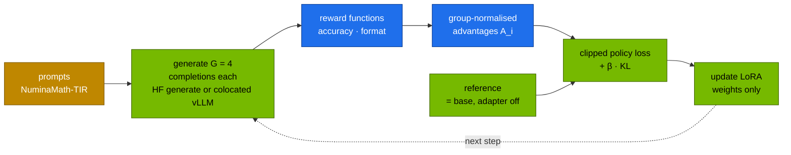

# Chapter 08 · PEFT & Alignment: LoRA/QLoRA, DPO, SimPO, GRPO

> **04-Qwen · Part III — Fine-tuning · Chapter 08 of 14** · ← [Chapter 07 · ms-swift & supervised fine-tuning](07-ms-swift-and-sft.md) · [All chapters](00-qwen-step-by-step-guide.md) · [Chapter 09 · Synthetic data & self-play](09-synthetic-data-and-self-play.md) →

| | |
|---|---|
| **You will build** | Three alignment runs with ms-swift on one Spark, all LoRA, all in the training window: DPO of Qwen3-4B-Instruct-2507 on preference pairs, the same Job as SimPO, and GRPO of Qwen2.5-1.5B-Instruct on maths problems with rule-based rewards — plus the arithmetic behind each loss, the memory each method costs, and the metrics that tell you whether it worked |
| **Hardware** | dgx-spark-1 |
| **Time** | 3–4 h (GRPO is the long one: record yours) |
| **Risk** | Medium. Serving is parked during the window, as in Chapter 07 |
| **Clusters** | `spark-root` (`batch`: Jobs, PVC `qwen-train`, Kueue; `llm-serving`: parked engines, adapters served afterwards) |
| **Lab files** | [`lab/k8s/jobs/swift-dpo.yaml`](lab/k8s/jobs/swift-dpo.yaml), [`lab/k8s/jobs/swift-grpo.yaml`](lab/k8s/jobs/swift-grpo.yaml), [`lab/k8s/jobs/swift-sft.yaml`](lab/k8s/jobs/swift-sft.yaml) (the window commands), [`lab/versions.env`](lab/versions.env) (`PIP_SWIFT`, `PIP_GRPO`, `VLLM_IMAGE`); from 02: [`training-window/`](../02-Kubernetes/lab/manifests/root-llms/training-window/kustomization.yaml) |

---

## 1. Why this matters on a Spark

SFT (Chapter 07) teaches a model *what* an answer looks like. It cannot teach which of two plausible answers is better, and it cannot reward being *right* on a problem whose answer you can check. Two families do:

- **Preference optimisation** (DPO, SimPO, ORPO, CPO, KTO) learns from pairs — a chosen and a rejected answer to the same prompt — without training a separate reward model.
- **RL with verifiable rewards** (GRPO) samples several answers per prompt, scores them with a program (a maths checker, unit tests, a format regex) and pushes the policy towards the better ones.

On one GB10 the question for each method is how many copies of the model it needs and how much generation it does. The answer, with LoRA:

| Method | Needs besides the policy | With LoRA on a Spark | Dominant cost |
|---|---|---|---|
| PPO (classic RLHF) | reward model, value model, reference | 3 extra models — impractical | memory |
| DPO | frozen reference model | the base **without the adapter** is the reference — no second copy | 2 forward passes (policy + reference) per pair |
| SimPO, ORPO, CPO | nothing | as SFT | 1 forward pass per pair |
| KTO | reference | as DPO, but unpaired thumbs-up/down data | as DPO |
| GRPO | reference only if β > 0; a rule-based reward | reference = base without adapter; rollouts in the same pod | **generation**: G completions per prompt |

Which one to reach for:

| You have | You want | Start with |
|---|---|---|
| prompts with good answers | a format, a voice, a domain | SFT (Chapter 07) |
| pairs: a better and a worse answer | the model to prefer the better kind | DPO (from an SFT checkpoint), SimPO if length bias shows |
| no SFT data, but pairs | one step instead of SFT + DPO | ORPO |
| single answers rated good/bad | the same, without pairs | KTO |
| problems with checkable answers | correctness and reasoning | GRPO with rule-based rewards |

The "DPO needs two full copies of a 32B model" argument in older guides is true for full fine-tuning, not for LoRA: PEFT-aware trainers compute the reference log-probabilities by switching the adapter off. The lab's DPO and GRPO Jobs both rely on that, and both fit in 48–64 Gi of the window's 80 Gi.

---

## 2. Concepts

### 2.1 LoRA, QLoRA and DoRA

**LoRA** freezes the weight `W₀` and learns a low-rank update:

$$W = W_0 + \frac{\alpha}{r} B A, \qquad A \in \mathbb{R}^{r \times d_{in}},\; B \in \mathbb{R}^{d_{out} \times r},\; B_{t=0} = 0$$

`B` starts at zero, so the first forward pass is exactly the base model. Rank `r` sets capacity, α/r the effective step size (the lab uses r = 16, α = 32). Target **all linear layers** (`--target_modules all-linear`: q, k, v, o, gate, up, down) — attention-only LoRA, as in the first LoRA paper, usually leaves quality on the table for instruction and reasoning tasks. After training, `W₀ + (α/r)BA` can be merged into one matrix (`swift export --merge_lora true`), so a merged model costs nothing extra at inference; unmerged, vLLM serves many adapters on one base.

Rank guidance, as a starting point to measure against: r = 8–16 for style and format, 16–64 for new skills (code, tool use, a domain). Raising r raises adapter memory linearly and, past the point the data supports, overfits.

**QLoRA** stores the frozen base in 4-bit **NF4** (16 levels placed at the quantiles of a normal distribution, which matches the weight distribution), quantizes the per-block scales themselves (*double quantization*: scale overhead from 0.5 to ~0.127 bits per parameter), and trains a BF16 LoRA on top. The base is de-quantized block by block in every forward and backward pass, so QLoRA trades speed for memory: Qwen3-32B's base drops from ~66 GB to ~19 GB, which is the difference between "doesn't fit the window" and "fits with room for activations". The third QLoRA idea, *paged optimizers* (optimizer state that pages to host memory under pressure), buys little on GB10, where host and GPU memory are the same pool. In ms-swift, QLoRA is LoRA plus bitsandbytes quantization arguments (`--quant_method bnb --quant_bits 4` and the `--bnb_4bit_*` options in recent releases); check that `bitsandbytes` imports and runs on the image's sm_121 before you plan a 32B run around it.

**DoRA** splits each weight into a magnitude vector and a direction and applies LoRA to the direction only:

$$W = m \odot \frac{W_0 + \frac{\alpha}{r} B A}{\lVert W_0 + \frac{\alpha}{r} B A \rVert_c}$$

(`‖·‖_c` is the column norm). It trains a little slower than LoRA, merges the same way, and is a LoRA option in ms-swift (`--use_dora true`). Whether it beats LoRA on your task is a measurement, not a given.

### 2.2 DPO

Classic RLHF maximises a learned reward under a KL leash to the reference model:

$$\max_{\pi_\theta}\; \mathbb{E}_{x,\,y \sim \pi_\theta}\big[r(x, y)\big] - \beta\, D_{KL}\big(\pi_\theta \,\Vert\, \pi_{ref}\big)$$

Its optimal policy satisfies `r(x, y) = β log(π*(y|x) / π_ref(y|x)) + β log Z(x)`. Put that into the Bradley–Terry preference model `P(y_w ≻ y_l) = σ(r(x, y_w) − r(x, y_l))` and `Z(x)` cancels — the policy *is* the reward model:

$$\mathcal{L}_{DPO} = -\,\mathbb{E}_{(x, y_w, y_l)} \log \sigma\Big(\beta \log \frac{\pi_\theta(y_w|x)}{\pi_{ref}(y_w|x)} - \beta \log \frac{\pi_\theta(y_l|x)}{\pi_{ref}(y_l|x)}\Big)$$

What to read in the log (TRL-style metric names, which ms-swift reports):

| Metric | Meaning | Healthy trend |
|---|---|---|
| `loss` | starts at **ln 2 ≈ 0.693**: at step 0 the policy equals the reference, both log-ratios are 0, and −log σ(0) = ln 2 | falls |
| `rewards/chosen`, `rewards/rejected` | the implicit rewards β·log(π/π_ref) of each answer | rejected falls faster than chosen |
| `rewards/margins` | chosen − rejected | grows |
| `rewards/accuracies` | share of pairs where chosen > rejected | rises from ~0.5 |

A loss stuck at 0.693 means the model never separates the pair: learning rate too low, or chosen and rejected nearly identical. A chosen reward that keeps *falling* (both answers become less likely) is a known DPO failure; an NLL term on the chosen answer counteracts it — that is the lab's `--rpo_alpha 0.1` (the RPO variant: DPO loss + 0.1 × the SFT loss on `y_w`). β defaults to 0.1; a smaller β lets the policy move further from the reference.

Worked number: if the policy makes the chosen answer 2.5× more likely than the reference does, its implicit reward is 0.1 × ln 2.5 ≈ 0.092.

### 2.3 SimPO, ORPO, CPO, KTO

**SimPO** drops the reference model and uses the *length-normalised* log-probability, with a target margin γ:

$$\mathcal{L}_{SimPO} = -\log \sigma\Big(\frac{\beta}{|y_w|} \log \pi_\theta(y_w|x) - \frac{\beta}{|y_l|} \log \pi_\theta(y_l|x) - \gamma\Big)$$

Length normalisation removes DPO's bias towards longer answers; no reference means one forward pass per answer instead of two. ms-swift's defaults are β = 2.0, γ = 1.0 (`--simpo_gamma`) and `--cpo_alpha 1.0`, which mixes in a CPO-style NLL term for stability; `--cpo_alpha 0` is the original SimPO.

| Method | Reference | Data | ms-swift |
|---|---|---|---|
| ORPO | none | pairs; adds an odds-ratio penalty to the SFT loss, so it can replace SFT + DPO | `--rlhf_type orpo`, `--beta` is ORPO's λ |
| CPO | none | pairs; preference term + NLL on chosen (`--cpo_alpha`) | `--rlhf_type cpo` |
| KTO | yes | single answers labelled good/bad — no pairs needed | `--rlhf_type kto`, a `label` column |

### 2.4 GRPO

GRPO (from DeepSeekMath, the method behind DeepSeek-R1, 03-DeepSeek [Chapter 03](../03-DeepSeek/03-r1-reasoning-and-grpo.md)) replaces PPO's learned value model with a **group baseline**. For each prompt, sample G completions from the current policy, score each with the reward functions, and normalise within the group:

$$A_i = \frac{r_i - \operatorname{mean}(r_1 \dots r_G)}{\operatorname{std}(r_1 \dots r_G) + \epsilon}$$

One GRPO step inside the lab's Job, all in one pod and one GB10 slice:



Then apply PPO's clipped objective to every token of completion i, with an optional KL term to the reference:

$$\mathcal{L}_{GRPO} = -\frac{1}{G}\sum_{i=1}^{G} \frac{1}{|y_i|}\sum_{t}\Big[\min\big(\rho_{i,t} A_i,\; \operatorname{clip}(\rho_{i,t}, 1-\epsilon, 1+\epsilon) A_i\big) - \beta\, D_{KL}\big(\pi_\theta \Vert \pi_{ref}\big)\Big], \quad \rho_{i,t} = \frac{\pi_\theta(y_{i,t}|\cdot)}{\pi_{old}(y_{i,t}|\cdot)}$$

Consequences you will see in the lab:

- **A group where every answer gets the same reward teaches nothing** (all advantages are 0). Problems that are always solved or never solved are wasted rollouts; the data's difficulty should sit where the model is right sometimes.
- **Rewards are programs.** The lab uses two: `accuracy` (the final answer checked with `math-verify` against the dataset's `solution`) and `format` (the `<think>…</think><answer>…</answer>` structure the system prompt asks for). A reward that can be satisfied without solving the task will be.
- **Generation dominates the time.** Each optimizer step generates G × (prompts per step) completions of up to `max_completion_length` tokens; with Hugging Face `generate()` that is far slower than the backward pass.
- The 1/|y_i| per-sequence normalisation favours short correct answers and long wrong ones; later variants (Dr. GRPO, DAPO) change the normalisation and drop the std term. Recent TRL and ms-swift releases expose these as loss-type options — check the version you pin.

The lab's GRPO settings and what they mean:

| Argument | Value | Meaning |
|---|---|---|
| `--num_generations` | 4 | G, completions per prompt |
| `--per_device_train_batch_size` × `--gradient_accumulation_steps` | 4 × 2 | completions per micro-batch × accumulation: 8 completions = 2 prompts per optimizer step |
| `--max_completion_length` | 1024 | longest generated answer |
| `--temperature` | 0.9 | sampling diversity — with too little, the group's answers are identical and advantages vanish |
| `--beta` | 0.04 | KL weight; 0 drops the reference forward pass |
| `--max_steps`, `--learning_rate` | 200, 1e-5 | short run, small steps |
| `--reward_funcs` | `accuracy format` | built-in ms-swift reward functions |

---

## 3. Prove it in code

### Task 3.1 — The losses on toy numbers (CPU)

#### What this lab does (inline Python)

- **Computes** the DPO loss for one toy pair, the SimPO loss for the same log-probs, and GRPO's group-normalised advantages for three groups of four rewards. MacBook CPU only.

#### What to look for

1. **Values:**

   | Line | Healthy value |
   |---|---|
   | `DPO` | `step 0 loss 0.6931`, then `margin +0.50 loss 0.4741` |
   | `SimPO` | `z -1.167  loss 1.4378` |
   | `GRPO rewards [1, 0, 0, 1]` | `[1.0, -1.0, -1.0, 1.0]` |
   | `GRPO rewards [1, 1, 1, 1]` | `[0.0, 0.0, 0.0, 0.0]`: no signal when every completion scores the same |
   | `GRPO rewards [0.0, 0.5, 1.0, 2.0]` | `[-1.18, -0.51, 0.17, 1.52]` |

**If something's off:** nothing on the cluster is involved; different numbers mean an edited constant.

#### Run it

```bash
# ▶ MacBook · any folder
python3 - <<'PY'
import math
sig = lambda z: 1 / (1 + math.exp(-z))
beta = 0.1
# log-probs of chosen (w) and rejected (l) under policy and reference, per answer
lw_pol, lw_ref, ll_pol, ll_ref = -40.0, -42.0, -55.0, -52.0
margin = beta * ((lw_pol - lw_ref) - (ll_pol - ll_ref))
print(f"DPO   step 0 loss {-math.log(sig(0)):.4f}   now: margin {margin:+.2f} loss {-math.log(sig(margin)):.4f}")
# SimPO: length-normalised, no reference
b, g, len_w, len_l = 2.0, 1.0, 40, 60
z = b * lw_pol / len_w - b * ll_pol / len_l - g
print(f"SimPO z {z:+.3f}  loss {-math.log(sig(z)):.4f}")
# GRPO: group-normalised advantages for G = 4 completions
for rewards in ([1, 0, 0, 1], [1, 1, 1, 1], [0.0, 0.5, 1.0, 2.0]):
    m = sum(rewards) / len(rewards); sd = (sum((r - m) ** 2 for r in rewards) / len(rewards)) ** 0.5
    print("GRPO rewards", rewards, "→ advantages", [round((r - m) / (sd + 1e-4), 2) for r in rewards])
PY
```

The DPO loss starts at ln 2 and drops when the chosen answer's log-ratio exceeds the rejected one's.

---

## 4. What it means on a Spark — the lab

### 4.1 Setup and the training window

#### What this lab does (KEDA pause + 02 overlay `root-llms/training-window`)

- **Checks** that PVC `qwen-train` from Chapter 07 exists in `batch`.
- **Parks serving and lends the pool**, exactly as Chapter 07 Task 5.3: `vllm` paused at 0, the side engine removed, `bge-m3` at 0; `batch-budget` and `spark-cq` go to 8 CPU · 80 Gi, `serving-budget` to 2 CPU · 10 Gi.

#### What to look for

1. **PVC:** `qwen-train` `Bound`, 60Gi.
2. **`batch-budget`:** hard `requests.cpu 8`, `requests.memory 80Gi`, `limits.memory 80Gi`, and nothing used yet.

**If something's off:** PVC missing → applying any `swift-*.yaml` creates it (each file carries the same PVC). Quotas back at 2 CPU · 12Gi → Argo CD self-heal (Chapter 07 Task 5.3).

#### Run it

```bash
# ▶ MacBook · 04-Qwen/lab
export KUBECONFIG="$PWD/../../01-Ansible/lab/.cache/kubeconfig-spark-lab.yaml"
source versions.env
kubectl --context spark-root -n batch get pvc qwen-train                  # created by Chapter 07's Job (Bound)
```

Open the window exactly as in Chapter 07 Task 5.3 — park first, then lend the pool:

```bash
# ▶ MacBook · 04-Qwen/lab
kubectl --context spark-root -n llm-serving annotate scaledobject vllm autoscaling.keda.sh/paused-replicas=0 --overwrite
scripts/serve-model.sh --stop-side qwen3-4b-instruct
kubectl --context spark-root -n llm-serving scale deploy bge-m3 --replicas=0
kubectl --context spark-root apply -k ../../02-Kubernetes/lab/manifests/root-llms/training-window
kubectl --context spark-root -n batch describe resourcequota batch-budget | grep -E 'cpu|memory|gpu'
```

One Job at a time: each asks for 6 CPU, and the window has 8.

### Task 4.2 — DPO

#### What this lab does (manifest `lab/k8s/jobs/swift-dpo.yaml`)

- **Job `swift-dpo` in `batch`**, admitted by Kueue (`train` → `spark-cq`): `swift rlhf --rlhf_type dpo`, LoRA rank 16 on Qwen3-4B-Instruct-2507, 2,000 pairs of `Intel/orca_dpo_pairs`, learning rate 5e-5, `--rpo_alpha 0.1`. 6 CPU · 48 Gi · 1 slice, request = limit.
- **Reuses** the PVC `qwen-train`: the base model is already in `/work/hf` from Chapter 07. Output in `/work/output/dpo`.
- **Variants:** the same file with `MODEL` pointed at your merged SFT model, or `DATASET` at your own pairs.

#### What to look for

1. **Workload:** `ADMITTED  True`; one pod `Running`.
2. **Log metrics:**

   | Metric | Healthy value |
   |---|---|
   | `loss` | starts near `0.693`, then falls |
   | `rewards/accuracies` | climbs above `0.5` |
   | `rewards/margins` | grows |
   | `rewards/chosen` | does not fall steadily |

3. **Memory:** the cgroup `peak … GiB` stays well below 48; record it with the time per step.

**If something's off:** `loss` flat at 0.693 → the pairs don't separate; check a few by eye. `rewards/chosen` falling steadily → DPO drift; keep `--rpo_alpha`. More in §5.

#### Run it

```bash
# ▶ MacBook · 04-Qwen/lab
kubectl --context spark-root apply -f k8s/jobs/swift-dpo.yaml
kubectl --context spark-root -n batch get workloads
kubectl --context spark-root -n batch logs -f job/swift-dpo | grep -oE "'(loss|rewards/(chosen|rejected|margins|accuracies))': [-0-9.e]+" 
```

The Job trains a LoRA on 2,000 pairs of `Intel/orca_dpo_pairs` (`question` / `chosen` / `rejected`, mapped by ms-swift onto its `messages` + `rejected_response` format) at learning rate 5e-5, β 0.1 (the default) and `--rpo_alpha 0.1`, in 6 CPU · 48 Gi request = limit. Record time per step and the cgroup peak as in Chapter 07 Task 5.4:

```bash
# ▶ MacBook · 04-Qwen/lab
kubectl --context spark-root -n batch exec job/swift-dpo -- sh -c 'echo "peak $(( $(cat /sys/fs/cgroup/memory.peak) / 1073741824 )) GiB"'
```

**From your SFT model instead of the base.** DPO normally follows SFT. The merged SFT model from Chapter 07 Task 5.5 is on the same PVC, so point `MODEL` at it:

```bash
# ▶ MacBook · 04-Qwen/lab
kubectl --context spark-root -n batch delete job swift-dpo --ignore-not-found
sed 's|value: Qwen/Qwen3-4B-Instruct-2507}|value: /work/output/sft/v0-XXXXXXXX-XXXXXX/checkpoint-NNN-merged}|' \
  k8s/jobs/swift-dpo.yaml | kubectl --context spark-root apply -f -
```

**Your own pairs.** `tools/synth_data.py --dpo` (Chapter 09) writes `messages` + `rejected_response` rows; load them as ConfigMap `qwen-dpo-data` and set `DATASET` to `/data/train.jsonl`, as the Job's header shows.

### Task 4.3 — SimPO with the same Job

#### What this lab does (`swift-dpo.yaml` with `RLHF_TYPE=simpo`)

- **Deletes** the DPO Job and re-applies the same manifest through `sed`: `RLHF_TYPE` becomes `simpo` and `--rpo_alpha 0.1` becomes `--cpo_alpha 0` (pure SimPO). Same name `swift-dpo`, same resources.
- **No reference model** forward pass. Output in `/work/output/simpo`; the DPO output stays.

#### What to look for

1. **Log:** `loss`, `rewards/*` and at the end `train_runtime`.
2. **Compared with DPO:** shorter time per step, a peak memory no higher, `rewards/accuracies` above 0.5. Compare accuracies, not raw margins: SimPO's rewards use β = 2 and length normalisation.

**If something's off:** `unrecognized arguments` → a typo in the `sed`; render it without `| kubectl apply` and read the args. More in §5.

#### Run it

`RLHF_TYPE` selects the method; everything else stays. Pure SimPO also wants `--cpo_alpha 0` (otherwise ms-swift mixes in the CPO NLL term):

```bash
# ▶ MacBook · 04-Qwen/lab
kubectl --context spark-root -n batch delete job swift-dpo --ignore-not-found
sed -e 's|{name: RLHF_TYPE, value: dpo}|{name: RLHF_TYPE, value: simpo}|' \
    -e 's|--rpo_alpha 0.1 \\|--cpo_alpha 0 \\|' \
    k8s/jobs/swift-dpo.yaml | kubectl --context spark-root apply -f -
kubectl --context spark-root -n batch logs -f job/swift-dpo | grep -oE "'(loss|rewards/(chosen|rejected|margins|accuracies))': [-0-9.e]+|train_runtime[^,]*"
```

The output goes to `/work/output/simpo`. Compare with the DPO run: time per step (no reference forward pass), peak memory, and the margins — SimPO's rewards are on a different scale (β = 2, length-normalised), so compare accuracies, not raw margins. The same edit with `orpo` or `cpo` runs those methods.

### Task 4.4 — GRPO with rule-based rewards

#### What this lab does (manifest `lab/k8s/jobs/swift-grpo.yaml`)

- **Job `swift-grpo` in `batch`:** LoRA GRPO of Qwen2.5-1.5B-Instruct (a new ~3 GB download into `/work/hf`) on 1,000 NuminaMath-TIR problems for 200 steps, 4 completions per prompt, rewards `accuracy` (via `math-verify`) and `format` (`<think>…</think><answer>…</answer>`). 6 CPU · 64 Gi · 1 slice, request = limit.
- **Rollouts** use Hugging Face `generate()`: slow, but it needs only the PyTorch image. Output in `/work/output/grpo`.
- **Variant:** the same Job on `VLLM_IMAGE` with a colocated vLLM engine at util 0.25 (≈ 30 GiB inside the pod's 64 Gi) that sleeps during the backward pass.

#### What to look for

1. **Log metrics** (names vary a little between releases):

   | Metric | Healthy value |
   |---|---|
   | format reward | rises first, within tens of steps |
   | accuracy reward | rises more slowly and noisily |
   | completion length | changes, often grows |
   | `kl` | starts at 0 and grows slowly |

2. **Time per step:** note it and how much is the rollout phase. The vLLM variant should cut it.

**If something's off:** accuracy reward always 0 → read a few completions; the answer format doesn't match the checker. `OOMKilled` in the vLLM variant → lower `--vllm_gpu_memory_utilization`. `pip` trying to replace `torch` or `vllm` on the vLLM image → stop the Job. More in §5.

#### Run it

```bash
# ▶ MacBook · 04-Qwen/lab
kubectl --context spark-root -n batch delete job swift-dpo --ignore-not-found
kubectl --context spark-root apply -f k8s/jobs/swift-grpo.yaml
kubectl --context spark-root -n batch logs -f job/swift-grpo | grep -oE "'(reward|rewards/[A-Za-z_/]+|completions/mean_length|completion_length|kl)': [-0-9.e]+"
```

This Job uses a smaller model on purpose — Qwen2.5-1.5B-Instruct on 1,000 NuminaMath-TIR problems for 200 steps — because generation dominates and a 1.5B model generates fast enough to see the curves move in one session. It runs in 6 CPU · 64 Gi request = limit and installs `math-verify` for the accuracy reward. Metric names differ slightly between releases; look for the mean reward, each reward function's mean, the completion length and the KL.

The format reward rises first because the tags are easy to learn; accuracy needs the model to reason better, so it moves slowly.

**Faster rollouts with colocated vLLM.** The Job's header gives the variant: run on the lab's vLLM image and let ms-swift start a vLLM engine *inside the training pod*, sleeping it during the backward pass (`--sleep_level 1`). Its util is a share of the whole ~121.7 GiB pool, so 0.25 ≈ 30 GiB comes out of the pod's 64 Gi:

```bash
# ▶ MacBook · 04-Qwen/lab
kubectl --context spark-root -n batch delete job swift-grpo --ignore-not-found
sed -e "s|image: nvcr.io/nvidia/pytorch:26.08-py3|image: ${VLLM_IMAGE}|" \
    -e 's|--rlhf_type grpo \\|--rlhf_type grpo --use_vllm true --vllm_mode colocate --vllm_gpu_memory_utilization 0.25 --sleep_level 1 \\|' \
    k8s/jobs/swift-grpo.yaml | kubectl --context spark-root apply -f -
```

Compare seconds per step with the first run. If `pip install` on the vLLM image tries to replace its `torch` or `vllm`, stop — the pins in `PIP_SWIFT` must match the image's packages, and the PyTorch-image run remains the reference.

### Task 4.5 — Look at the result

#### What this lab does (close the window, DPO adapter as a LoRA module, GRPO log summary)

- **Closes the window** as in Chapter 07 Task 5.6 (everyday quotas back, pause removed, `bge-m3` back).
- **Serves** the DPO adapter next to its base: copy it into `model-cache/adapters/qwen3-4b-dpo` on dgx-spark-1 and register it on the `vllm-qwen3-4b-instruct` side engine with `--lora-modules=qwen3-4b-dpo=…`.
- **Summarises** the GRPO accuracy reward from the Job log on the MacBook. Read-only.

#### What to look for

1. **`/v1/models`** on the side engine lists `qwen3-4b-dpo` next to `qwen3-4b-instruct`.
2. **Answers:** the DPO model differs mostly in length and tone.
3. **GRPO summary:** `first 20: …   last 20: …` with the last value higher than the first.

**If something's off:** the `awk` line prints nothing → the accuracy metric has another name in your ms-swift release; adjust the `grep` pattern. The GRPO Job's log is gone after 24 h (`ttlSecondsAfterFinished: 86400`).

#### Run it

Close the window first (Chapter 07 Task 5.6: re-apply `10-tenancy` and `20-scheduling`, remove the pause, scale `bge-m3` back). Then serve the DPO adapter next to its base exactly as in Chapter 07 Task 5.6 — copy `/data/k8s/retain/batch/qwen-train/output/dpo/v*/checkpoint-*` to `model-cache/adapters/qwen3-4b-dpo` on the Spark and add `--lora-modules=qwen3-4b-dpo=/models/adapters/qwen3-4b-dpo` to the side engine. Ask both models the same open questions and compare length and tone; preference training on Orca pairs mostly changes style.

For GRPO, the training log is the first measurement: compare the mean accuracy reward over the first and last 20 logging steps.

```bash
# ▶ MacBook · 04-Qwen/lab
kubectl --context spark-root -n batch logs job/swift-grpo | grep -oE "'rewards/[A-Za-z_]*[Aa]ccuracy[A-Za-z_/]*': [0-9.]+" \
  | awk -F': ' '{v[NR]=$2} END {n=NR; k=(n<20?n:20); for(i=1;i<=k;i++){a+=v[i]; b+=v[n-k+i]}; printf "first %d: %.3f   last %d: %.3f\n", k, a/k, k, b/k}'
```

A held-out evaluation on problems the model did not train on is the real test; 03-DeepSeek's eval harness and Chapter 13's telemetry are where that lives. Training reward that rises while held-out accuracy doesn't is reward hacking or memorisation.

---

## 5. Troubleshooting

| You see | Cause | Fix |
|---|---|---|
| DPO `loss` flat at 0.693 | the model never separates the pair: learning rate too low, or chosen ≈ rejected | check a few pairs by eye; try a higher LR (LoRA: 5e-5 – 1e-4) |
| `rewards/chosen` falls steadily | both answers pushed down, a known DPO drift | keep the RPO/NLL term (`--rpo_alpha`), lower LR, fewer steps |
| DPO answers get longer and longer | DPO's length bias | SimPO (length-normalised), or filter pairs where chosen is much longer |
| `KeyError: rejected_response` / column errors | dataset columns not in a format ms-swift maps | convert to `messages` + `rejected_response` (Chapter 09's tool does) |
| GRPO accuracy reward always 0 | answers not in the form the checker parses, or the model is too weak for the data | read a few completions; easier problems; check the system prompt's tags |
| GRPO format reward 1, accuracy flat | reward hacked by structure alone | weight accuracy higher, or require both |
| GRPO advantages ~0, nothing learns | every completion in a group gets the same reward | raise `--temperature`, raise G, change the data difficulty |
| GRPO very slow | rollouts through `generate()` | the colocated vLLM variant (Task 4.4) |
| `OOMKilled` in the vLLM variant | colocated engine util × 121.7 GiB + training state above 64 Gi | lower `--vllm_gpu_memory_utilization` or `--max_completion_length` |
| `bitsandbytes` import or CUDA errors (QLoRA) | no build for this image's arch | stay on LoRA for ≤ 14B; test bnb in a small Job first |
| Workload never admitted | window not open, or another training Job holds 6 of 8 CPU | Chapter 07 §7; `kubectl --context spark-root -n batch get workloads` |

---

## 6. Scale-out path (2×)

- **Rollouts on the second Spark.** ms-swift's `--vllm_mode server` sends generation to a separate engine (`swift rollout --model …`), so dgx-spark-2 can generate while dgx-spark-1 trains — the split that RL frameworks use at scale. 03-DeepSeek [Chapter 11](../03-DeepSeek/11-distributed-training-and-rl.md) runs the same pattern with TRL and a vLLM rollout server.
- **Full-parameter DPO** needs the reference as a real second model (no adapter to switch off); across two Sparks with ZeRO-3, policy and reference states are sharded over both pools.
- **Bigger policies**: QLoRA brings Qwen3-32B into one window; two Sparks make 32B LoRA in BF16 possible.

---

## 7. Checklist

- [ ] I can write LoRA's update, explain why `B` starts at zero, and size an adapter for a Qwen model
- [ ] I know what QLoRA's NF4 and double quantization save, and why paged optimizers don't help on GB10
- [ ] I can derive the DPO loss from the KL-constrained objective and explain why it starts at ln 2
- [ ] I know why LoRA DPO needs no second copy of the model, and what SimPO, ORPO, CPO and KTO drop or add
- [ ] I can compute GRPO's group advantages and explain why a uniform group teaches nothing
- [ ] I ran DPO and SimPO with the same Job and compared time, memory and accuracies
- [ ] I ran GRPO with `accuracy` and `format` rewards and read the reward and length curves
- [ ] Every Job ran in the training window with request = limit, one at a time, and I closed the window afterwards
