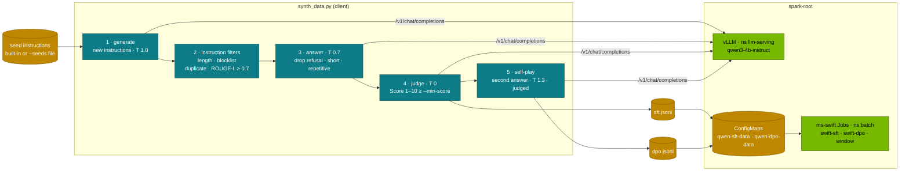

# Chapter 09 · Synthetic Data & Self-Play

> **04-Qwen · Part III — Fine-tuning · Chapter 09 of 14** · ← [Chapter 08 · PEFT & alignment](08-peft-and-alignment.md) · [All chapters](00-qwen-step-by-step-guide.md) · [Chapter 10 · Qwen-Agent & function calling](10-qwen-agent-and-function-calling.md) →

| | |
|---|---|
| **You will build** | A synthetic-data pipeline on one Spark: a Qwen model served by vLLM writes new instructions from a handful of seeds (Self-Instruct), filters drop duplicates, near-duplicates (ROUGE-L), off-topic and degenerate rows, the model answers and judges its own answers, a second high-temperature answer turns into self-play preference pairs, and the result feeds the ms-swift SFT and DPO Jobs of Chapters 07–08. On top: rejection sampling with an executable verifier, the stronger signal when the task can be checked |
| **Hardware** | dgx-spark-1 (generation on the GB10; filters and verifiers on the client) |
| **Time** | 90 min (plus the SFT run in the training window) |
| **Risk** | Low. Generation uses the everyday `serving-budget`; the verifier exercise runs model-written code only in a time-limited subprocess on the MacBook, never on the Spark host. The SFT/DPO runs need the training window (02-Kubernetes Chapter 14) |
| **Clusters** | `spark-root` (vLLM in `llm-serving`, the ms-swift Jobs in `batch`) · optionally `dev-llms` (generate with `qwen3-0.6b` in `llm-sandbox` first) |
| **Lab files** | [`tools/synth_data.py`](lab/tools/synth_data.py), [`tests/mock_openai.py`](lab/tests/mock_openai.py), [`models.yaml`](lab/models.yaml), [`scripts/serve-model.sh`](lab/scripts/serve-model.sh), [`k8s/jobs/swift-sft.yaml`](lab/k8s/jobs/swift-sft.yaml), [`k8s/jobs/swift-dpo.yaml`](lab/k8s/jobs/swift-dpo.yaml) |

---

## 1. Why this matters on a Spark

Qwen2.5-Coder, Qwen2.5-Math and the Qwen3 post-training all lean heavily on **model-generated data**: instructions written by a model, answers sampled from a model, and — wherever possible — an automatic check that keeps only the good ones (code that passes tests, maths whose final answer matches, tool calls that validate against their schema). Human-written instruction data is slow and expensive to collect; a model can write thousands of candidate rows an hour. The work is in the filtering.

For a lab team the use case is narrower and very practical: you have a few examples of the questions *your* engineers ask (runbooks, kubectl, memory budgets), and you want a small model to answer them in your house style. Synthetic data turns six seed examples into a few hundred training rows; a LoRA SFT on a 4B model (Chapter 07) does the rest.

The pipeline uses two different parts of the machine:

| Stage | Bound by | Where it runs |
|---|---|---|
| Write instructions, answer, judge | GPU decode (memory bandwidth, ~273 GB/s) | vLLM on the GB10, continuous batching |
| Filter (ROUGE-L, n-grams, regex), verify (run tests) | CPU | the client (MacBook, or a pod) |
| Fine-tune on the result | GPU + memory | ms-swift Job in `batch`, training window |

The constraint is the shared memory pool: the generator runs inside the ~90 GiB LLM pool at its catalog util, and the SFT run that consumes the data needs the training window, so generation and training happen one after the other.

---

## 2. Architecture — HLD



The client is the only stateful piece: it owns the instruction pool, calls the model for every step, applies the filters and writes two files in ms-swift's format. vLLM does nothing special; it is the Deployment Chapter 04 serves, with a non-thinking catalog model. The same model writes, answers and judges — cheap, and the reason the judge needs scrutiny (§3.3).

---

## 3. LLD

### 3.1 Self-Instruct: growing a pool from seeds

Each round shows the model a few examples sampled from the pool and asks for $m$ new instructions (`--rounds`, `--per-round`, `--examples`). Every candidate passes the instruction filters before it joins the pool, so later rounds are prompted with an increasingly varied set:

| Filter | Rule in `synth_data.py` | Catches |
|---|---|---|
| length | 4–60 words | fragments, essays |
| blocklist | mentions of images, video, audio, attachments | tasks a text model can't do |
| exact duplicate | same normalised token sequence as a pool entry | repeats |
| near-duplicate | ROUGE-L F ≥ `--max-sim` (0.7) against any pool entry | paraphrases of seeds |

**ROUGE-L** compares two word sequences by their longest common subsequence (LCS):

$$P = \frac{\text{LCS}(a,b)}{|a|}, \quad R = \frac{\text{LCS}(a,b)}{|b|}, \quad F = \frac{2PR}{P+R}$$

"Explain how --gpu-memory-utilization relates to unified memory on a GB10" and "Explain how the --gpu-memory-utilization flag relates to unified memory on a GB10" tokenise (lower-case alphanumeric runs) to 12 and 14 words with all 12 of the first in order in the second: $P = 1$, $R = 0.857$, $F = 0.92$ — dropped as a near-duplicate. The check is $O(|a|\,|b|)$ per pair and runs against the whole pool, which is fine for hundreds of rows; for tens of thousands, use MinHash/LSH instead of all-pairs ROUGE.

Answers get their own filters: refusals ("I'm sorry", "as an AI"), answers under 8 words, and **repetitive** text, measured as the share of distinct word 3-grams:

$$\text{distinct}_3 = \frac{|\{\text{unique 3-grams}\}|}{|\{\text{3-grams}\}|} < 0.5 \Rightarrow \text{drop}$$

A model stuck in a loop repeats phrases and scores low; normal prose is close to 1.

### 3.2 Which model generates

Use a **non-thinking** model, or `--no-think` on a hybrid one. Thinking traces are expensive to generate and the client strips any `<think>…</think>` anyway; you want answers in the style the student should learn. The catalog's choice is `qwen3-4b-instruct` (*-Instruct-2507, util 0.12): fast, good at following the format, and it fits next to `qwen3-8b` and the app stack. A stronger generator (e.g. `qwen3-coder-30b-fp8` for code, util 0.40) produces better rows at a higher cost and with less room beside it.

Training a model on the outputs of a *larger* model is distillation; on its *own* outputs it is self-training. Both work, with a caveat for the second (§3.7). Check the generator's licence on the model card before training on its outputs — the catalog's models are all Apache-2.0.

### 3.3 LLM-as-a-judge and its biases

`synth_data.py --judge` asks the model to rate each answer 1–10 ("Score: N", temperature 0) and keeps rows at or above `--min-score` (6). Known biases of LLM judges:

1. **Position** — in pairwise comparisons, preferring whichever answer is shown first.
2. **Verbosity** — preferring longer answers.
3. **Self-preference** — rating text in its own style higher; strongest when the judge *is* the generator, as here.

The lab's judge is **pointwise** (one answer at a time), so position bias doesn't apply; verbosity and self-preference do. When you compare two answers in one prompt, remove position bias by judging twice with the order swapped:

$$\text{score}(y_A, y_B) = \tfrac{1}{2}\big(J(y_A \text{ first}, y_B) + 1 - J(y_B \text{ first}, y_A)\big)$$

and drop pairs where the two orders disagree. Before trusting any judge, measure it against your own labels on 30–100 rows with **Cohen's kappa**:

$$\kappa = \frac{p_o - p_e}{1 - p_e}$$

$p_o$ is observed agreement, $p_e$ the agreement expected by chance from each rater's label frequencies. Example: $p_o = 0.88$, $p_e = 0.50$ → $\kappa = 0.76$, "substantial". Rough reading: < 0.4 poor, 0.4–0.6 moderate, 0.6–0.8 substantial, > 0.8 near-perfect. Below ~0.6, fix the rubric or use a stronger, different-family judge before generating at scale ([Chapter 14](14-hands-on-workbook.md) E17 computes κ).

### 3.4 Self-play preference pairs

With `--dpo`, every kept instruction gets a **second answer at temperature 1.3**. Both answers are judged; if the scores differ, the better one becomes `chosen` and the other `rejected`:

```text
instruction q ─┬─ answer y₁ (T 0.7) ─► judge ─► s₁ ┐
               └─ answer y₂ (T 1.3) ─► judge ─► s₂ ┴─► s₁ ≠ s₂ ?  chosen = higher, rejected = lower → dpo.jsonl
                                                     s₁ = s₂   → no pair (no preference signal)
```

Both answers come from the model you are going to train, so the pairs are **on-policy**: DPO pushes the model away from its own typical failure (the high-temperature answer usually wanders) rather than from someone else's. That is the simplest form of self-play: the model generates both sides, an external signal (here the judge; better, a verifier) decides. ms-swift reads the row as `messages` (ending with the chosen assistant turn) plus `rejected_response` — exactly what `swift-dpo.yaml` expects (Chapter 08).

### 3.5 Rejection sampling with a verifier (RFT)

When the task can be **checked automatically**, a verifier is a much stronger filter than a judge. For a prompt $x$, sample $N$ candidates at temperature $T > 0$; a verifier returns $V(x, y_i) \in \{0, 1\}$ (tests pass, answer matches, JSON validates); keep only verified pairs:

$$y_1, \dots, y_N \sim \pi(y \mid x), \qquad \mathcal{D}_{\text{RFT}} = \{(x, y_i) \mid V(x, y_i) = 1\}$$

Two numbers decide whether it is worth it:

- **pass@1** $p$ of the generator on the prompt set. $p \approx 0$: nothing survives. $p \approx 1$: the data teaches little.
- **coverage**, the share of prompts with at least one accepted candidate: $1 - (1-p)^N$. With $p = 0.2$: $N = 4$ → 59 %, $N = 8$ → 83 %, $N = 16$ → 97 %. Larger $N$ buys coverage on hard prompts at linear decode cost.

Keep one or two passing candidates per prompt (otherwise easy prompts dominate), and pair a passing with a failing candidate for DPO — a verified version of §3.4.

| Verifier | Checks | False-accept risk | Use for |
|---|---|---|---|
| unit tests, executed | behaviour on chosen inputs | weak tests pass wrong code | code |
| reference answer | final answer after normalisation (`\boxed{…}` for Qwen-Math) | right answer, wrong reasoning | maths, extraction |
| JSON Schema | arguments parse and validate (`fc_check.py validate`) | valid but wrong values | tool calls ([Chapter 10](10-qwen-agent-and-function-calling.md)) |
| LLM judge | rubric score | bias (§3.3) | open-ended text |

Unit tests need 4–6 cases each — a normal case, edge cases (empty, zero, negative, duplicates) and one larger input that catches slow solutions under the timeout. A single `assert two_sum([2, 7, 11, 15], 9) == [0, 1]` lets through `return [0, 1]`. Model-written code is untrusted: run it in a separate process with a timeout and no network, never with `exec()` inside your own interpreter, never on the Spark host (§5.6).

### 3.6 After filtering: decontamination and format

| Check | How | Why |
|---|---|---|
| Decontamination | drop rows that share a long n-gram (13 words is common) with any eval item you will report on | a leaked benchmark item makes the eval meaningless |
| Format | `messages` roles in order, no empty assistant turn, total length under the SFT `--max_length` (2048 in `swift-sft.yaml`) | broken or truncated rows poison SFT |
| Mix | keep a share of real data (or a general SFT set) next to the synthetic rows | narrow data narrows the model |

### 3.7 Self-play variants and model collapse

| Form | Loop | Signal |
|---|---|---|
| Self-play pairs (§3.4) | two own answers → judge → DPO | judge |
| Iterated RFT (expert iteration) | generate → verify → SFT → serve the new model → generate again | verifier |
| Proposer / solver | model writes problems *and* tests; keep problems some, not all, solutions pass | verifier + difficulty |
| SPIN-style | real answer = chosen, the current model's answer = rejected → DPO → repeat | human data vs own output |
| Instruction back-translation | existing good code/doc → model infers the request → keep if generated tests pass on the original | verifier on real answers |

**Model collapse.** Training repeatedly on unfiltered own output narrows the distribution and amplifies the model's quirks. The protections are the ones above: a signal that does not come from the model alone (a verifier, your labels, a different judge), deduplication, a share of real data in every round, and an eval set the generator never sees. Measure each round on held-out prompts; stop when it stops improving — two rounds are often where it flattens, but measure.

### 3.8 Memory and time budget

| Generator (catalog) | util | ≈ UMA | Fits next to |
|---|---|---|---|
| `qwen3-0.6b` (sandbox smoke test) | 0.02 in `dev-llms` | ~2.4 GiB | anything |
| `qwen3-4b-instruct` (non-thinking) | 0.12 | ~15 GiB | `qwen3-8b`, bge-m3 (set `everyday`) |
| `qwen3-8b` with `--no-think` | 0.20 | ~24 GiB | a 4B side model, bge-m3 |
| `qwen3-coder-30b-fp8` (MoE, 3B active) | 0.40 | ~49 GiB | the app stack only (set `coding`) |

Time is decode-bound and dominated by the answer and judge calls: per kept SFT row, roughly one share of a generation call, one answer and one judge call; with `--dpo`, one more answer and judge. The client sends one request at a time, so throughput is a single stream's tokens/s; for large runs, run several clients with different `--seed` values in parallel (vLLM batches them) and merge and re-deduplicate the outputs.

---

## 4. Integrations

| With | How | Chapter |
|---|---|---|
| Serving the generator | `scripts/serve-model.sh qwen3-4b-instruct` (main) or `--side` next to `qwen3-8b` | [04](04-serving-qwen-with-vllm-and-sglang.md), [06](06-kubernetes-deployment-and-weight-caching.md) |
| SFT | `sft.jsonl` → ConfigMap `qwen-sft-data` → `k8s/jobs/swift-sft.yaml` with `DATASET=/data/train.jsonl` | [07](07-ms-swift-and-sft.md) |
| DPO / SimPO | `dpo.jsonl` → ConfigMap `qwen-dpo-data` → `k8s/jobs/swift-dpo.yaml` | [08](08-peft-and-alignment.md) |
| Tool-call data | `fc_check.py validate` as the verifier for generated tool calls | [10](10-qwen-agent-and-function-calling.md) |
| Training window | quotas switched with the 02 overlay, vLLM parked first | [02-Kubernetes Chapter 14](../02-Kubernetes/14-multi-tenancy-resource-quotas-and-cgroups.md) |
| Coder / Math generators | FIM and `\boxed{}` formats, TIR | [02](02-coder-math-and-reasoning-models.md) |
| GRPO | rule-based rewards are verifiers used online instead of offline | [08](08-peft-and-alignment.md) |

The two output formats, one JSON object per line:

```json
{"messages": [{"role": "user", "content": "List the pods in llm-serving that restarted today."},
              {"role": "assistant", "content": "kubectl --context spark-root -n llm-serving get pods ..."}]}
{"messages": [{"role": "user", "content": "..."}, {"role": "assistant", "content": "<chosen>"}],
 "rejected_response": "<rejected>"}
```

---

## 5. Lab

### 5.1 Run the pipeline without a GPU

#### What this lab does (tool `lab/tools/synth_data.py` against `lab/tests/mock_openai.py`)

- **Mock endpoint:** starts a deterministic OpenAI-compatible server on `127.0.0.1:18780`, in the background on the MacBook. No cluster, no GPU.
- **Pipeline:** 2 rounds × 8 generated instructions, filters, answers, judge, and self-play DPO pairs.
- **Writes** `out/mock-sft.jsonl` and `out/mock-dpo.jsonl` in ms-swift's format, then stops the mock with `kill %1`.

#### What to look for

1. **Summary line:** `generated 16 instructions → 11 new after filtering, 9 SFT rows kept, 9 DPO pairs`.
2. **Drop reasons:**

   | Reason | Count |
   |---|---|
   | `duplicate` | 2 |
   | `near-duplicate`, `needs a non-text input`, `refusal`, `repetitive`, `too short` | 1 each |

3. **`head -2`:** rows of the form `{"messages": [{"role": "user", …}, {"role": "assistant", …}]}`.

**If something's off:** `Connection refused` → the mock wasn't up yet; wait a second and rerun. `Address already in use` → another mock still runs on 18780 (`kill %1` or pick another port). More in §7.

#### Run it

`tests/mock_openai.py` is a deterministic OpenAI-compatible endpoint: asked for new instructions it returns a canned list with duplicates, near-duplicates, a too-short line and a multimodal task on purpose, so every filter has work to do.

```bash
# ▶ MacBook · 04-Qwen/lab
python3 tests/mock_openai.py 18780 &
python3 tools/synth_data.py --url http://127.0.0.1:18780 --model mock \
  --rounds 2 --per-round 8 --judge --out out/mock-sft.jsonl --dpo out/mock-dpo.jsonl
head -2 out/mock-sft.jsonl
kill %1
```

The answers are rule-based and wrong by design; this run tests the plumbing and the filters, not quality.

### 5.2 Serve a generator

#### What this lab does (`serve-model.sh qwen3-4b-instruct`)

- **Serves** Qwen3-4B-Instruct-2507 as the main model behind `svc/vllm` (util 0.12, 20 Gi, non-thinking, `hermes` tool parser; ~8.1 GB download on the first run). It replaces the current main model.
- **Port-forward:** `svc/vllm` to `127.0.0.1:8000`.
- **Alternatives:** `--side` keeps `qwen3-8b` as main; `qwen3-0.6b --sandbox` tries things in `dev-llms` first.

#### What to look for

1. **Script output:** `[PASS] vllm ready with qwen3-4b-instruct`, `[PASS] answer: 144  (reasoning chars: 0)` (an Instruct-2507 model never thinks), `0 failed`.
2. **Port-forward:** `Forwarding from 127.0.0.1:8000 -> 8000`.

**If something's off:** `[FAIL] budget` → park a side model first. More in [Chapter 04 §7](04-serving-qwen-with-vllm-and-sglang.md).

#### Run it

```bash
# ▶ MacBook · 04-Qwen/lab
scripts/serve-model.sh list
scripts/serve-model.sh qwen3-4b-instruct
kubectl --context spark-root -n llm-serving port-forward svc/vllm 8000:8000 &
```

If `qwen3-8b` is the main model and should stay, serve the generator next to it instead (`scripts/serve-model.sh qwen3-4b-instruct --side`, then `port-forward svc/vllm-qwen3-4b-instruct 8000:8000`). To try changed flags or a new model first, use the sandbox: `scripts/serve-model.sh qwen3-0.6b --sandbox` (context `dev-llms`, namespace `llm-sandbox`).

### 5.3 Generate from your own seeds

#### What this lab does (`synth_data.py` against the served generator)

- **Writes** six seed instructions to `out/seeds.txt`.
- **Generates** 6 rounds × 10 instructions with Qwen3-4B-Instruct, filters them, answers each, judges each answer (keep ≥ 6 of 10) and builds DPO pairs from a second, high-temperature answer.
- **Writes** `out/sft.jsonl` and `out/dpo.jsonl`. Nothing on the cluster changes; this is inference only.

#### What to look for

1. **Exit code 0** and a summary line with SFT rows kept above 0.
2. **The funnel:** fill the table below from the summary and `dropped` lines.
3. **`wc -l`:** row counts that match the summary.
4. **Your own reading of twenty rows:** on-topic, no paraphrases of each other, no `<think>` text.

**If something's off:** `0 SFT rows kept` and exit 1 → the generator ignored the numbered-list format; ask it the prompt by hand. Most rows `near-duplicate` → seeds too similar or `--max-sim` too strict. More in §7.

#### Run it

Write 6–10 seed instructions that look like what your team asks, one per line, then generate:

```bash
# ▶ MacBook · 04-Qwen/lab
cat > out/seeds.txt <<'EOF'
Explain why a vLLM pod on a DGX Spark sets its memory request equal to its limit.
Write a kubectl command that shows which pods in llm-serving use a GPU slice.
How do I open the training window and close it again afterwards?
Which vLLM flag separates Qwen3 thinking text from the answer?
Give two reasons a model Deployment can stay Pending on spark-root.
Summarise what a LoRA adapter changes in a Qwen model and what it costs in memory.
EOF
python3 tools/synth_data.py --url http://127.0.0.1:8000 --model qwen3-4b-instruct \
  --seeds out/seeds.txt --rounds 6 --per-round 10 --judge --min-score 6 \
  --out out/sft.jsonl --dpo out/dpo.jsonl
wc -l out/sft.jsonl out/dpo.jsonl
```

Record the funnel:

| Stage | Count |
|---|---|
| instructions generated | record yours |
| dropped: duplicate / near-duplicate / length / blocklist | |
| answers dropped: refusal / short / repetitive | |
| dropped: low judge score | |
| SFT rows kept | |
| DPO pairs | |

Read twenty SFT rows yourself. If many are off-topic, your seeds are too broad; if many paraphrases of each other survived, lower `--max-sim` to 0.6.

### 5.4 Check the judge

#### What this lab does (`synth_data.py --min-score 1` + a small stats script)

- **Generates** a second set with `--min-score 1`, so every answer the judge scored is kept, into `out/judge-all.jsonl` (`--seed 1` for a different sample).
- **Prints** the row count and the median answer length. You then label 30 rows by hand and compare with "judge score ≥ 6".

#### What to look for

1. **Stats line:** `N rows, answer length p50 … words`, with N close to the number of instructions that survived filtering.
2. **Your κ** between your labels and the judge (workbook E17). Record it.
3. **Verbosity bias:** are the rows you rejected mostly the short ones the judge liked, or the reverse?

**If something's off:** the judge gives nearly everything 8–9 → a lenient rubric or self-preference; try another judge model (§5.5).

#### Run it

Label 30 rows yourself as good / bad, then compare with "judge score ≥ 6". To see the judge's verdict on every answer, not only the kept ones, run with `--min-score 1` into a separate file, label those rows, and re-score them by hand against the threshold:

```bash
# ▶ MacBook · 04-Qwen/lab
python3 tools/synth_data.py --url http://127.0.0.1:8000 --model qwen3-4b-instruct \
  --seeds out/seeds.txt --rounds 3 --per-round 10 --judge --min-score 1 --seed 1 --out out/judge-all.jsonl
python3 - <<'EOF'
import json, statistics
rows = [json.loads(l) for l in open("out/judge-all.jsonl")]
lens = [len(r["messages"][-1]["content"].split()) for r in rows]
print(f"{len(rows)} rows, answer length p50 {statistics.median(lens)} words")
EOF
```

Compute κ between your labels and the judge (workbook E17), and check whether the rows you rejected are systematically the short ones (verbosity bias). Then try `qwen3-8b` with `--no-think` as judge and generator (§5.5) and compare κ.

### 5.5 Try a second generator

#### What this lab does (`serve-model.sh qwen3-8b` + `synth_data.py --no-think`)

- **Switches** the main model to Qwen3-8B (util 0.20, 32 Gi). The port-forward breaks when the pod changes; restart it.
- **Generates** from the same seeds with thinking off (`enable_thinking=false`) into `out/sft-8b.jsonl`.

#### What to look for

1. **`serve-model.sh`:** `[PASS] vllm ready with qwen3-8b`.
2. **Funnel:** compare with §5.3, and rows kept per minute of wall time.
3. **No thinking text:** `grep -c '<think>' out/sft-8b.jsonl` prints `0`.

**If something's off:** `<think>` in rows → `--no-think` is missing. `Connection refused` → restart the port-forward.

#### Run it

Serve `qwen3-8b` and generate with `--no-think` from the same seeds (`--seed` fixed), then compare the funnels and read a sample from each. Notice how many rows each keeps per minute of wall time, and whether the 8B's answers are noticeably better for your seeds. The cheaper generator wins unless the difference shows in the rows.

```bash
# ▶ MacBook · 04-Qwen/lab
scripts/serve-model.sh qwen3-8b
python3 tools/synth_data.py --url http://127.0.0.1:8000 --model qwen3-8b --no-think \
  --seeds out/seeds.txt --rounds 6 --per-round 10 --judge --out out/sft-8b.jsonl
```

(Restart the port-forward if it dropped while the model switched.)

### 5.6 A verifier instead of a judge (CPU)

#### What this lab does (`out/verify.py`)

- **Runs** each candidate function plus four tests in a separate, isolated Python process (`-I`, temporary directory, 5 s timeout) on the MacBook. Generated code never runs in the verifier's own process.
- **Uses** two hand-written candidates, or candidates you ask the served model for.

#### What to look for

1. **Output:** `['pass', 'fail'] covered: True` with the two hand-written candidates.
2. **With model candidates:** at least one `pass` means the problem is covered and the passing answer is a training row.

**If something's off:** every candidate `timeout` → a loop in the candidates; the timeout did its job.

#### Run it

Where you can check, check. This runs candidate Python against tests in a separate, isolated interpreter with a timeout — the core of rejection sampling (§3.5). Run it on the MacBook with candidates you generate from the served model (ask it for `is_palindrome` four times at temperature 0.8), or with the two hand-written ones below.

```python
# out/verify.py — run with: python3 -I out/verify.py
import pathlib
import subprocess
import sys
import tempfile

TESTS = """
assert is_palindrome("A man, a plan, a canal: Panama")
assert not is_palindrome("race a car")
assert is_palindrome(" ")
assert not is_palindrome("0P")
"""

def verify(code: str, tests: str, timeout: float = 5.0) -> str:
    with tempfile.TemporaryDirectory() as d:
        f = pathlib.Path(d) / "cand.py"
        f.write_text(code + "\n" + tests)
        try:
            r = subprocess.run([sys.executable, "-I", str(f)], cwd=d, capture_output=True, timeout=timeout)
        except subprocess.TimeoutExpired:
            return "timeout"
        return "pass" if r.returncode == 0 else "fail"

candidates = [
    "def is_palindrome(s):\n    t = [c.lower() for c in s if c.isalnum()]\n    return t == t[::-1]",
    "def is_palindrome(s):\n    return s == s[::-1]",
]
results = [verify(c, TESTS) for c in candidates]
print(results, "covered:", "pass" in results)
```

For real use, add resource limits or run the verifier in a pod with no network and a read-only filesystem; a subprocess on your laptop is enough for this exercise, the Spark host is never the place.

### 5.7 Hand the data to ms-swift

#### What this lab does (ConfigMaps `qwen-sft-data` / `qwen-dpo-data`, training window, `swift-sft.yaml`)

- **Creates or updates** ConfigMaps `qwen-sft-data` and `qwen-dpo-data` in `batch` from your files; the Jobs mount them at `/data/train.jsonl`.
- **Opens the training window** (vLLM paused, `training-window` overlay: `batch` 8 CPU · 80 Gi). Park side engines and `bge-m3` too, as in Chapter 07 Task 5.3.
- **Submits** `swift-sft` with `DATASET=/data/train.jsonl` instead of Alpaca-GPT4.

#### What to look for

1. **ConfigMaps:** `configmap/qwen-sft-data created` (or `configured`), same for `qwen-dpo-data`.
2. **Workload and pod:** Workload `ADMITTED True`, Job active, pod `Running`.
3. **Log:** the dataset loaded from `/data/train.jsonl`, with about as many rows as `wc -l out/sft.jsonl` (2 % go to the eval split), not 2,000.
4. **Afterwards:** window closed (everyday quotas, no pause annotation).

**If something's off:** `configmap … too long` → file over ~1 MiB; copy it into `qwen-train`. Workload not admitted → window not open or vLLM still holds the pool. More in §7.

#### Run it

The Jobs read your file from a ConfigMap mounted at `/data` (see the headers of `swift-sft.yaml` and `swift-dpo.yaml`). ConfigMaps are limited to ~1 MiB: fine for a few thousand short rows; for more, copy the file into the `qwen-train` PVC instead.

```bash
# ▶ MacBook · 04-Qwen/lab
kubectl --context spark-root -n batch create configmap qwen-sft-data --from-file=train.jsonl=out/sft.jsonl \
  --dry-run=client -o yaml | kubectl --context spark-root apply -f -
kubectl --context spark-root -n batch create configmap qwen-dpo-data --from-file=train.jsonl=out/dpo.jsonl \
  --dry-run=client -o yaml | kubectl --context spark-root apply -f -
```

Open the training window ([Chapter 07](07-ms-swift-and-sft.md) has the full sequence):

```bash
# ▶ MacBook · 02-Kubernetes/lab
kubectl --context spark-root -n llm-serving annotate scaledobject vllm autoscaling.keda.sh/paused-replicas=0 --overwrite
kubectl --context spark-root apply -k manifests/root-llms/training-window
```

Submit the SFT Job with the dataset pointed at your file:

```bash
# ▶ MacBook · 04-Qwen/lab
sed 's|"vicgalle/alpaca-gpt4#2000"|/data/train.jsonl|' k8s/jobs/swift-sft.yaml | kubectl --context spark-root apply -f -
kubectl --context spark-root -n batch get workloads,jobs,pods
kubectl --context spark-root -n batch logs -f job/swift-sft
```

For DPO afterwards, the same with `swift-dpo.yaml` and `"Intel/orca_dpo_pairs#2000"`. Close the window when the Jobs are done (re-apply `root-llms/10-tenancy` and `root-llms/20-scheduling` in 02-Kubernetes/lab, remove the pause annotation), then serve and compare the adapter as Chapter 08 shows: ask held-out questions in your seeds' style, base vs adapter.

---

## 6. Verify

| Check | Command | Expected |
|---|---|---|
| Mock pipeline | §5.1 | summary line, the filter reasons appear, two files |
| No thinking traces | `grep -c '<think>' out/sft.jsonl` | `0` |
| Funnel recorded | §5.3 | counts per stage; SFT rows > 0 |
| Judge measured | §5.4 | κ against your labels recorded |
| Verifier | §5.6 | `['pass', 'fail'] covered: True` |
| Rows valid for ms-swift | `python3 -c "import json;[json.loads(l)['messages'] for l in open('out/sft.jsonl')]"` | no exception |
| Data reached the Job | `kubectl --context spark-root -n batch logs job/swift-sft \| grep -i 'train.jsonl'` | the ConfigMap file was loaded, not the default dataset |
| Window closed | `kubectl --context spark-root -n batch describe quota` and the ScaledObject annotations | everyday quotas; no pause annotation |

---

## 7. Troubleshooting

| You see | Cause | Fix |
|---|---|---|
| `0 SFT rows kept`, exit code 1 | generator ignores the numbered-list format, or every row was filtered | ask the model the generation prompt once by hand; a stronger generator; lower `--min-score` to inspect |
| Most instructions dropped as near-duplicates | seeds too similar, or `--max-sim` too strict for short instructions | more varied seeds; `--max-sim 0.8` |
| Off-topic instructions | the generation prompt's framing doesn't match your seeds | seeds that state the domain explicitly; more of them |
| Many `repetitive` answers | a small model stuck in a loop | a larger generator; check the model's sampling defaults |
| `<think>` text in rows | hybrid model without `--no-think` and without the reasoning parser | `--no-think`, or serve with `--reasoning-parser` (Chapter 04); the client also strips `<think>…</think>` |
| Few DPO pairs | the two answers get equal scores | expected for easy instructions; more rounds, or a verifier instead of the judge |
| Judge gives everything 8–9 | self-preference, lenient rubric | a different judge model, κ check (§5.4) |
| SFT loss drops to ~0 fast | duplicates, too-easy data | stricter `--max-sim`; mix in real data |
| Eval jumps suspiciously after SFT | eval items leaked into the synthetic data | decontaminate against every eval set (§3.6) |
| `configmap … too long` | file over ~1 MiB | copy into the `qwen-train` PVC instead |
| Job `Pending` / Workload not admitted | window not open, or vLLM still holding the pool | §5.7; Chapter 07 |

---

## 8. Scale-out path

With dgx-spark-2, generation and training can overlap instead of alternating: keep the generator on one Spark while the ms-swift Job runs on the other (Kueue still admits it against `spark-cq`; the Job needs node affinity to the free Spark). Generation itself scales by running several clients with different seeds against one vLLM, which batches them; the filter step then has to deduplicate across the merged files. For a stronger generator than one Spark holds, the cheaper route is usually more samples from a model that fits plus a verifier, not a larger model across the CX-7 fabric.

---

## 9. Checklist

- [ ] I can explain each filter (length, blocklist, ROUGE-L, distinct-3, refusal) and what it catches.
- [ ] The mock run and a real run produced `sft.jsonl` and `dpo.jsonl`; the funnel is recorded.
- [ ] I measured the judge against my own labels (κ) and know its biases.
- [ ] I can explain why self-play pairs are on-policy, and why a verifier beats a judge when the task is checkable.
- [ ] Model-written code ran only in an isolated, time-limited process, never on the Spark host.
- [ ] The SFT (and DPO) Job used my data, ran in the training window, and the window was closed afterwards.
- [ ] The fine-tuned model was compared with the base on held-out questions, not on the training rows.
