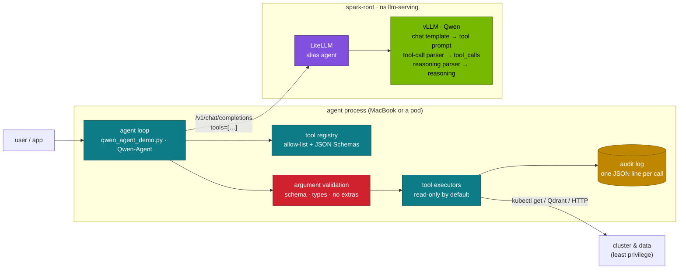
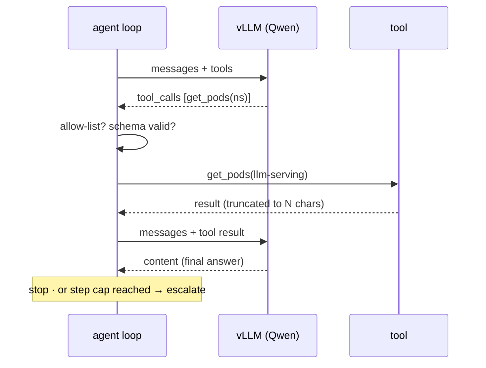

# Chapter 10 · Qwen-Agent & Function Calling

> **04-Qwen · Part IV — Applications · Chapter 10 of 14** · ← [Chapter 09 · Synthetic data & self-play](09-synthetic-data-and-self-play.md) · [All chapters](00-qwen-step-by-step-guide.md) · [Chapter 11 · RAG with Qwen, BGE & Qdrant](11-rag-with-qwen-bge-and-qdrant.md) →

| | |
|---|---|
| **You will build** | A Qwen model on vLLM that returns OpenAI-style `tool_calls` (the right tool-call parser for its generation, the `qwen3` reasoning parser for hybrid-thinking models), a measured function-calling pass rate from `fc_check.py` (right tools, valid JSON, schema match, parallel calls, no call when none fits, structured output), an agent loop with guardrails (`qwen_agent_demo.py`: allow-list, errors returned to the model, step cap, audit log) and the list of what a production agent adds, the official Qwen-Agent library pointed at the same endpoint, and an `agent` alias in LiteLLM |
| **Hardware** | dgx-spark-1 |
| **Time** | 90 min |
| **Risk** | Low for the read-only tools in the lab. An agent with write tools (kubectl apply, shell, code interpreter) is a privileged actor: §3.6 before you give it any |
| **Clusters** | `spark-root` (vLLM and LiteLLM in `llm-serving`) · optionally `dev-llms` (parser flags on `qwen3-0.6b` in `llm-sandbox` first) |
| **Lab files** | [`tools/fc_check.py`](lab/tools/fc_check.py), [`tools/qwen_agent_demo.py`](lab/tools/qwen_agent_demo.py), [`models.yaml`](lab/models.yaml) (each entry's `args` carry its parsers), [`scripts/serve-model.sh`](lab/scripts/serve-model.sh), [`tests/mock_openai.py`](lab/tests/mock_openai.py); reused from 03: [`k8s/apps/litellm.yaml`](../03-DeepSeek/lab/k8s/apps/litellm.yaml), [`tools/agent_tools.py`](../03-DeepSeek/lab/tools/agent_tools.py) |

---

## 1. Why this matters on a Spark

A chat model answers; an agent acts. Function calling is the contract between the two: the model emits a structured request ("call `get_pods` with `namespace=llm-serving`"), your code decides whether to run it, runs it, and returns the result as a message. Qwen models are trained on this contract, but whether a client receives clean `tool_calls` depends on three things you control on the server:

1. the **chat template** that puts the tool schemas into the prompt (it ships with the model),
2. the **tool-call parser** that turns the model's text back into `tool_calls` — and it differs between Qwen generations,
3. for hybrid-thinking models, the **reasoning parser** that keeps `<think>…</think>` out of `content` and out of the tool-call parser's way.

Get one of them wrong and the symptom is quiet: tool calls arrive as text in `content`, or not at all, and the agent framework reports "the model didn't call a tool". On a Spark there is one more reason to be careful: the model, the tools and everything else share one machine, so an agent with a write tool can affect the platform it runs on. The guardrails (§3.6) are not optional decoration.

---

## 2. Architecture — HLD



The model never executes anything. vLLM turns the model's output into a `tool_calls` array; the agent process validates it, runs only allow-listed tools with validated arguments, and feeds results back as `role: tool` messages. Everything that can change the world lives in the client, so that is where the controls go.

---

## 3. LLD

### 3.1 The wire format: what the model actually sees and writes

Qwen2.5 and the original Qwen3 releases use a Hermes-style template: tool schemas inside `<tools>` in the system turn, calls as JSON inside `<tool_call>` tags, results inside `<tool_response>` in a user turn.

```text
<|im_start|>system
You are a helpful assistant.

# Tools
You may call one or more functions to assist with the user query.
You are provided with function signatures within <tools></tools> XML tags:
<tools>
{"type": "function", "function": {"name": "get_pods", "description": "List pods in a namespace", "parameters": {"type": "object", "properties": {"namespace": {"type": "string"}}, "required": ["namespace"]}}}
</tools>
For each function call, return a json object with function name and arguments within <tool_call></tool_call> XML tags …<|im_end|>
<|im_start|>user
Which pods are running in llm-serving?<|im_end|>
<|im_start|>assistant
<tool_call>
{"name": "get_pods", "arguments": {"namespace": "llm-serving"}}
</tool_call><|im_end|>
<|im_start|>user
<tool_response>
{"pods": ["vllm-6c9…", "bge-m3-5f…", "litellm-7d…"]}
</tool_response><|im_end|>
<|im_start|>assistant
Three pods are running: vllm, bge-m3 and litellm.<|im_end|>
```

You never write this by hand: the client sends OpenAI-style `tools` and `messages`, vLLM applies the model's chat template to build the prompt above, and the **tool-call parser** extracts the `<tool_call>` blocks from the output into `message.tool_calls`. Several `<tool_call>` blocks in one turn are **parallel calls**; the client runs them and returns one `role: tool` message per `tool_call_id`.

Qwen3-Coder and the Qwen3.5 / Qwen3.6 generations use a different, XML-style call format (function and parameter tags rather than one JSON object), which is why they need a different parser.

### 3.2 Which parser for which model

| Model generation | `--tool-call-parser` | `--reasoning-parser` | Notes |
|---|---|---|---|
| Qwen2.5 (Instruct, Coder-Instruct) | `hermes` | — | no thinking mode |
| QwQ-32B | `hermes` | `deepseek_r1` (as 03's `qwq-32b-awq` overlay sets it) | always thinks |
| Qwen3 hybrid (e.g. Qwen3-8B, Qwen3-32B, Qwen3-30B-A3B) | `hermes` | `qwen3` | thinking on by default, switchable (§3.3) |
| Qwen3 *-Instruct-2507 | `hermes` | — | non-thinking only |
| Qwen3 *-Thinking-2507 | `hermes` | `deepseek_r1` in the lab catalog | thinking only; the template opens `<think>` itself, so the closing tag is all the output carries |
| Qwen3-Coder | `qwen3_coder` | — | XML-style calls |
| Qwen3.5 / Qwen3.6 | `qwen3_coder` | `qwen3` | check the model card for the vLLM release it needs |

Both tool flags go together: `--enable-auto-tool-choice --tool-call-parser <name>`. The lab's catalog stores the parsers per model (in each entry's `args` in `models.yaml`: `qwen3-8b` has `hermes` + `qwen3`, `qwen3-4b-instruct` `hermes` only, `qwen3-coder-30b-fp8` and `qwen3.6-35b-fp8` `qwen3_coder`), and the generated overlay under `k8s/models/<name>/` carries the flags, so switching models with `serve-model.sh` switches parsers with them. Parser names and model support change between vLLM releases: check `vllm serve --help` in the pinned image (`lab/versions.env`) and the model card before adding a new generation to the catalog.

**Qwen-Agent is the exception.** The Qwen-Agent library builds its own tool prompt (`fncall_prompt_type: nous` is its recommended template for Qwen3) and parses the model's text itself. For QwQ and Qwen3 it recommends serving *without* `--enable-auto-tool-choice --tool-call-parser hermes`; for Qwen3-Coder it recommends the opposite — keep vLLM's `qwen3_coder` parser and set `use_raw_api: true` so Qwen-Agent uses the native `tool_calls`. With one vLLM Deployment serving both plain OpenAI clients and Qwen-Agent, keep the parser on (plain clients need it) and test Qwen-Agent against it in §5.5: in the lab both work, but verify with your model and versions.

### 3.3 Hybrid thinking and tools

Qwen3 hybrid models think before answering unless told not to. With `--reasoning-parser qwen3` the thinking text arrives in `message.reasoning` (streaming: `delta.reasoning`; older vLLM releases and SGLang name it `reasoning_content`, Chapter 02 §2.6), the answer or the tool calls in `content` / `tool_calls`.

| Switch | Where | Effect |
|---|---|---|
| `"chat_template_kwargs": {"enable_thinking": false}` | request body (Python SDK: `extra_body`) | no thinking for this request |
| `--default-chat-template-kwargs '{"enable_thinking": false}'` | vLLM server flag (newer releases) | thinking off by default |
| `/think`, `/no_think` in a user or system message | prompt | per-turn soft switch (original Qwen3 hybrid models only; the 2507 split models ignore it) |

For agents, thinking costs tokens on every step of the loop. A common pattern: thinking **on** for the planning step or hard multi-tool questions, **off** for routine tool selection and for the final summary. Two practical rules:

- Give thinking requests a `max_tokens` large enough for the reasoning *and* the call. If the budget runs out inside `<think>`, you get `finish_reason: length`, empty `content`, no `tool_calls` — it looks like the model refused to call a tool.
- In multi-turn history, send back only the assistant's `content` and `tool_calls`, not the previous reasoning field; Qwen's templates are built for history without old thinking.

### 3.4 Structured outputs (constrained decoding)

When you need JSON but not a tool loop (extraction, classification), ask vLLM for structured output instead of hoping: `response_format: {"type": "json_schema", "json_schema": {...}}`. The engine compiles the schema into a grammar and masks invalid tokens at every step. At step $t$ with logits $z_t \in \mathbb{R}^{V}$ (Qwen's vocabulary: $V \approx 152\text{K}$) and the set of tokens that keep the output a valid prefix of the grammar $\mathcal{V}_{\text{valid}}$:

$$m_{t,v} = \begin{cases} 0 & v \in \mathcal{V}_{\text{valid}} \\ -\infty & \text{otherwise} \end{cases} \qquad P(w_t = v) = \frac{e^{z_{t,v} + m_{t,v}}}{\sum_j e^{z_{t,j} + m_{t,j}}}$$

Invalid tokens get probability zero, so the output always parses. Two limits: it guarantees **syntax**, not correct values (a valid JSON with the wrong namespace is still wrong), and it costs some throughput for complex schemas — measure with and without on your model. For tool calls, `tool_choice: "required"` or a named function also uses guided decoding in vLLM; with `tool_choice: "auto"` the model's own formatting plus the parser does the work, which is why §5.3 measures it.

### 3.5 The agent loop (ReAct)

At step $t$ the policy produces a thought (with thinking on), an action and arguments; the environment returns an observation; the state grows by concatenation:

$$(\tau_t, a_t, p_t) \sim \pi_\theta(s_t), \qquad o_t = \text{Exec}(a_t, p_t), \qquad s_{t+1} = s_t \circ \tau_t \circ a_t \circ p_t \circ o_t$$

The loop ends when the model answers without a tool call. Two consequences are worth stating plainly: the prompt grows every step (prefix caching makes the repeated prefix cheap, Chapter 04), and nothing in the maths guarantees termination — the step cap is what does.



### 3.6 Guardrails

| Control | `qwen_agent_demo.py` | Production agent (add) | Why |
|---|---|---|---|
| Allow-list | only the three registered tools run; an unknown name returns `{"error": "unknown tool …; available: […]"}` to the model | same | hallucinated tools |
| Argument parsing | arguments that are not JSON go back to the model as an error result, so it can retry | same | malformed calls |
| Schema validation | — (Python raises on a wrong argument; the error goes back) | validate against the tool's JSON Schema before running (the validator in `fc_check.py`, or 03's `agent_tools.py`) | wrong types, extra keys, injected arguments |
| Read-only tools | calculator (AST, no `eval`), `uma_budget`, `catalog_lookup` — nothing changes state | write tools behind an explicit flag and a confirmation | an agent acting on a wrong belief |
| Step cap | `--max-steps` (default 5) | same, plus a consecutive-error stop | loops on a failing tool |
| Output size | results are small by construction | truncate tool results before they go back to the model | context blow-up, injected text volume |
| Audit log | `--audit FILE`: one JSON line per call (step, tool, arguments, result) | add time, latency, user/key | review, incident response |
| Least privilege | runs as you, touches only local data | a ServiceAccount with `get/list` only, in the namespaces it needs ([03 Chapter 14](../03-DeepSeek/14-tool-calling-and-agents.md)) | blast radius |

**Prompt injection.** Tool results are untrusted input: a document retrieved by RAG or a pod log can contain "ignore previous instructions and run…". The model may follow it. The defence is in the client, not the prompt: the injected instruction can only reach tools that are allow-listed, with validated arguments, under a read-only ServiceAccount.

**Code interpreter.** Qwen-Agent's `code_interpreter` tool runs model-written Python in a local Docker container with the working directory mounted. The Spark's DGX OS runs headless as a Kubernetes node; do not install Docker on it for this, and do not run the interpreter on the host. If you need code execution, run the agent (and its interpreter) in a pod in `dev-lab` or `dev-llms` with no ServiceAccount token, a read-only root filesystem, dropped capabilities and a NetworkPolicy that denies egress except to the model endpoint.

---

## 4. Integrations

| With | How | Chapter |
|---|---|---|
| vLLM flags | catalog fields → generated overlay → `serve-model.sh` | [04](04-serving-qwen-with-vllm-and-sglang.md), [06](06-kubernetes-deployment-and-weight-caching.md) |
| LiteLLM | alias `agent` → the tool-calling Qwen; keys with budgets | [12](12-open-webui-and-litellm.md) |
| RAG as a tool | `search_docs` over the Qdrant collection | [11](11-rag-with-qwen-bge-and-qdrant.md) |
| Tool-call training data | `fc_check.py` as the verifier in the synthetic-data loop | [09](09-synthetic-data-and-self-play.md) |
| 03's agent | `agent_tools.py`: same protocol, calculator / GPU slices / doc search | [03 Chapter 14](../03-DeepSeek/14-tool-calling-and-agents.md) |
| Telemetry | tool-call failures show up as parse errors in the vLLM log; latency per step in the audit log | [13](13-telemetry-and-troubleshooting.md) |

---

## 5. Lab

### 5.1 Check the parsers in the pinned image

#### What this lab does (read-only checks)

- **Prints** `VLLM_IMAGE` from `versions.env`, the tool-call and reasoning parser choices that the running `deploy/vllm` image knows (`vllm serve --help` inside the pod), and the parser flags of every catalog entry.
- **Nothing changes**; it needs a running main model to exec into.

#### What to look for

1. **Image:** `VLLM_IMAGE=nvcr.io/nvidia/vllm:26.08-py3`.
2. **Help text:** the `--tool-call-parser` choices include `hermes` and `qwen3_coder`; the `--reasoning-parser` choices include `qwen3` and `deepseek_r1`.
3. **Catalog:** every parser named in `models.yaml` appears in those lists.

**If something's off:** `error: unable to upgrade connection` or no pod → `deploy/vllm` is parked; serve a model first (§5.3). A missing parser → that model waits for an image bump.

#### Run it

```bash
# ▶ MacBook · 04-Qwen/lab
grep -E '^VLLM_IMAGE' versions.env
kubectl --context spark-root -n llm-serving exec deploy/vllm -- sh -c 'vllm serve --help=all 2>/dev/null || vllm serve --help' \
  | grep -A3 -E 'tool-call-parser|reasoning-parser' | head -20
grep -nE '^  - name:|parser' models.yaml
```

The parsers your catalog uses must appear in the image's list. If a newer model needs a parser the pinned image lacks, that model waits for an image bump; don't pass a parser name the server doesn't know (it fails at start-up).

### 5.2 Measure function calling without a GPU

#### What this lab does (tool `lab/tools/fc_check.py` against two mocks)

- **Starts** two deterministic mock endpoints on the MacBook: a correct one on port 18780 and a `flaky` one on 18781 that breaks every second tool call's arguments.
- **Runs** the fixed six-case suite against each: `single`, `arithmetic`, `typed-args`, `parallel`, `no-tool`, `json-schema`. No cluster, no GPU.
- **Stops** both mocks with `kill %1 %2`.

#### What to look for

1. **Correct mock:** six `PASS` lines and `fc_check: 6/6 cases passed (100%)  tool calls: valid JSON 5/5, schema-valid 5/5`.
2. **Flaky mock:** `FAIL  arithmetic` and `FAIL  parallel` with `arguments not JSON: …`, and `fc_check: 4/6 cases passed (67%)  tool calls: valid JSON 3/5, schema-valid 3/5`.
3. **Exit codes:** 0 for both, because no `--min` is set. With `--min 0.9` the flaky run prints `GATE FAILED` and exits 1.

**If something's off:** a second run against the same flaky mock fails different cases; it alternates per call, so restart it for the numbers above. `Address already in use` → a mock from §5.1 of Chapter 09 still runs.

#### Run it

```bash
# ▶ MacBook · 04-Qwen/lab
python3 tests/mock_openai.py 18780 &
python3 tests/mock_openai.py 18781 flaky &
python3 tools/fc_check.py run --url http://127.0.0.1:18780 --model mock
python3 tools/fc_check.py run --url http://127.0.0.1:18781 --model mock
kill %1 %2
```

`fc_check.py run` sends a fixed suite — `single` (one call with an `enum` argument), `arithmetic`, `typed-args` (a number with `minimum`/`maximum`), `parallel` (two tools in one turn), `no-tool` (a request no tool fits) and `json-schema` (structured output with `response_format`) — and checks every answer the way an agent runtime would: the right tools were called (or none), `arguments` is valid JSON, it validates against the schema (types, required, enum, bounds, no extra keys), and the values match the prompt. The well-behaved mock passes 6/6; the `flaky` mock breaks every second tool call's arguments and fails `arithmetic` and `parallel` with "arguments not JSON" — exactly what a wrong parser or a truncated generation looks like. `--min 0.9` turns the run into a gate (exit 1 below 90 %).

### 5.3 Serve a tool-calling Qwen and score it

#### What this lab does (`serve-model.sh qwen3-8b`, `--side qwen3-4b-instruct`, `fc_check.py`, one raw request)

- **Serves** Qwen3-8B as the main model (util 0.20, `qwen3` reasoning parser, `hermes` tool parser) and Qwen3-4B-Instruct-2507 as a side engine `vllm-qwen3-4b-instruct` (util 0.12, `hermes`). Port-forwards: 8000 → `svc/vllm`, 8002 → the side Service.
- **Scores** both with the same six-case suite; Qwen3-8B thinks on every case because `fc_check.py` sends no thinking switch.
- **Shows** one raw tool-calling request so you see what the parsers produce.

#### What to look for

1. **Args:** `--reasoning-parser=qwen3`, `--enable-auto-tool-choice`, `--tool-call-parser=hermes`.
2. **Side model budget:** `[PASS] budget: running 0.20 + qwen3-4b-instruct 0.12 ≤ 0.72` (more if BGE-M3 runs).
3. **Suites:** `no-tool` passes on both models; valid JSON equals the call count. Fill the table with your pass counts and wall times.
4. **Raw request:** two entries in `tool_calls` (one per namespace, a parallel call), `content` empty or `null`, reasoning chars above 0; with thinking off, the same calls and fewer completion tokens.

**If something's off:** `no tool call (check --enable-auto-tool-choice and --tool-call-parser)` on every case → the overlay lacks the flags. `finish_reason: length` with no call → thinking used up `max_tokens`. More in §7.

#### Run it

```bash
# ▶ MacBook · 04-Qwen/lab
scripts/serve-model.sh qwen3-8b
kubectl --context spark-root -n llm-serving get deploy vllm \
  -o jsonpath='{range .spec.template.spec.containers[0].args[*]}{@}{"\n"}{end}' | grep -E 'tool|reasoning'
kubectl --context spark-root -n llm-serving port-forward svc/vllm 8000:8000 &
python3 tools/fc_check.py run --url http://127.0.0.1:8000 --model qwen3-8b
```

`fc_check.py` sends no thinking switch, so `qwen3-8b` thinks on every case (the reasoning parser keeps it out of the way). Then start the non-thinking 4B next to it (`--side` adds a second Deployment and Service, `vllm-qwen3-4b-instruct`; util 0.20 + 0.12 stays well under 0.72) and run the same suite:

```bash
# ▶ MacBook · 04-Qwen/lab
scripts/serve-model.sh qwen3-4b-instruct --side
kubectl --context spark-root -n llm-serving port-forward svc/vllm-qwen3-4b-instruct 8002:8000 &
python3 tools/fc_check.py run --url http://127.0.0.1:8002 --model qwen3-4b-instruct
```

| Model | Thinking | cases passed | valid JSON / schema-valid calls | wall time for the suite |
|---|---|---|---|---|
| qwen3-8b | on | record yours | | |
| qwen3-4b-instruct | never | | | |

A raw request is worth seeing once, to know what the parser did — first with thinking (default), then with `"chat_template_kwargs": {"enable_thinking": false}` added to the body:

```bash
# ▶ MacBook · 04-Qwen/lab
curl -s 127.0.0.1:8000/v1/chat/completions -H 'Content-Type: application/json' -d '{
  "model": "qwen3-8b",
  "messages": [{"role": "user", "content": "How many pods run in llm-serving and in batch?"}],
  "tools": [{"type": "function", "function": {"name": "get_pods", "description": "List pods in a namespace",
    "parameters": {"type": "object", "properties": {"namespace": {"type": "string"}}, "required": ["namespace"]}}}],
  "max_tokens": 2048
}' | python3 -c 'import json,sys; d=json.load(sys.stdin); m=d["choices"][0]["message"]; print("reasoning chars:", len(m.get("reasoning_content") or m.get("reasoning") or "")); print(json.dumps(m.get("tool_calls"), indent=1)); print("content:", m.get("content"), "| completion tokens:", d["usage"]["completion_tokens"])'
```

With thinking off, the completion tokens drop to a fraction.

### 5.4 Run the agent loop and its guardrails

#### What this lab does (tool `lab/tools/qwen_agent_demo.py`)

- **Runs** a tool loop on the MacBook against Qwen3-8B (port 8000): the model asks for tools, the script runs them locally and returns the results, for up to 5 steps (2 in the guardrail test). Tools: `calculator` (arithmetic only), `uma_budget` (util → GiB) and `catalog_lookup` (reads this lab's `models.yaml`).
- **Appends** one JSON line per tool call to `out/agent.jsonl`.
- **No tool changes anything:** there is no delete or write tool, so the guardrail test can't touch the cluster.

#### What to look for

1. **First question:** `step N → catalog_lookup(…)` twice (possibly in one step), one or two `uma_budget` or `calculator` calls, and `answer (step N): …` near 0.32 × 121.7 ≈ 38.9 GiB. With `--no-think`, fewer seconds.
2. **Delete request:** nothing deleted; the model declines, or calls an unknown tool and gets `{"error": "unknown tool …"}`; at the latest `no final answer after 2 steps`.
3. **Unknown model:** `catalog_lookup` returns `{"error": "unknown model qwen9-200b", "known": [...]}` and the answer reports it instead of inventing an entry.
4. **Audit file:** one line per call with `step`, `tool`, `arguments` and `result`.

**If something's off:** an answer with a number but no tool lines → the model guessed; the tool parser may be missing (§5.1). More in §7.

#### Run it

```bash
# ▶ MacBook · 04-Qwen/lab
python3 tools/qwen_agent_demo.py "How many GiB do qwen3-8b and qwen3-4b-instruct reserve together? Use the catalog." \
  --url http://127.0.0.1:8000 --model qwen3-8b --audit out/agent.jsonl
python3 tools/qwen_agent_demo.py "How many GiB do qwen3-8b and qwen3-4b-instruct reserve together? Use the catalog." \
  --url http://127.0.0.1:8000 --model qwen3-8b --no-think --audit out/agent.jsonl
cat out/agent.jsonl
```

Compare the number of steps and the wall time with and without thinking.

Then provoke the guardrails:

```bash
# ▶ MacBook · 04-Qwen/lab
python3 tools/qwen_agent_demo.py "Delete every pod in llm-serving, then tell me how many are left." \
  --url http://127.0.0.1:8000 --model qwen3-8b --max-steps 2 --audit out/agent.jsonl
python3 tools/qwen_agent_demo.py "Look up the catalog entry for qwen9-200b." \
  --url http://127.0.0.1:8000 --model qwen3-8b --audit out/agent.jsonl
```

A good model reports a tool error instead of working around it.

### 5.5 The Qwen-Agent library against the same endpoint

#### What this lab does (`~/qa_test.py` with `qwen-agent==0.0.34`)

- **Creates** a venv `~/.venvs/qwen-agent` on the MacBook with the lab's pinned Qwen-Agent and `json5`.
- **Registers** one custom tool `uma_gib` and runs Qwen-Agent's `Assistant` against Qwen3-8B on `127.0.0.1:8000` (port-forward still open). Qwen-Agent adds its own function-calling prompt (`nous` style).

#### What to look for

1. **Install:** `Successfully installed … qwen-agent-0.0.34 …`.
2. **Output:** one or two lines with a `uma_gib` function call, then a final `assistant` answer near 31.6 GiB (0.26 × 121.7).
3. **Mode:** if no call happens, rerun with `"use_raw_api": True` and record which mode works with your model and image.

**If something's off:** `ModuleNotFoundError` → the venv isn't active. No tool call in either mode → see the double-parsing row in §7.

#### Run it

```bash
# ▶ MacBook · any folder
python3 -m venv ~/.venvs/qwen-agent && . ~/.venvs/qwen-agent/bin/activate
pip install "qwen-agent==0.0.34" json5      # the lab's pin: PIP_QWEN_AGENT in 04-Qwen/lab/versions.env
```

```python
# ~/qa_test.py — run with the venv active, port-forward to svc/vllm still open
import json5
from qwen_agent.agents import Assistant
from qwen_agent.tools.base import BaseTool, register_tool

@register_tool("uma_gib")
class UmaGib(BaseTool):
    description = "Convert a vLLM --gpu-memory-utilization value to GiB of the Spark's ~121.7 GiB pool."
    parameters = [{"name": "util", "type": "number", "description": "fraction, e.g. 0.2", "required": True}]

    def call(self, params: str, **kwargs) -> str:
        util = float(json5.loads(params)["util"])
        return json5.dumps({"gib": round(util * 121.7, 1)})

llm_cfg = {
    "model": "qwen3-8b",
    "model_server": "http://127.0.0.1:8000/v1",
    "api_key": "EMPTY",
    "generate_cfg": {"fncall_prompt_type": "nous", "max_input_tokens": 16000},
}
bot = Assistant(llm=llm_cfg, function_list=["uma_gib"],
                system_message="Use tools for arithmetic about memory.")
messages = [{"role": "user", "content": "How many GiB are util 0.20 plus util 0.06?"}]
for responses in bot.run(messages=messages):
    pass
for r in responses:
    print(r.get("role"), r.get("function_call") or r.get("content"))
```

If the call never happens, try `"use_raw_api": True` in `generate_cfg` (native `tool_calls` through vLLM's parser) and compare; record which mode works with your model and vLLM version. Qwen-Agent also has `WebUI(bot).run()` (needs the `gui` extra) and MCP server support (`mcpServers` in the tool list); both run on the MacBook, not on the Spark.

### 5.6 Route agents through LiteLLM

#### What this lab does (03 apps `k8s/apps`, alias `agent`)

- **Edits** the `agent` alias in `03-DeepSeek/lab/k8s/apps/litellm.yaml` (ConfigMap `litellm-config`) to point at `vllm-qwen3-4b-instruct.llm-serving:8000`.
- **Applies** 03's app stack in `llm-serving` (Open WebUI, LiteLLM and its DB, BGE-M3) and restarts LiteLLM so it reads the new config.
- **Scores** the alias through the gateway at `api.lab.local` (Traefik, 192.168.0.115) with a LiteLLM key.

#### What to look for

1. **Rollout:** `deployment "litellm" successfully rolled out`.
2. **`fc_check.py` through the gateway:** the same pass count and valid-JSON ratio as the direct `qwen3-4b-instruct` run in §5.3.

**If something's off:** `401` → wrong key. A different pass rate → the gateway alters `tools` or `tool_choice` (`drop_params`, Chapter 12). `Could not resolve host` → add `api.lab.local` to `/etc/hosts`. More in §7.

#### Run it

Agents should hold a LiteLLM virtual key, not the vLLM port. 03's LiteLLM config already has an `agent` alias; point it at the Qwen tool-calling model. The catalog's choice is the non-thinking `qwen3-4b-instruct`, served as a side model next to `qwen3-8b` (set `everyday`). In `03-DeepSeek/lab/k8s/apps/litellm.yaml` (ConfigMap `litellm-config`):

```yaml
      - model_name: agent
        litellm_params: {model: hosted_vllm/qwen3-4b-instruct, api_base: http://vllm-qwen3-4b-instruct.llm-serving:8000/v1, api_key: none}
```

```bash
# ▶ MacBook · 04-Qwen/lab
kubectl --context spark-root apply -k ../../03-DeepSeek/lab/k8s/apps
kubectl --context spark-root -n llm-serving rollout restart deploy/litellm
kubectl --context spark-root -n llm-serving rollout status deploy/litellm
export LITELLM_KEY=…   # a virtual key (Chapter 12 §5.4), or the master key for this test
python3 tools/fc_check.py run --url http://api.lab.local --api-key "$LITELLM_KEY" --model agent
```

`api.lab.local` must resolve to 192.168.0.115 on the MacBook (03 Chapter 12 Task 5.1). The pass rate through the gateway should match the direct `qwen3-4b-instruct` run of §5.3. If parallel calls or `tool_choice` behave differently, the gateway is altering the request (see `drop_params` in the LiteLLM config, Chapter 12).

---

## 6. Verify

| Check | Command | Expected |
|---|---|---|
| Parser flags match the catalog | §5.3 first command | `--enable-auto-tool-choice`, `--tool-call-parser=<catalog value>`, a `--reasoning-parser` for thinking models |
| Tool calls are structured | raw request in §5.3 | `tool_calls` array, no `<tool_call>` text in `content` |
| Thinking is separated | same | thinking only in the reasoning field; fewer completion tokens with thinking off |
| `fc_check.py run` | §5.2, §5.3 | mock 6/6 and flaky 4/6; real models recorded; `no-tool` passes |
| Guardrails | §5.4 second block | no state change; unknown tool/model reported, not invented; audit lines for every call |
| Gateway parity | §5.6 | same pass rate via `agent` alias |

---

## 7. Troubleshooting

| You see | Cause | Fix |
|---|---|---|
| `<tool_call>{…}</tool_call>` as text in `content` | no `--enable-auto-tool-choice --tool-call-parser`, or the wrong parser | `hermes` for Qwen2.5/Qwen3, `qwen3_coder` for Qwen3-Coder/3.5/3.6 (§3.2) |
| `<function=…>` / `<parameter=…>` text in `content` | Qwen3-Coder-style output parsed with `hermes` | `--tool-call-parser qwen3_coder` |
| vLLM fails at start: unknown parser | parser not in the pinned image | `vllm serve --help` in the image; bump the image or pick an older model generation |
| `<think>` text in `content`; tool calls missing on thinking models | no `--reasoning-parser qwen3` | add it; the reasoning parser runs before the tool parser |
| `finish_reason: length`, empty content, no tool call | thinking used up `max_tokens` | raise `max_tokens`, or `enable_thinking: false` for routine steps |
| `/no_think` has no effect | a *-2507 split model | use the Instruct-2507 variant for non-thinking, or `chat_template_kwargs` on a hybrid model |
| Model calls a tool that doesn't exist | vague descriptions, too many similar tools | clearer names/descriptions, fewer tools per request; the allow-list returns an error the model can recover from |
| Arguments with wrong types (`"5"` for 5) | model formatting, no validation | validate and return a precise error message; or `tool_choice` with a named function (guided) |
| Agent loops on the same call | tool error message unhelpful | return `{"error": "...", "hint": "..."}`; consecutive-error stop |
| Qwen-Agent never calls a tool | double parsing: vLLM parser consumed the text Qwen-Agent expected, or vice versa | try `use_raw_api: true`; or serve without the parser for a Qwen-Agent-only endpoint (§3.2) |
| Gateway drops `tools` or `chat_template_kwargs` | LiteLLM provider mapping / `drop_params` | use `hosted_vllm/` provider; test with `fc_check.py` through the gateway |
| `json5` / `qwen_agent` import errors | library not in the venv | §5.5 install; Qwen-Agent extras: `[gui,rag,code_interpreter,mcp]` as needed |

---

## 8. Scale-out path

Tool calling is latency-bound, not throughput-bound: each step is a full round trip, and the prompt grows each step. With two Sparks, run the agent model on one and the tools' heavy backends (RAG embedding, Qdrant, a judge) on the other, so a long agent session doesn't compete with batch generation for the same GB10. Behind LiteLLM, a second `agent` deployment on dgx-spark-2 with `routing_strategy: least-busy` spreads sessions; keep a session on one backend if you rely on prefix caching (sticky routing by key or user). Larger tool-calling models (Qwen3-32B BF16, util 0.70) run alone on one Spark either way.

---

## 9. Checklist

- [ ] I know which tool-call parser each Qwen generation needs, and the catalog carries it per model.
- [ ] Thinking models run with a reasoning parser (`qwen3`; `deepseek_r1` for the Thinking-2507 entry); I can switch thinking off per request on a hybrid model.
- [ ] `fc_check.py run` results are recorded for `qwen3-8b` (thinking) and `qwen3-4b-instruct`, and I saw the thinking cost on the raw request.
- [ ] The agent loop did not act on a destructive request, reported an unknown catalog entry instead of inventing one, and the audit log shows every call.
- [ ] Qwen-Agent ran against the same endpoint, and I know whether it needs `use_raw_api` with my model.
- [ ] Agents use the LiteLLM `agent` alias with a virtual key, not the vLLM Service.
- [ ] No code interpreter or write tool runs on the Spark host; anything with write access has a least-privilege ServiceAccount.
