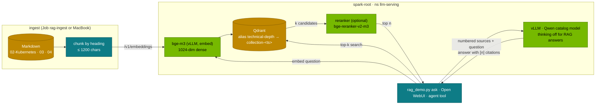

# Chapter 11 · RAG with Qwen, BGE & Qdrant

> **04-Qwen · Part IV — Applications · Chapter 11 of 14** · ← [Chapter 10 · Qwen-Agent & function calling](10-qwen-agent-and-function-calling.md) · [All chapters](00-qwen-step-by-step-guide.md) · [Chapter 12 · Open WebUI & LiteLLM](12-open-webui-and-litellm.md) →

| | |
|---|---|
| **You will build** | Retrieval-augmented answers from a Qwen model over this repository: BGE-M3 embeddings on vLLM, a Qdrant collection behind a blue/green alias, a measured retrieval quality (hit@k, MRR) and cited answers — all with 03-DeepSeek's RAG stack, pointed at a Qwen catalog model. Then the hybrid extensions: sparse + dense fusion with RRF and a cross-encoder reranker, and when to use Qwen's long context instead of retrieval |
| **Hardware** | dgx-spark-1 |
| **Time** | 90 min |
| **Risk** | Low. bge-m3 adds util 0.06 (~7 GiB, 9 Gi pod) to the chat model; Qdrant uses the `local-nvme-retain` StorageClass |
| **Clusters** | `spark-root` (vLLM, bge-m3, Qdrant in `llm-serving`; the ingest Job) · optionally `dev-llms` (`qwen3-0.6b` for prompt-template trials) |
| **Lab files** | reused from 03: [`k8s/apps/bge-m3.yaml`](../03-DeepSeek/lab/k8s/apps/bge-m3.yaml), [`tools/rag_demo.py`](../03-DeepSeek/lab/tools/rag_demo.py), [`data/rag_gold.jsonl`](../03-DeepSeek/lab/data/rag_gold.jsonl), [`k8s/jobs/rag-ingest.yaml`](../03-DeepSeek/lab/k8s/jobs/rag-ingest.yaml); from 02: [`qdrant-statefulset.yaml`](../02-Kubernetes/lab/manifests/root-llms/50-workloads/qdrant-statefulset.yaml); from this module: [`models.yaml`](lab/models.yaml), [`scripts/serve-model.sh`](lab/scripts/serve-model.sh) |

---

## 1. Why this matters on a Spark

A model knows what was in its training data up to a cut-off date; your runbooks, configs and tickets were not in it. RAG retrieves the relevant passages at question time and puts them in the prompt with an instruction to answer only from them and cite them. It is usually the first useful application on a lab LLM, and on a Spark it is cheap to run because every piece fits beside the chat model:

| Component | Runs as | Memory |
|---|---|---|
| Chat model (`qwen3-4b-instruct` or `qwen3-8b`) | vLLM `vllm` Deployment, util 0.12 / 0.20 | ~15 / ~24 GiB, pod 20 / 32 Gi |
| BGE-M3 embeddings | vLLM `bge-m3` Deployment, util 0.06 | ~7 GiB, pod 9 Gi (request = limit) |
| Reranker (optional) | vLLM, cross-encoder | a few GiB at a small util |
| Qdrant | StatefulSet, CPU + NVMe | index in RAM, a few GiB for this repo |

Sum of util for `qwen3-8b` + embeddings: 0.26 — far under the 0.72 rule, so a second chat model or a reranker still fits.

Qwen models also make the alternative tempting: Qwen2.5 and Qwen3 take 32K tokens natively and up to 128K with YaRN. Section 3.5 compares "stuff the whole document in" with retrieval; on a Spark the KV-cache cost of long context usually decides it.

---

## 2. Architecture — HLD



Nothing here is Qwen-specific except the last hop, and that is the point: the retrieval half (03's bge-m3 Deployment, 02's Qdrant StatefulSet, 03's `rag_demo.py`) is shared by both LLM modules. To use a Qwen model you change one argument, `--chat-model`, and decide whether that model should think.

**Blue/green index.** `rag_demo.py ingest` writes to a new physical collection `technical-depth-<timestamp>`, checks retrieval quality on the gold set (`--gate`), and only then moves the alias `technical-depth` to it. Readers always query the alias, so they never see a half-built index, and `rollback` moves the alias back.

---

## 3. LLD

### 3.1 BGE-M3: three representations from one model

BGE-M3 is a multilingual (100+ languages), 8K-token embedding model that can produce three outputs in one forward pass:

| Output | Shape | Score | Good at |
|---|---|---|---|
| Dense | one 1024-dim vector (normalised CLS state) | cosine / dot product | meaning, paraphrase, cross-lingual |
| Sparse (lexical) | weight per vocabulary token, $w_v = \max_{i: x_i = v} \text{ReLU}(W h_i)$ | dot product over shared tokens | exact identifiers: error codes, flags, names |
| Multi-vector (ColBERT) | one vector per token | $\sum_{q} \max_{d} e_q^\top e_d$ | fine-grained matching, expensive to store |

vLLM's `/v1/embeddings` (the `bge-m3` Deployment, `--task=embed`) returns the **dense** vector, which is what the lab indexes. Sparse and multi-vector outputs need the FlagEmbedding library (`BGEM3FlagModel(...).encode(..., return_sparse=True)`), which you would run in a Job or a small service of your own (§5.6).

Mixed-language corpora are where BGE-M3 and Qwen pair well: a question in German retrieves an English runbook section through the dense vector, and Qwen answers in German.

### 3.2 Hybrid retrieval with Reciprocal Rank Fusion

Dense search misses exact tokens (`--tool-call-parser`, `Xid 79`); lexical search misses paraphrase. Run both and fuse by rank, not score, because the two scores live on different scales:

$$\text{RRF}(d) = \sum_{m \in \{\text{dense}, \text{sparse}\}} \frac{1}{k + r_m(d)}, \qquad k = 60$$

$r_m(d)$ is the rank of $d$ in list $m$ (a document missing from a list contributes 0). Worked example:

```text
dense : A(1) B(2) C(3)        sparse : B(1) D(2) A(3)
RRF(A) = 1/61 + 1/63 = 0.03227
RRF(B) = 1/62 + 1/61 = 0.03252   ← first: high in both lists
RRF(D) = 0    + 1/62 = 0.01613
RRF(C) = 1/63 + 0    = 0.01587
```

$k$ damps the influence of the very top ranks; 60 is the usual default and rarely worth tuning. Qdrant does the fusion server-side with its Query API (`prefetch` both vector types, `query: {"fusion": "rrf"}`), so the client sends one request.

### 3.3 Reranking

Bi-encoders (BGE-M3) embed query and document separately: fast, pre-computable, but no token in the query ever attends to a token in the document. A cross-encoder (`BAAI/bge-reranker-v2-m3`) reads `[query ; document]` together and outputs one relevance score, which captures negation and conditions ("works on GB10 *unless* …") that a single vector blurs. It is too slow to run over the whole corpus, so the standard shape is: retrieve 20–50 candidates cheaply, rerank them, keep the top 3–8 for the prompt. vLLM can serve cross-encoders with a score/rerank endpoint; check the pinned image's support (`--task score` or the current equivalent) before deploying one.

### 3.4 The prompt for Qwen

`rag_demo.py ask` builds the prompt as numbered sources plus the question, with an instruction to answer only from the sources, cite them as `[n]`, and say so when the sources don't contain the answer. For Qwen models three details matter:

| Detail | Choice | Why |
|---|---|---|
| Thinking | off for routine questions (`enable_thinking: false`, or a non-thinking catalog model) | thinking roughly multiplies output tokens; for "find and quote" it adds latency, not accuracy |
| Thinking on reasoning models | `rag_demo.py` drops `reasoning_content` from the answer it prints | citations are checked against `content` only |
| Context budget | k × chunk size well under `--max-model-len` | the catalog's 4B and 8B run at 32K, which leaves room; prefix caching reuses the instruction part |
| Language | answer in the question's language | Qwen follows this reliably when the instruction says so |

Faithfulness is checked, not assumed: every `[n]` must refer to a source that was actually in the prompt, and an answer without citations to a question the gold set says is answerable is a miss (§5.4).

### 3.5 Long context or retrieval?

Qwen2.5/Qwen3 support 32K natively; with YaRN (`--rope-scaling '{"rope_type":"yarn","factor":4.0,"original_max_position_embeddings":32768}' --max-model-len 131072`) up to 128K. YaRN in vLLM is static: it applies to every request, including short ones, and can lower quality on short texts, so enable it only on a deployment that needs long inputs (Chapter 01).

The cost is the KV cache. Per token, per sequence: $2 \times \text{layers} \times \text{kv\_heads} \times \text{head\_dim} \times 2$ bytes (BF16).

| Model | KV / token | 8K prompt | 32K prompt | 128K prompt |
|---|---|---|---|---|
| Qwen2.5-7B (28 L, 4 KV heads, 128) | 56 KiB | 0.44 GiB | 1.75 GiB | 7 GiB |
| Qwen3-8B (36 L, 8 KV heads, 128) | 144 KiB | 1.1 GiB | 4.5 GiB | 18 GiB |
| Qwen2.5-32B (64 L, 8 KV heads, 128) | 256 KiB | 2 GiB | 8 GiB | 32 GiB |

At util 0.20 (~24 GiB) a Qwen3-8B in BF16 (~16 GiB of weights) has roughly 6–7 GiB of KV cache: one 32K request fits, a single 128K request does not. A RAG prompt of 8 chunks is 2–4K tokens, so dozens of concurrent users fit in the same cache. Rule of thumb on a Spark: retrieval for collections and for anything multi-user; long context for a single long document read by one user at a time, on a deployment sized for it.

### 3.6 Measuring retrieval

The gold set (`03-DeepSeek/lab/data/rag_gold.jsonl`) maps questions to the file that contains the answer.

$$\text{hit@k} = \frac{|\{q : \text{gold}(q) \in \text{top-}k(q)\}|}{|Q|}, \qquad \text{MRR} = \frac{1}{|Q|}\sum_{q} \frac{1}{\text{rank}_q}$$

hit@k tells you whether the answer was retrievable at all; MRR whether it was near the top (what matters when you keep only a few chunks). Measure before and after every change — chunk size, embedding model, hybrid, reranker — and gate re-ingests on it (`--gate`). Add Qwen-chapter questions to the gold set for this module's files; the gold format is one JSON object per line, `{"question": "…", "expect": "04-Qwen/10-qwen-agent-and-function-calling.md"}`.

---

## 4. Integrations

| With | How | Chapter |
|---|---|---|
| Chat model | `scripts/serve-model.sh <qwen catalog name>`; `rag_demo.py --chat-model <same name>` | [04](04-serving-qwen-with-vllm-and-sglang.md) |
| Embeddings / Qdrant / ingest Job | 03's `k8s/apps/bge-m3.yaml`, `k8s/jobs/rag-ingest.yaml`; 02's Qdrant StatefulSet | [03 Chapter 13](../03-DeepSeek/13-rag-with-qdrant-and-bge.md) |
| Open WebUI document RAG | Open WebUI uses the `embeddings` alias through LiteLLM | [12](12-open-webui-and-litellm.md) |
| RAG as an agent tool | `search_docs` tool over the same alias | [10](10-qwen-agent-and-function-calling.md) |
| Images and scanned PDFs | Qwen-VL turns pages into text/markdown before chunking | [03](03-vision-language-models.md) |
| Storage | Qdrant on `local-nvme-retain`; snapshot before re-ingest experiments | [02-Kubernetes Chapter 13](../02-Kubernetes/13-storage-csi-and-high-performance-volumes.md) |

---

## 5. Lab

### 5.1 Bring up the retrieval half

#### What this lab does (02 StatefulSet `qdrant` + 03 manifest `k8s/apps/bge-m3.yaml`)

- **Checks** that 02's Qdrant StatefulSet runs in `llm-serving` on `spark-root`. It is platform, not part of this module.
- **Applies** 03's BGE-M3 Deployment and Service: vLLM in embedding mode (`--task=embed`, served name `bge-m3`, util 0.06), 1 CPU · 9 Gi · 1 slice, request = limit, on the 02 base vLLM image. The first start downloads the model into `model-cache`.
- **Reads** `serving-budget`. Nothing else changes.

#### What to look for

1. **Qdrant:** `qdrant   1/1`.
2. **BGE-M3:** `deployment "bge-m3" successfully rolled out` within 20 minutes.
3. **Quota:** `requests.memory` used grows by 9Gi; `requests.nvidia.com/gpu` by 1.

**If something's off:** `statefulsets.apps "qdrant" not found` → apply 02's `root-llms` (below). BGE-M3 Pending → memory, quota or slices; `kubectl --context spark-root -n llm-serving describe pod -l app=bge-m3`. More in §7.

#### Run it

```bash
# ▶ MacBook · 04-Qwen/lab
kubectl --context spark-root -n llm-serving get statefulset qdrant
kubectl --context spark-root apply -f ../../03-DeepSeek/lab/k8s/apps/bge-m3.yaml
kubectl --context spark-root -n llm-serving rollout status deploy/bge-m3 --timeout=20m
kubectl --context spark-root -n llm-serving describe quota serving-budget | grep -E 'memory|nvidia'
```

If Qdrant is missing, apply 02's `root-llms` layer as 02-Kubernetes Chapter 13 describes; it is a platform component, not part of this module.

### 5.2 Serve a Qwen chat model

#### What this lab does (`serve-model.sh qwen3-4b-instruct` + three port-forwards)

- **Serves** Qwen3-4B-Instruct-2507 as the main model behind `svc/vllm` (util 0.12, 20 Gi, non-thinking). With BGE-M3 the util sum is 0.18.
- **Port-forwards** to the MacBook: Qdrant on 6333, BGE-M3 on 8001, the chat model on 8000. They run in the background until you stop them.

#### What to look for

1. **Script output:** `[PASS] budget: running 0.06 + qwen3-4b-instruct 0.12 ≤ 0.72` (BGE-M3 counted), `[PASS] vllm ready with qwen3-4b-instruct`, `0 failed`.
2. **Pods:** one `vllm-…` and one `bge-m3-…` pod, both `1/1 Running`.
3. **Port-forwards:** three `Forwarding from 127.0.0.1:… -> …` lines.

**If something's off:** `bind: address already in use` → an old port-forward still runs; `pkill -f 'port-forward'` and start again.

#### Run it

```bash
# ▶ MacBook · 04-Qwen/lab
scripts/serve-model.sh qwen3-4b-instruct
kubectl --context spark-root -n llm-serving get pods -l 'app in (vllm,bge-m3)'
```

Open port-forwards for the MacBook tools (the in-cluster defaults of `rag_demo.py` point at Service DNS names):

```bash
# ▶ MacBook · 04-Qwen/lab
kubectl --context spark-root -n llm-serving port-forward svc/qdrant 6333:6333 &
kubectl --context spark-root -n llm-serving port-forward svc/bge-m3 8001:8000 &
kubectl --context spark-root -n llm-serving port-forward svc/vllm 8000:8000 &
```

### 5.3 Ingest with a quality gate

#### What this lab does (tool `03-DeepSeek/lab/tools/rag_demo.py ingest --gate 0.6`)

- **Chunks** the Markdown of `02-Kubernetes`, `03-DeepSeek` and `04-Qwen` by heading, embeds every chunk with BGE-M3 and writes a new Qdrant collection `technical-depth-<timestamp>`.
- **Gate:** runs the gold questions (`03-DeepSeek/lab/data/rag_gold.jsonl`) against the new collection first. Only if hit@5 ≥ 0.6 does the alias `technical-depth` move to it; otherwise the new collection is deleted and the alias stays.
- **Keeps** the live collection and the previous one (for rollback); older ones are pruned.

#### What to look for

1. **Ingest output:** `N files → M chunks`, `collection technical-depth-…: M points, dim 1024`, `gate passed`, `alias technical-depth: … → technical-depth-…`.
2. **Collection:** `points_count` equal to M, `status` `green`.
3. **Aliases:** `technical-depth` → the newest `technical-depth-<timestamp>`.

**If something's off:** `GATE FAILED: hit@5 below 0.6` → inspect the misses with `eval` (§5.4); the old index keeps serving. A vector size error → an old collection from another embedding model; ingest always creates a new one. More in §7.

#### Run it

```bash
# ▶ MacBook · 04-Qwen/lab
python3 ../../03-DeepSeek/lab/tools/rag_demo.py ingest --repo ../.. \
  --dirs 02-Kubernetes 03-DeepSeek 04-Qwen \
  --qdrant http://localhost:6333 --embed-url http://localhost:8001 --gate 0.6
curl -s localhost:6333/collections/technical-depth | python3 -m json.tool | grep -E 'points_count|status'
curl -s localhost:6333/aliases | python3 -m json.tool
```

The gate runs the gold set against the new collection before it goes live; if hit@5 is below 0.6 it deletes the new collection and leaves the alias where it was. For a scheduled re-ingest inside the cluster, 03's `k8s/jobs/rag-ingest.yaml` runs the same command as a Job.

### 5.4 Measure retrieval, then ask

#### What this lab does (`rag_demo.py eval` and `ask`)

- **`eval`:** runs every gold question against the live alias and prints hit@1, hit@5 and MRR, plus a `MISS` line for each question whose expected file isn't the top hit.
- **`ask`:** embeds the question, takes the top 5 chunks and asks `qwen3-4b-instruct` for an answer with `[n]` citations; `--show-context` prints the chunks first. Read-only.

#### What to look for

1. **`eval`:** `… questions  hit@1 …  hit@5 …  MRR …` with hit@5 at or above the 0.6 gate.
2. **`ask`:** the printed context, then an answer naming `qwen3_coder`, then `sources:` with `[1]`…`[5]`, score, path and heading. Every `[n]` in the answer matches a chunk that says what the sentence claims.
3. **Record** hit@1, hit@5 and MRR in the table below.

**If something's off:** `[7]` with 5 sources → the model invents citation numbers. A good context but a wrong answer → too much context, or try thinking off. More in §7.

#### Run it

```bash
# ▶ MacBook · 04-Qwen/lab
python3 ../../03-DeepSeek/lab/tools/rag_demo.py eval -k 5 --qdrant http://localhost:6333 --embed-url http://localhost:8001
python3 ../../03-DeepSeek/lab/tools/rag_demo.py ask "Which tool-call parser does Qwen3-Coder need in vLLM?" \
  --qdrant http://localhost:6333 --embed-url http://localhost:8001 \
  --chat-url http://localhost:8000 --chat-model qwen3-4b-instruct --show-context
```

Record hit@1, hit@5 and MRR. Read the answer against the printed context: every `[n]` should point at a chunk that says what the sentence claims.

| Setting | hit@1 | hit@5 | MRR |
|---|---|---|---|
| dense, chunk 1200 chars | record yours | | |
| dense, after adding 04-Qwen questions to the gold set | | | |
| hybrid RRF (§5.6) | | | |

### 5.5 Thinking or not

#### What this lab does (`serve-model.sh qwen3-8b` + two `curl` requests)

- **Switches** the main model to Qwen3-8B (util 0.20, hybrid thinking, `qwen3` reasoning parser). The port-forward on 8000 may drop during the switch.
- **Asks** the same one-sentence question with `enable_thinking` true and false, timing each with `/usr/bin/time`.

#### What to look for

1. **Two result lines** plus `real …` times: with thinking on, many more completion tokens and seconds than with thinking off.
2. **`thinking chars`:** above 0 with thinking on, 0 with thinking off.

**If something's off:** `thinking chars 0` in both rows while the completion tokens differ a lot → the image returns the trace as `reasoning`, and the one-liner reads only `reasoning_content`; read both fields. `Connection refused` → restart the port-forward.

#### Run it

Switch to a hybrid-thinking Qwen3 model and ask the same question twice — thinking on (default) and off — and compare latency and answer quality.

```bash
# ▶ MacBook · 04-Qwen/lab
scripts/serve-model.sh qwen3-8b
for think in true false; do
  /usr/bin/time -p curl -s localhost:8000/v1/chat/completions -H 'Content-Type: application/json' -d "{
    \"model\": \"qwen3-8b\", \"max_tokens\": 4096,
    \"chat_template_kwargs\": {\"enable_thinking\": $think},
    \"messages\": [{\"role\": \"user\", \"content\": \"In one sentence: what does --gpu-memory-utilization 0.20 mean on a DGX Spark?\"}]
  }" | python3 -c 'import json,sys; d=json.load(sys.stdin); m=d["choices"][0]["message"]; print("thinking chars", len(m.get("reasoning_content") or ""), "| completion tokens", d["usage"]["completion_tokens"])'
done
```

(The port-forward to `svc/vllm` reconnects to the new pod; restart it if it dropped during the switch.) For citation-style RAG answers, thinking off is the usual default; keep thinking for questions that need several sources combined.

### 5.6 Extension: hybrid search and reranking

#### What this lab does (Qdrant collection `td-hybrid`)

- **Creates** a new, empty collection `td-hybrid` with a named dense vector (1024, cosine) and a named sparse vector `lexical`. The live `technical-depth` alias is not touched.
- **Fills it yourself:** BGE-M3 dense vectors and lexical weights for the same chunks (FlagEmbedding, in a Job on the GB10 or on the MacBook for a small corpus). The query shape fuses both with RRF.

#### What to look for

1. **Create:** `{"result":true,"status":"ok",…}`.
2. **Query** (after upserting real vectors): up to 8 points, each with an id and a fused score.
3. **The comparison:** hit@k and MRR for hybrid next to the dense-only row; keep hybrid only if it helps your questions.

**If something's off:** a 400 on the query with the placeholder vectors → expected; the dense query needs 1024 entries.

#### Run it

The lab's collection holds dense vectors only. To try hybrid retrieval, create a collection with a named dense and a named sparse vector, fill the sparse side with BGE-M3 lexical weights (FlagEmbedding in a Job on the GB10, or on the MacBook for a small corpus), and query with fusion:

```bash
# ▶ MacBook · 04-Qwen/lab
curl -s -X PUT localhost:6333/collections/td-hybrid -H 'Content-Type: application/json' -d '{
  "vectors": {"dense": {"size": 1024, "distance": "Cosine"}},
  "sparse_vectors": {"lexical": {}}
}'
# after upserting points with both vectors:
curl -s -X POST localhost:6333/collections/td-hybrid/points/query -H 'Content-Type: application/json' -d '{
  "prefetch": [
    {"query": [0.01, 0.02], "using": "dense", "limit": 30},
    {"query": {"indices": [1012, 3871], "values": [0.41, 0.27]}, "using": "lexical", "limit": 30}
  ],
  "query": {"fusion": "rrf"}, "limit": 8
}'
```

(The vectors shown are placeholders — the real query vector has 1024 entries and the sparse indices come from BGE-M3's tokenizer.) Compare hit@k and MRR with the dense-only collection on the same gold set; keep hybrid only if it measurably helps your questions. A reranker is the next step after that, and its memory (util) counts against the same 0.72 sum.

---

## 6. Verify

| Check | Command | Expected |
|---|---|---|
| Embeddings answer | `curl -s localhost:8001/v1/embeddings -H 'Content-Type: application/json' -d '{"model":"bge-m3","input":["x"]}' \| python3 -c 'import json,sys;print(len(json.load(sys.stdin)["data"][0]["embedding"]))'` | `1024` |
| Alias points to the new collection | `curl -s localhost:6333/aliases` | `technical-depth` → `technical-depth-<ts>` |
| Gate held | §5.3 output | alias moved only with hit@5 ≥ gate |
| Retrieval measured | §5.4 | hit@1/hit@5/MRR recorded |
| Answers cite sources | §5.4 `ask` | `[n]` markers, each matching a printed chunk |
| Budget | `kubectl --context spark-root -n llm-serving describe quota serving-budget` | used ≤ hard; util sum (chat + 0.06) ≤ 0.72 |

---

## 7. Troubleshooting

| You see | Cause | Fix |
|---|---|---|
| `Connection refused` to `qdrant.llm-serving` from the MacBook | in-cluster DNS names used outside the cluster | port-forwards (§5.2) and `--qdrant/--embed-url/--chat-url` flags |
| Ingest: vector size mismatch | collection created with another embedding model | new collection (ingest always creates one); don't reuse old names |
| Gate refuses to move the alias | hit@5 below `--gate` | inspect `eval` misses; chunking or a stale gold set; lower the gate only deliberately |
| Good retrieval, answer ignores sources | prompt too long, sources at the end truncated, or thinking drifts | fewer/shorter chunks; thinking off; check `--max-model-len` vs prompt length |
| Answers cite `[7]` with 5 sources | model invents citation numbers | keep k small; validate citations in the client; a stronger model |
| Exact identifiers not found | dense-only retrieval | hybrid RRF (§5.6), or add identifier-rich text to chunks (headings) |
| Answers in English to German questions | instruction missing | "answer in the language of the question" in the system prompt |
| bge-m3 Pending | memory/quota/slices | `describe pod`; park another engine; Chapter 06 budget table |
| 128K request fails or evicts others | KV cache too small at util 0.20 | separate long-context deployment with higher util, run alone (§3.5) |
| `<think>` in printed answers | model without reasoning parser | the catalog entry of a thinking model must carry `--reasoning-parser` in its `args` |

---

## 8. Scale-out path

Retrieval scales separately from generation. With dgx-spark-2, move bge-m3 (and a reranker) there and keep the chat model alone on dgx-spark-1, which frees ~7 GiB of the pool for KV cache; Qdrant can stay where its PVC is (local NVMe is node-bound) or be re-created on the other node from a snapshot. Qdrant itself scales by sharding and replication across nodes, which only pays off far beyond a documentation corpus. Re-ingest Jobs belong in `batch` with Kueue so they never compete with interactive traffic.

---

## 9. Checklist

- [ ] bge-m3 runs beside a Qwen chat model inside `serving-budget`; util sum recorded.
- [ ] Ingest created a new collection, passed the gate and moved the alias; I know how to roll back.
- [ ] hit@1, hit@5 and MRR are recorded, and I have added gold questions for 04-Qwen files.
- [ ] `rag_demo.py ask` with `--chat-model <qwen catalog name>` returns cited answers that match the context.
- [ ] I compared thinking on/off for RAG answers on a Qwen3 hybrid model.
- [ ] I can explain RRF with $k = 60$, when a reranker is worth its memory, and when long context beats retrieval on a Spark.
