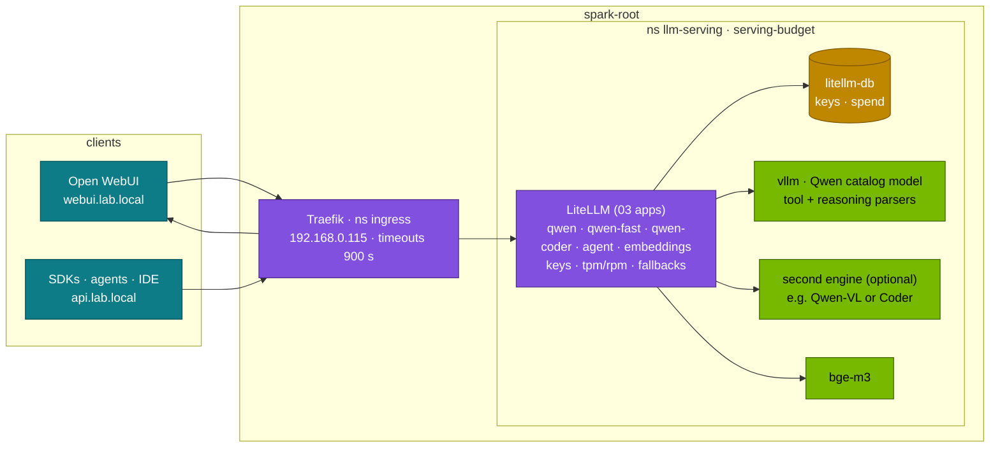

# Chapter 12 · Open WebUI & LiteLLM

> **04-Qwen · Part IV — Applications · Chapter 12 of 14** · ← [Chapter 11 · RAG with Qwen, BGE & Qdrant](11-rag-with-qwen-bge-and-qdrant.md) · [All chapters](00-qwen-step-by-step-guide.md) · [Chapter 13 · Telemetry & troubleshooting](13-telemetry-and-troubleshooting.md) →

| | |
|---|---|
| **You will build** | Qwen models behind the lab's existing gateway: LiteLLM aliases for the Qwen catalog (`qwen`, `qwen-nothink`, `qwen-fast`, `agent`, `qwen-coder`, `qwen-vl`), a scoped virtual key with token and request limits you can watch trip, thinking on/off per alias and per Open WebUI preset, fallbacks between Qwen models, and Open WebUI showing Qwen3's thinking, calling tools natively and reading images with a Qwen-VL model — all on 03-DeepSeek's LiteLLM, PostgreSQL and Open WebUI, not a second copy |
| **Hardware** | dgx-spark-1 |
| **Time** | 75 min |
| **Risk** | Low. Editing the LiteLLM model list restarts LiteLLM (a few seconds of 503s on `api.lab.local`) |
| **Clusters** | `spark-root` only: `llm-serving` (serving-budget), behind Traefik in `ingress` at 192.168.0.115 |
| **Lab files** | reused from 03: [`k8s/apps/litellm.yaml`](../03-DeepSeek/lab/k8s/apps/litellm.yaml), [`k8s/apps/litellm-db.yaml`](../03-DeepSeek/lab/k8s/apps/litellm-db.yaml), [`k8s/apps/open-webui.yaml`](../03-DeepSeek/lab/k8s/apps/open-webui.yaml), [`k8s/apps/bge-m3.yaml`](../03-DeepSeek/lab/k8s/apps/bge-m3.yaml), [`tools/stream_probe.py`](../03-DeepSeek/lab/tools/stream_probe.py); from this module: [`models.yaml`](lab/models.yaml), [`scripts/serve-model.sh`](lab/scripts/serve-model.sh), [`tools/fc_check.py`](lab/tools/fc_check.py) |

Prerequisites: 03-DeepSeek [Chapter 12](../03-DeepSeek/12-open-webui-and-litellm-gateway.md) Tasks 5.1–5.2 (apps deployed, `api.lab.local` and `webui.lab.local` in the MacBook's `/etc/hosts`, the master key readable) and a Qwen model serving ([Chapter 04](04-serving-qwen-with-vllm-and-sglang.md)). That chapter covers the gateway itself — PostgreSQL, teams, spend, backups and the restore drill; this one covers what changes when the models behind it are Qwen.

---

## 1. Why this matters on a Spark

The Spark serves one or two chat models at a time and the set changes: a Qwen3 hybrid model for general chat, a Qwen2.5-Coder for the IDE plug-in, a Qwen-VL for a document session, an R1 distill from module 03 for a comparison. Clients should never know which one is loaded. LiteLLM gives them stable names; you move the names.

Qwen adds two gateway questions that a single-mode model doesn't raise:

1. **Thinking or not.** The same Qwen3 hybrid weights answer in two modes. Users want the fast mode for most chat and the thinking mode for hard questions; that choice must be reachable from Open WebUI and from SDK clients without a second copy of the model in memory.
2. **Tools and images.** Tool calling only works end to end if the gateway forwards `tools` untouched and the served model has the right parser (Chapter 10); images only work if the alias points at a VL model.

---

## 2. Architecture — HLD



The data path is 03's: Traefik → LiteLLM → engine Service. What this chapter changes is the **model list** in the `litellm-config` ConfigMap and the **model presets** in Open WebUI. LiteLLM addresses a vLLM engine by its Service and served model name (`hosted_vllm/<catalog name>`); the 04 overlays serve the catalog name, so an alias line names a catalog entry.

---

## 3. LLD

### 3.1 Qwen aliases

| Alias | Points at (example catalog names) | Thinking | Clients |
|---|---|---|---|
| `qwen` | `qwen3-8b` (main engine, svc `vllm`) | on (model default) | Open WebUI "Qwen (thinking)", SDKs |
| `qwen-nothink` | the same engine, `enable_thinking: false` | off | test of the request-level switch (§5.3) |
| `qwen-fast` | `qwen3-4b-instruct` (side engine, svc `vllm-qwen3-4b-instruct`) | never | Open WebUI default, most SDK traffic |
| `agent` | `qwen3-4b-instruct` (same side engine) | never | agents with virtual keys (Chapter 10) |
| `qwen-coder` | `qwen3-coder-30b-fp8` (set `coding`, served as the main model) | — | IDE plug-ins, coding agents |
| `qwen-vl` | `qwen3-vl-8b` (side engine, when served) | — | image and document chats ([Chapter 03](03-vision-language-models.md)) |
| `embeddings` | `bge-m3` (unchanged from 03) | — | Open WebUI RAG, `rag_demo.py` |

The catalog set `everyday` is exactly this: `qwen3-8b` (util 0.20, 32 Gi) plus `qwen3-4b-instruct` (0.12, 20 Gi) next to the 03 apps (bge-m3 0.06) — Σ util 0.38, well inside 0.72. There are two ways to get a non-thinking answer, in order of preference:

1. **A non-thinking model** (`qwen-fast` → `qwen3-4b-instruct`). The *-Instruct-2507 models never think, so there is no request-level switch to get wrong. It costs a second engine (~15 GiB of the pool).
2. **The template switch on the shared engine** (`qwen-nothink`). Put `chat_template_kwargs: {enable_thinking: false}` into the request. From LiteLLM that means passing it through `litellm_params` as an extra body field, which depends on the LiteLLM version and the `drop_params` setting — §5.3 verifies it rather than trusting it. For Open WebUI, a model preset with the system prompt `/no_think` works on original Qwen3 hybrid models without any gateway support (not on the 2507 split models, which ignore soft switches).

### 3.2 Limits: what a token bucket does to a chat

LiteLLM enforces `tpm_limit` and `rpm_limit` per key (and per team, per model deployment). The behaviour is a token bucket: capacity $C$, refill rate $r = \text{TPM}/60$ per second, balance $B$. A request needing $k$ tokens at time $t$:

$$B(t) = \min\big(C,\; B(t_{\text{last}}) + r\,(t - t_{\text{last}})\big), \qquad \text{admit if } B(t) \ge k \text{, then } B \leftarrow B - k \text{; else HTTP 429}$$

For Qwen this matters because thinking multiplies the output tokens: a thinking answer can use 5–20× the tokens of the same answer without thinking. A key with `tpm_limit: 20000` that serves ~40 non-thinking answers a minute may serve only a handful with thinking on. Size TPM on the alias the key may use, and give thinking aliases to fewer keys. Record your own ratio in §5.4 rather than relying on the 5–20× range.

### 3.3 Failures, retries and cooldown

| LiteLLM setting (03 config) | Effect | Qwen use |
|---|---|---|
| `num_retries: 2` | retry the same deployment on 5xx/timeouts | covers a vLLM restart during a model switch |
| `allowed_fails: 3`, `cooldown_time: 60` | a deployment failing 3× in a minute is skipped for 60 s (a circuit breaker) | a crashed engine stops eating retries |
| `fallbacks` | on failure, try the next alias | `qwen` → `qwen-fast` → `reasoning-fast` |
| `timeout: 900` | per-request ceiling | thinking answers are long; matches Traefik's 900 s |

Retry back-off in most clients follows truncated exponential back-off with jitter, $t_{\text{wait}} = \min(t_{\max}, t_0 2^{n}) + U(0, \delta)$; with LiteLLM in front, client retries stack on top of gateway retries, so keep client retries low (1–2).

### 3.4 Open WebUI with Qwen

| Feature | What Qwen needs | Setting |
|---|---|---|
| Thinking display | vLLM `--reasoning-parser qwen3` so thinking arrives as `reasoning_content` | nothing in Open WebUI; it renders a collapsible "Thought for N seconds" block |
| Thinking off for a preset | `/no_think` system prompt (hybrid models), or the `qwen-fast` alias | Workspace → Models → new model on top of `qwen`, system prompt |
| Native tool calling | the served model's tool-call parser (Chapter 10) | model's Advanced Params → Function Calling: Native |
| Images | alias pointing at a Qwen-VL model | the model must be marked with vision capability in Workspace → Models |
| Document RAG | `embeddings` alias (bge-m3) | unchanged from 03 |
| Long answers | Traefik and `AIOHTTP_CLIENT_TIMEOUT` at 900 s | set by 03's manifests |

---

## 4. Integrations

| With | How | Chapter |
|---|---|---|
| The gateway itself (DB, teams, spend, backup) | 03's apps and tasks | [03 Chapter 12](../03-DeepSeek/12-open-webui-and-litellm-gateway.md) |
| Serving the models | `scripts/serve-model.sh`; util sum ≲ 0.72 for two engines | [04](04-serving-qwen-with-vllm-and-sglang.md), [06](06-kubernetes-deployment-and-weight-caching.md) |
| Tool calling through the gateway | `fc_check.py run --model agent` | [10](10-qwen-agent-and-function-calling.md) |
| RAG | `embeddings` alias; `rag_demo.py` | [11](11-rag-with-qwen-bge-and-qdrant.md) |
| Secrets | master key and Open WebUI secret from Vault (`kv/spark-lab/…`) | [03 Chapter 15](../03-DeepSeek/15-automation-secrets-and-day2.md) |
| Streaming hops | Traefik timeouts, buffering | [03 Chapter 08](../03-DeepSeek/08-kubernetes-deployment-storage-and-streaming.md) |
| Metrics | LiteLLM and vLLM in Prometheus | [13](13-telemetry-and-troubleshooting.md) |

---

## 5. Lab

### 5.1 Serve the Qwen models and check the budget

```bash
# ▶ MacBook · 04-Qwen/lab
scripts/serve-model.sh list                              # the sets: everyday = qwen3-8b + qwen3-4b-instruct
scripts/serve-model.sh qwen3-8b
scripts/serve-model.sh qwen3-4b-instruct --side
for d in vllm vllm-qwen3-4b-instruct bge-m3; do
  echo "$d $(kubectl --context spark-root -n llm-serving get deploy $d -o jsonpath='{.spec.template.spec.containers[0].args}' | grep -o 'gpu-memory-utilization=[0-9.]*')"
done
kubectl --context spark-root -n llm-serving describe quota serving-budget | grep -E 'memory|nvidia'
```

`serve-model.sh` refuses a model that would push Σ util over 0.72 (`FORCE=1` overrides it — don't). Memory is the tighter limit with the apps: 32 + 20 Gi for the two engines plus ~19 Gi for the 03 apps leaves no room in `serving-budget` (90 Gi) for a third 32 Gi engine such as `qwen3-vl-8b`; stop the side model (`scripts/serve-model.sh --stop-side qwen3-4b-instruct`) before serving the VL model as a side engine.

### 5.2 Add the Qwen aliases

Edit the `model_list` in `03-DeepSeek/lab/k8s/apps/litellm.yaml` (ConfigMap `litellm-config`). Add, keeping 03's entries (replace 03's `agent` entry):

```yaml
      - model_name: qwen
        litellm_params: {model: hosted_vllm/qwen3-8b, api_base: http://vllm.llm-serving:8000/v1, api_key: none}
      - model_name: qwen-nothink
        litellm_params:
          model: hosted_vllm/qwen3-8b
          api_base: http://vllm.llm-serving:8000/v1
          api_key: none
          extra_body: {chat_template_kwargs: {enable_thinking: false}}
      - model_name: qwen-fast
        litellm_params: {model: hosted_vllm/qwen3-4b-instruct, api_base: http://vllm-qwen3-4b-instruct.llm-serving:8000/v1, api_key: none}
      - model_name: agent
        litellm_params: {model: hosted_vllm/qwen3-4b-instruct, api_base: http://vllm-qwen3-4b-instruct.llm-serving:8000/v1, api_key: none}
      - model_name: qwen-coder
        litellm_params: {model: hosted_vllm/qwen3-coder-30b-fp8, api_base: http://vllm.llm-serving:8000/v1, api_key: none}
      - model_name: qwen-vl
        litellm_params: {model: hosted_vllm/qwen3-vl-8b, api_base: http://vllm-qwen3-vl-8b.llm-serving:8000/v1, api_key: none}
```

and extend `router_settings.fallbacks` with `{"qwen": ["qwen-fast"]}` and `{"qwen-fast": ["qwen"]}`. Only aliases whose catalog name is currently served will answer; the others fail and fall back where a fallback exists (§5.5).

```bash
# ▶ MacBook · 04-Qwen/lab
kubectl --context spark-root apply -k ../../03-DeepSeek/lab/k8s/apps
kubectl --context spark-root -n llm-serving rollout restart deploy/litellm
kubectl --context spark-root -n llm-serving rollout status deploy/litellm
KEY=$(kubectl --context spark-root -n llm-serving get secret litellm-master-key -o jsonpath='{.data.key}' | base64 -d)
API=http://api.lab.local
H=(-H "Authorization: Bearer $KEY" -H 'Content-Type: application/json')
curl -s $API/v1/models "${H[@]}" | jq -r '.data[].id' | grep -E '^(qwen|agent)'
```

Keep this edit in your fork of the repo (or in Git behind Argo CD, 03 Chapter 15); a later `apply -k` of an unedited checkout removes the aliases.

### 5.3 Verify the thinking switch through the gateway

```bash
# ▶ MacBook · 04-Qwen/lab
for m in qwen qwen-nothink qwen-fast; do
  curl -s $API/v1/chat/completions "${H[@]}" -d "{\"model\":\"$m\",\"max_tokens\":4096,
    \"messages\":[{\"role\":\"user\",\"content\":\"Is 221 prime? One line.\"}]}" \
  | jq -c "{alias: \"$m\", thinking_chars: (.choices[0].message.reasoning_content // \"\" | length), completion_tokens: .usage.completion_tokens, answer: .choices[0].message.content}"
done
```

Expected: `qwen` with thinking characters > 0; `qwen-fast` with 0 (the model can't think); `qwen-nothink` with 0 *if* your LiteLLM version forwards `extra_body`. If `qwen-nothink` still thinks, the gateway dropped the field: rely on `qwen-fast`, on a `/no_think` preset in Open WebUI, or on per-request `chat_template_kwargs` from SDK clients, and remove the `qwen-nothink` alias so nobody depends on it. Record which methods work in your setup.

### 5.4 A scoped key and the thinking cost

```bash
# ▶ MacBook · 04-Qwen/lab
QK=$(curl -s $API/key/generate "${H[@]}" -d '{"key_alias":"qwen-tpm-test","models":["qwen","qwen-nothink","qwen-fast"],"tpm_limit":6000,"rpm_limit":30,"duration":"1d"}' | jq -r .key)
Q=(-H "Authorization: Bearer $QK" -H 'Content-Type: application/json')
for m in qwen-fast qwen; do
  codes=""
  for i in $(seq 10); do
    codes+=$(curl -s -o /dev/null -w '%{http_code} ' $API/v1/chat/completions "${Q[@]}" \
      -d "{\"model\":\"$m\",\"max_tokens\":2048,\"messages\":[{\"role\":\"user\",\"content\":\"Explain KV cache in two sentences.\"}]}")
  done
  echo "$m: $codes"; sleep 65
done
curl -s "$API/key/info?key=$QK" "${H[@]}" | jq '.info | {key_alias, spend, tpm_limit, rpm_limit}'
```

Expected: `qwen-fast` mostly `200`, `qwen` hitting `429` after a few requests — same question, same limit, the thinking tokens use up the bucket (§3.2). `qwen-fast` is also a smaller model, so for a same-model comparison repeat the loop with `qwen-nothink` against `qwen` if §5.3 showed the switch works. Record how many requests each alias got through per minute; that ratio is your TPM sizing factor for thinking aliases.

### 5.5 Fallback between Qwen models

```bash
# ▶ MacBook · 04-Qwen/lab
kubectl --context spark-root -n llm-serving scale deploy vllm --replicas=0
for m in qwen qwen-nothink; do
  curl -s -D - -o /dev/null -w "$m %{http_code} %{time_total}s\n" $API/v1/chat/completions "${H[@]}" \
    -d "{\"model\":\"$m\",\"max_tokens\":64,\"messages\":[{\"role\":\"user\",\"content\":\"hi\"}]}" \
    | grep -iE '^x-litellm-(model-api-base|attempted-fallbacks)|^qwen'
done
kubectl --context spark-root -n llm-serving scale deploy vllm --replicas=1
kubectl --context spark-root -n llm-serving rollout status deploy/vllm --timeout=20m
```

Expected: `qwen` returns `200` with an attempted fallback and the side engine's api_base (`vllm-qwen3-4b-instruct`) — the user got an answer from the 4B model; `qwen-nothink` shares the parked engine, has no fallback, and fails after the retries. Note the extra latency the failed attempts added. Aliases on the same engine fail together; only a fallback to a *different* engine helps. The same mechanism reaches across model families: `{"qwen": ["qwen-fast", "reasoning-fast"]}` with an R1 distill from 03 served as an engine. Whether a cross-family fallback is acceptable is a product decision: the answer style changes.

If the vLLM ScaledObject from 02 manages this Deployment, use the pause annotation instead of `scale` (`kubectl --context spark-root -n llm-serving annotate scaledobject vllm autoscaling.keda.sh/paused-replicas=0 --overwrite`, and remove it afterwards), or KEDA will scale it back.

### 5.6 Open WebUI presets for Qwen

In `http://webui.lab.local` as admin:

1. **Workspace → Models → +**: base model `qwen`, name "Qwen (thinking)". Save.
2. Again: base model `qwen-fast`, name "Qwen (fast)" — or, without the side engine, base model `qwen` with the system prompt `/no_think` (works on the hybrid `qwen3-8b`). Make it the default model (**Admin Panel → Settings → Models**).
3. For the agent preset: base `agent`, **Advanced Params → Function Calling: Native**, attach a tool (Open WebUI **Workspace → Tools**). Ask something that needs the tool and check the call appears in the chat.
4. For images: `scripts/serve-model.sh --stop-side qwen3-4b-instruct` then `scripts/serve-model.sh qwen3-vl-8b --side` (§5.1 explains why one has to go). Base `qwen-vl`, enable the **Vision** capability, then paste a screenshot of a Grafana panel and ask what it shows. Swap the side engines back afterwards.

Ask both Qwen presets *"A job checkpoints every 7 steps; how many checkpoints after 100 steps?"*. Expected: the thinking preset shows a collapsible thinking block then **14**; the fast preset answers directly. Time both through the gateway hop by hop:

```bash
# ▶ MacBook · 04-Qwen/lab
python3 ../../03-DeepSeek/lab/tools/stream_probe.py --url http://api.lab.local --api-key "$KEY" --model qwen
python3 ../../03-DeepSeek/lab/tools/stream_probe.py --url http://api.lab.local --api-key "$KEY" --model qwen-fast
```

Compare *time to first answer token*: with thinking it is the length of the thinking phase, which is what users perceive as "slow".

### 5.7 Tools through the gateway

```bash
# ▶ MacBook · 04-Qwen/lab
python3 tools/fc_check.py run --url http://api.lab.local --api-key "$KEY" --model agent
```

The pass rate must match the direct `qwen3-4b-instruct` run of Chapter 10 §5.3. A difference means the gateway changed the request (dropped `tools`, `tool_choice` or parallel calls).

---

## 6. Verify

| Check | Command | Expected |
|---|---|---|
| Aliases exist | §5.2 last command | `qwen`, `qwen-nothink`, `qwen-fast`, `agent`, `qwen-coder`, `qwen-vl` |
| Thinking switch | §5.3 | `qwen` thinks; `qwen-fast` doesn't; `qwen-nothink` result recorded |
| Limits enforced | §5.4 | `429` once the bucket is empty; thinking alias trips first |
| Fallback | §5.5 | `qwen` answered by the side engine; `qwen-nothink` fails with its engine |
| Open WebUI | §5.6 | thinking block on the thinking preset only; native tool call visible |
| Tool parity | §5.7 | same `fc_check.py` pass rate as direct |
| Budget | `kubectl --context spark-root -n llm-serving describe quota serving-budget` | used ≤ hard |

---

## 7. Troubleshooting

| You see | Cause | Fix |
|---|---|---|
| `qwen` returns 400 "model not found" | catalog name in `hosted_vllm/<name>` differs from the served name | `kubectl --context spark-root -n llm-serving get deploy vllm -o jsonpath='{.metadata.labels.model}'`; aliases must use that name |
| New aliases missing after a deploy | an unedited `apply -k` reset the ConfigMap | keep the edit in Git; `rollout restart deploy/litellm` after changing it |
| `qwen-nothink` still thinks | `extra_body` not forwarded by this LiteLLM version, or `drop_params` removed it | use `qwen-fast` (non-thinking model), a `/no_think` preset, or client-side `chat_template_kwargs` |
| Open WebUI shows `<think>` as text | engine without `--reasoning-parser qwen3` | catalog entry for the model; re-run `serve-model.sh` |
| Thinking block never closes, answer empty | `max_tokens` used up in thinking | raise the model's max tokens in the preset; use the fast preset |
| `429` for a user who sent few requests | TPM bucket emptied by thinking tokens | larger `tpm_limit` for thinking aliases, or give the key `qwen-fast` only |
| Tool calls work direct, not through the gateway | `tools` dropped or rewritten | `hosted_vllm/` provider; check `drop_params`; `fc_check.py` direct vs gateway |
| Images ignored in Open WebUI | alias is a text model, or vision capability off in the preset | point `qwen-vl` at a VL catalog entry; enable Vision |
| Streams stall at ~60 s | a hop with a default timeout | 03 Chapter 08: Traefik HTTPRoute timeout, `AIOHTTP_CLIENT_TIMEOUT`, LiteLLM `timeout` |
| `serve-model.sh` refuses with "budget", or a side engine is Pending | Σ util > 0.72, or `serving-budget` memory full | `--stop-side` a model first; Chapter 06 budget table and the catalog `sets` |

---

## 8. Scale-out path

With dgx-spark-2, give each alias its own engine: `qwen` (thinking) on one Spark, `qwen-fast` (a non-thinking model) and `qwen-coder` on the other, so the thinking traffic can't starve the fast path. For one alias served on both Sparks, list two deployments under the same `model_name` with `routing_strategy: least-busy` (03 Chapter 12 Task 5.9); prefix caching works per engine, so for long multi-turn chats prefer sticky routing by user. LiteLLM itself is stateless apart from PostgreSQL and scales with replicas.

---

## 9. Checklist

- [ ] The Qwen aliases are in `litellm-config` (in Git), and each points at a served catalog name.
- [ ] I verified which non-thinking methods work in my versions (`qwen-fast`, `qwen-nothink`, `/no_think`) and documented them.
- [ ] A scoped key with `tpm_limit` tripped on the thinking alias first; I recorded the ratio.
- [ ] Fallback behaviour is known: aliases on one engine fail together; `qwen` falls back to the side engine; cross-family fallback is a deliberate choice.
- [ ] Open WebUI has a thinking preset, a fast default preset and an agent preset with native function calling.
- [ ] `fc_check.py` gives the same result through the gateway as direct.
