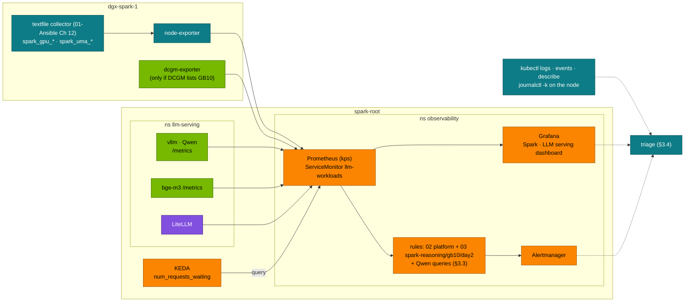
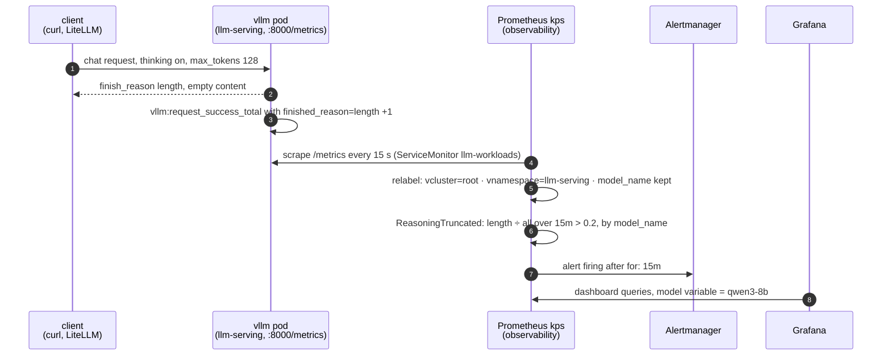
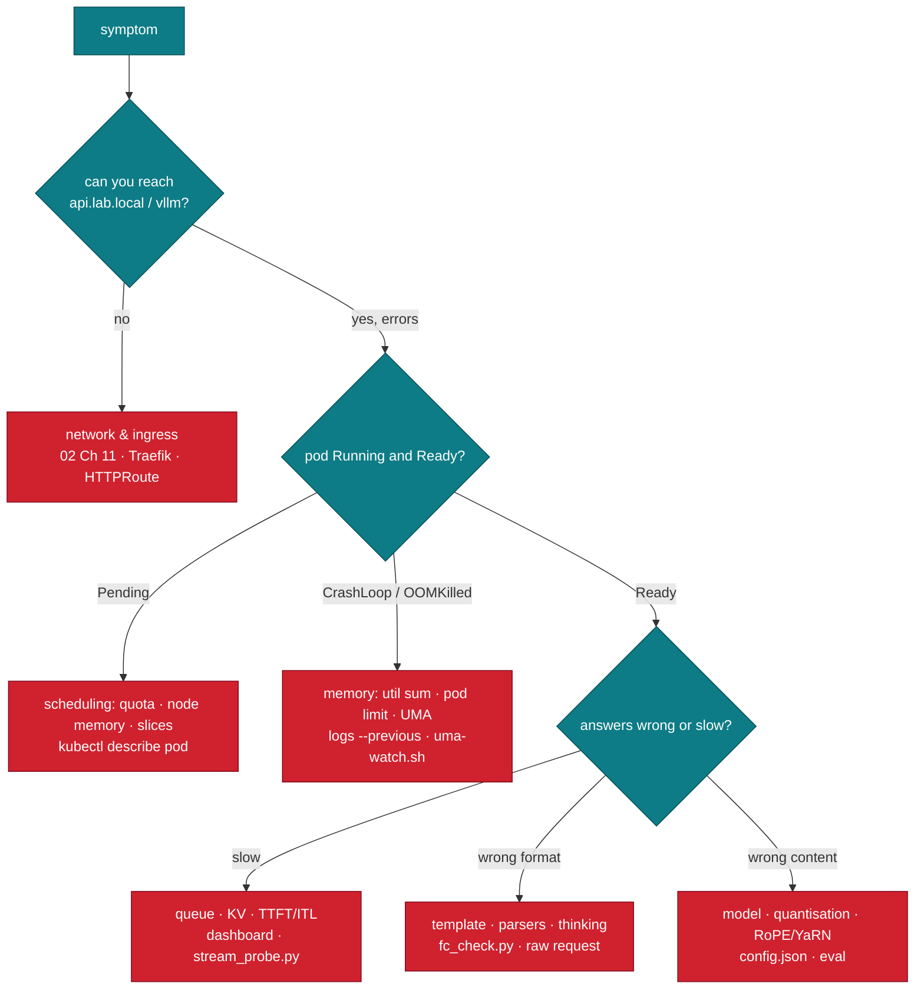

# Chapter 13 · Telemetry & Troubleshooting

> **04-Qwen · Part V — Operations · Chapter 13 of 14** · ← [Chapter 12 · Open WebUI & LiteLLM](12-open-webui-and-litellm.md) · [All chapters](00-qwen-step-by-step-guide.md) · [Chapter 14 · Hands-on workbook](14-hands-on-workbook.md) →

| | |
|---|---|
| **You will build** | Observability for Qwen models on the root with 03-DeepSeek's rules and dashboard (no second copy), the Qwen-specific signals on top — thinking share of output tokens, truncated thinking, tool-call parse failures, YaRN and context limits — and a troubleshooting playbook: a triage order, the evidence for each layer, and a runbook per failure mode from CUDA OOM on unified memory to NaN losses in ms-swift and NCCL hangs across two Sparks |
| **Hardware** | dgx-spark-1 (the NCCL runbook needs dgx-spark-2) |
| **Time** | 90 min |
| **Risk** | Low. Rules and a dashboard ConfigMap in `observability`; the provoked failures in §5.5 are on the served model only and revert with `serve-model.sh` |
| **Clusters** | `spark-root` (kube-prometheus-stack, the ServiceMonitor `llm-workloads`, the engines in `llm-serving`, jobs in `batch`) · `dev-llms` for trying a fix on `qwen3-0.6b` |
| **Lab files** | reused from 03: [`observability/`](../03-DeepSeek/lab/observability/) (`rules.yaml`, `rules.test.yaml`, `gen_dashboard.py`, `kustomization.yaml`), [`scripts/llm-triage.sh`](../03-DeepSeek/lab/scripts/llm-triage.sh), [`tools/stream_probe.py`](../03-DeepSeek/lab/tools/stream_probe.py); from 02: [`scripts/uma-watch.sh`](../02-Kubernetes/lab/scripts/uma-watch.sh), [`scripts/collect-diag.sh`](../02-Kubernetes/lab/scripts/collect-diag.sh); from this module: [`models.yaml`](lab/models.yaml), [`scripts/serve-model.sh`](lab/scripts/serve-model.sh), [`tools/fc_check.py`](lab/tools/fc_check.py) |

---

## 1. Why this matters on a Spark

LLM failures are rarely a crash. More often the service gets slower (TTFT climbs as the queue grows), answers get cut off (`finish_reason: length` because thinking used the budget), tool calls silently become text, or the whole node gets tight on memory because two engines plus the page cache exceeded the pool. On a Spark, three facts shape how you observe and debug:

1. **Unified memory.** `nvidia-smi` reports memory as `[N/A]`; GPU allocations come from the same ~121.7 GiB as the OS, the control plane, every pod and the page cache. Memory signals come from `/proc/meminfo` (the 01-Ansible textfile collector: `spark_uma_available_bytes`) and from pod cgroups, not from a framebuffer counter.
2. **One shared pool, two budgets.** An engine must fit vLLM's own budget (util × 121.7 GiB) *and* the cluster's (pod memory request = limit inside `serving-budget`, and free allocatable memory on the node). A failure can come from either, and the symptom differs: CUDA OOM in the log, or `OOMKilled`, or `Pending`.
3. **Qwen's two modes.** A hybrid model's output-token rate, latency and truncation rate depend on how much of the traffic thinks. Dashboards that don't separate the two make a healthy model look slow.

---

## 2. Architecture — HLD



The metrics pipeline is the platform's (02-Kubernetes) and the serving rules and dashboard are 03-DeepSeek's: they query vLLM's metrics by name, so they work for whichever model the `vllm` Deployment serves. vLLM labels its metrics with `model_name` (the served name, i.e. the catalog name), which is how you filter the dashboard to a Qwen model or compare two engines.

### 2.1 From a truncated answer to an alert, step by step



- **Steps 1–3** are §5.5 (a): `jq` prints `finish: "length"` and an empty `content`.
- **Steps 4–5** are what §5.2 checks: `vllm:num_requests_running` returns `["qwen3-8b"]`. Side engines (`vllm-<name>`) are scraped too, with their own `vservice`; add `vservice="vllm"` to a query to see the main model only.
- **Steps 6–7** need sustained truncation: more than 20 % of requests for 15 minutes. One provoked request shows in the finish-reasons panel, not as an alert.
- **Step 8** is §5.1: the dashboard "Spark · LLM serving (DeepSeek)" with its `model` variable set to the Qwen engine.

---

## 3. LLD

### 3.1 Latency, decomposed

$$T_{\text{e2e}} = \underbrace{T_{\text{queue}} + T_{\text{prefill}}(N_{\text{in}})}_{\text{TTFT}} + \sum_{i=1}^{N_{\text{out}}-1} \text{ITL}_i$$

- **TTFT** grows with queueing and prompt length. Prefill is compute-bound; on a GB10 it is the part that benefits from prefix caching (Chapter 04).
- **ITL** (inter-token latency) is decode, bound by memory bandwidth: every token reads the weights and the sequence's KV cache. On ~273 GB/s, a 16 GiB BF16 model has a hard ceiling near 273 / 17 ≈ 16 tokens/s per stream at batch 1 before any overhead; batching raises total throughput, not the per-stream ceiling. Quantisation (Chapter 05) raises it.
- With thinking on, **the user's "first token" is the first answer token**, after the whole thinking phase. vLLM's TTFT counts the first *generated* token, thinking included, so TTFT stays low while users wait. Measure the user's view with `stream_probe.py` (time to first answer).

Percentiles: for sorted latencies $x_1 \le \dots \le x_N$, $Q(p) = x_{\lceil pN \rceil}$. Prometheus estimates them from histogram buckets (`histogram_quantile`), so the precision is limited by the bucket boundaries.

### 3.2 The metrics that matter

| Signal | Source | Query (examples) |
|---|---|---|
| output tokens/s per model | vLLM | `sum by (model_name) (rate(vllm:generation_tokens_total[5m]))` |
| TTFT p95 | vLLM histogram | `histogram_quantile(0.95, sum by (le, model_name) (rate(vllm:time_to_first_token_seconds_bucket[5m])))` |
| ITL p50 | vLLM histogram | `inter_token_latency_seconds` (older: `time_per_output_token_seconds`) |
| queue | vLLM gauge | `vllm:num_requests_waiting` (KEDA's trigger) |
| KV pressure | vLLM gauge | `vllm:kv_cache_usage_perc` (older: `gpu_cache_usage_perc`) and `rate(vllm:num_preemptions_total[5m])` |
| truncation | vLLM counter | `sum by (model_name) (rate(vllm:request_success_total{finished_reason="length"}[15m])) / sum by (model_name) (rate(vllm:request_success_total[15m]))` |
| prefix-cache hit rate | vLLM counters | `rate(vllm:prefix_cache_hits_total[5m]) / rate(vllm:prefix_cache_queries_total[5m])` |
| unified memory | textfile collector | `spark_uma_available_bytes`, `spark_uma_page_cache_bytes` |
| GPU power, temperature, throttle, Xid | textfile collector or DCGM | `spark_gpu_power_watts`, `spark_gpu_throttle_reasons_bitmask`, `spark_gpu_xid_events_24h` |
| gateway | LiteLLM / Traefik | 429s and 5xx by alias/route |

Metric names move between vLLM releases; after an image bump, `curl …/metrics | grep '^vllm:'` tells you whether a query needs the new name. DCGM fields that describe framebuffer memory are absent or meaningless on GB10; if `dcgmi discovery -l` doesn't list the GPU on your DGX OS release, the textfile collector is the source for everything (01-Ansible [Chapter 12](../01-Ansible/12-gpu-telemetry-and-alerting.md)).

### 3.3 Qwen-specific signals

| Signal | Why | How to see it |
|---|---|---|
| Thinking share | thinking tokens dominate output on hybrid models; a sudden rise means clients stopped sending `enable_thinking: false` or a preset changed | not a vLLM metric: sample with `stream_probe.py` per alias, or compare `vllm:request_generation_tokens` p50 for the thinking and fast aliases on separate engines |
| Truncated thinking | `finish_reason=length` with empty `content` — users see nothing | the truncation ratio above (03's `ReasoningTruncated` alert fires at > 20 %) |
| Tool-call parse failures | the parser couldn't extract a call; the call arrives as text | vLLM log lines from the tool parser; `fc_check.py` pass rate as a scheduled probe |
| Context overflows | prompts over `--max-model-len` are rejected (400) | gateway 4xx by alias; vLLM log "maximum context length" |
| YaRN on a short-prompt deployment | static scaling applies to every request | `kubectl get deploy vllm -o jsonpath` → `--hf-overrides` with `rope_parameters` (older images: `--rope-scaling`) present where it shouldn't be |
| Parser/template drift after a model bump | new generation, new parser (Chapter 10 §3.2) | `fc_check.py` after every catalog change |

A Qwen alert you can add next to 03's rules without a new file:

```yaml
# PrometheusRule snippet (add to a rules file of your own in namespace observability)
- alert: QwenRequestsTruncated
  expr: |
    (sum(rate(vllm:request_success_total{model_name=~"qwen.*",finished_reason="length"}[15m]))
      / sum(rate(vllm:request_success_total{model_name=~"qwen.*"}[15m]))) > 0.2
  for: 15m
  labels: {severity: warning}
  annotations:
    summary: "Qwen requests end truncated (>20 % finish_reason=length): thinking budget or max_tokens too small"
```

### 3.4 Triage order



Work from the outside in, and collect evidence before you change anything: `kubectl describe` and events, current and previous logs, the dashboard at the time of the incident, `/proc/meminfo` on the node. 02's `collect-diag.sh llm-serving batch` packs it all into one bundle; 03's `llm-triage.sh` prints a live summary of the serving stack, which works for a Qwen model too because it reads the `vllm` Deployment generically.

### 3.5 Runbooks

#### 3.5.1 Out of memory on unified memory

Three different failures look like "OOM":

| Symptom | Layer | Cause |
|---|---|---|
| `torch.OutOfMemoryError` / "CUDA out of memory" in the vLLM log, pod restarts | vLLM's budget | weights + activations + KV don't fit util × 121.7 GiB; or the util was set below what the weights need |
| `OOMKilled` (exit 137) in `describe pod` | the pod's cgroup | memory limit below what the process (and, if charged, its CUDA allocations) uses |
| `Pending`, "Insufficient memory" or quota exceeded | the scheduler / quota | request = limit doesn't fit free allocatable memory or `serving-budget` |

At load time, vLLM also needs activation memory for a profiling pass and CUDA graphs. Prefill of a long prompt allocates activations proportional to the number of batched tokens; chunked prefill bounds that:

```text
--enable-chunked-prefill --max-num-batched-tokens 4096     # caps the prefill activation spike
--max-model-len 16384                                      # only the context users need
--max-num-seqs 32                                          # fewer concurrent sequences → smaller KV demand
```

Fix order: (1) is the util sum over all running engines ≲ 0.72? (2) do the weights fit util × 121.7 GiB with room for KV (Chapter 06 memory math)? (3) is the pod's request = limit large enough — measured with `uma-watch.sh` during load, not guessed? (4) is the page cache holding the weights twice right after a load (it is reclaimable; the 02 rules distinguish it)? Raising util on one engine means lowering it on another; it never means going above 0.72 in total. A 32B BF16 at 0.70 runs alone with everything else parked.

#### 3.5.2 Truncated answers and runaway thinking

`finish_reason` is the first thing to read:

| `finish_reason` | Meaning | Fix |
|---|---|---|
| `stop` | normal end (`<|im_end|>` or a stop string) | — |
| `length` with text in `content` | `max_tokens` too low for the answer | raise `max_tokens` in the client/preset |
| `length` with empty `content` and a long reasoning field (`reasoning` / `reasoning_content`) | thinking used the whole budget | larger budget, thinking off for this traffic, or a non-thinking model |
| `tool_calls` | the model called a tool | the client must run it and continue |

Qwen's end-of-turn token is `<|im_end|>` (id 151645); `<|endoftext|>` (id 151643) ends documents. Engines read both from `generation_config.json`. A hand-rolled pipeline that only knows one of them produces runaway generations that continue into an invented next turn — with vLLM and the model's own config this doesn't happen; check `generation_config.json` if you converted or merged a model yourself (Chapter 08 merges).

#### 3.5.3 Tool calls and thinking in the wrong field

See Chapter 10 §7 for the full table. The short version: tool calls as text → missing or wrong `--tool-call-parser` (`hermes` vs `qwen3_coder`); `<think>` in `content` → missing `--reasoning-parser qwen3`; both are catalog fields, so fix `models.yaml`, regenerate the overlays and re-serve.

#### 3.5.4 Long-context quality collapses (RoPE and YaRN)

Qwen2.5/Qwen3 use RoPE with base $\theta = 10^6$ (`rope_theta: 1000000.0` in `config.json`). A converted or re-packaged checkpoint that carries Llama's default $\theta = 10^4$ has wavelengths $\lambda_i = 2\pi\,\theta^{2i/d}$ up to 100× shorter in the slow dimensions, so positions beyond a few thousand tokens alias and the model degrades into repetition. Beyond the native 32K, YaRN must be configured explicitly:

```text
# the pinned image (vLLM ≥ 0.12); before 0.12: --rope-scaling '{"rope_type":"yarn",…}'
--hf-overrides '{"rope_parameters": {"rope_type": "yarn", "factor": 4.0, "original_max_position_embeddings": 32768, "rope_theta": 1000000}}' --max-model-len 131072
```

Check `config.json` in the model cache (`rope_theta`, `max_position_embeddings`, `rope_scaling`) against the model card. And remember that vLLM's YaRN is static: enable it only on the deployment that needs long inputs (Chapter 01, Chapter 11 §3.5).

#### 3.5.5 NaN or exploding loss in ms-swift

Qwen's MLP is SwiGLU: $\text{SwiGLU}(x) = \text{Swish}(xW_{\text{gate}}) \odot (xW_{\text{up}})$ with $\text{Swish}(z) = z\,\sigma(z)$. In FP16 the largest finite value is 65,504; a large activation times a large gate overflows to `inf`, and one `inf` in the backward pass turns the weights into `NaN`. BF16 has FP32's exponent range (max ≈ 3.4 × 10³⁸) and avoids this; the GB10 supports BF16 natively.

| Check | Setting (ms-swift) |
|---|---|
| precision | `--torch_dtype bfloat16` (never fp16 for Qwen fine-tuning) |
| gradient clipping | `--max_grad_norm 1.0` |
| warm-up | `--warmup_ratio 0.05` |
| learning rate | LoRA 1e-4 – 2e-4, full fine-tune 1e-5 range (Chapter 07–08) |
| data | no empty assistant turns, correct ChatML roles (Chapter 09 §3.4) |

If the loss is fine and then jumps to NaN at step N, restart from the last checkpoint before N with clipping on and a lower LR, and inspect the batch at N (a corrupted row is common). A loss that drops to ~0 within a few steps is the opposite problem: duplicated or trivially easy data.

#### 3.5.6 Jobs that don't start or hang

| Symptom | Cause | Fix |
|---|---|---|
| ms-swift Job `Pending`, Workload not admitted | training window not open; `spark-cq` quota | 02 Chapter 14 window; `kubectl --context spark-root -n batch get workloads` |
| Admission denied | `:latest` tag, missing request = limit, NVIDIA_VISIBLE_DEVICES env | pinned image from `versions.env`; fix the manifest |
| Two-Spark job hangs at the first collective | NCCL can't reach the peer over the CX-7 fabric, wrong interface | `NCCL_DEBUG=INFO`, `NCCL_SOCKET_IFNAME`/`NCCL_IB_HCA` for the 192.168.100.0/24 and 192.168.101.0/24 links; 01-Ansible [Chapter 14](../01-Ansible/14-rocev2-qos-and-nccl.md) |
| Hang without errors after hours | one rank stalled (straggler), no timeout | `TORCH_NCCL_ASYNC_ERROR_HANDLING=1` and a collective timeout so the job fails instead of hanging; 02 [Chapter 26 §3.9](../02-Kubernetes/26-cluster-diagnostics-and-failure-scenarios.md) |

#### 3.5.7 GPU errors and throttling

Xid events in `journalctl -k`, `spark_gpu_xid_events_24h > 0`, or an engine that suddenly can't initialise CUDA: follow 02 [Chapter 26 §3.8](../02-Kubernetes/26-cluster-diagnostics-and-failure-scenarios.md) and 01-Ansible [Chapter 29](../01-Ansible/29-incident-response-and-emergency-drain.md). Throttle bits beyond "idle" while busy point at airflow, ambient temperature or the power supply of a desk-side box, not at the model.

---

## 4. Integrations

| With | How | Chapter |
|---|---|---|
| Serving rules and dashboard | `kubectl --context spark-root apply -k ../../03-DeepSeek/lab/observability` | [03 Chapter 16](../03-DeepSeek/16-telemetry.md) |
| Platform rules (UMA pressure, Pending GPU pods, KV full) | 02's `95-observability` | [02-Kubernetes Chapter 20](../02-Kubernetes/20-vllm-high-throughput-llm-serving.md) |
| Host GPU telemetry | 01-Ansible textfile collector, DCGM if supported | [01-Ansible Chapter 12](../01-Ansible/12-gpu-telemetry-and-alerting.md) |
| Cluster-level triage | evidence map, runbooks, drills | [02-Kubernetes Chapter 26](../02-Kubernetes/26-cluster-diagnostics-and-failure-scenarios.md) |
| 03's playbook | drills D01–D08 on the same serving stack | [03 Chapter 17](../03-DeepSeek/17-troubleshooting-playbook.md) |
| Function-calling probe | `fc_check.py` after each catalog change | [10](10-qwen-agent-and-function-calling.md) |
| Training window silences | silence `VLLMDown` while vLLM is parked | [07](07-ms-swift-and-sft.md) |

---

## 5. Lab

### 5.1 Deploy the rules and the dashboard

#### What this lab does (03 kustomization `03-DeepSeek/lab/observability`)

- **Applies** to namespace `observability` on `spark-root`: PrometheusRule `spark-reasoning` (alerts such as `ReasoningTruncated`, `VLLMDown`, `PrefixCacheIneffective`, `ReasoningTTFTSlow`, `SparkGPUXid`, `SparkGPUThrottling`) and ConfigMap `deepseek-serving-dashboard` labelled `grafana_dashboard: "1"`, which Grafana's sidecar loads.
- **Nothing in `llm-serving` changes.** The rules read vLLM's own metrics, so they cover the Qwen engines as they are.

#### What to look for

1. **Apply:** `prometheusrule.monitoring.coreos.com/spark-reasoning` and `configmap/deepseek-serving-dashboard` created or unchanged.
2. **Lists:** `prometheusrule.monitoring.coreos.com/spark-reasoning` among the rules; `configmap/deepseek-serving-dashboard` among the dashboards.
3. **Grafana:** the dashboard "Spark · LLM serving (DeepSeek)" shows Qwen series once you select the Qwen model.

**If something's off:** `no matches for kind "PrometheusRule"` → the kube-prometheus-stack isn't installed (02-Kubernetes Chapter 20). Dashboard missing in Grafana → the sidecar didn't pick up the label; wait a minute or restart `deploy/kps-grafana`.

#### Run it

```bash
# ▶ MacBook · 04-Qwen/lab
kubectl --context spark-root apply -k ../../03-DeepSeek/lab/observability
kubectl --context spark-root -n observability get prometheusrule -o name
kubectl --context spark-root -n observability get cm -l grafana_dashboard=1 -o name
```

Open Grafana (`http://192.168.0.100:32000`) → the LLM serving dashboard, and set the model variable (or add `model_name=~"qwen.*"` to a panel) to the Qwen engine.

### 5.2 Check that every source is scraped, with a Qwen model serving

#### What this lab does (Prometheus queries + node checks)

- **Serves** `qwen3-8b` as the main model (if it isn't already), then port-forwards `svc/kps-prometheus` to `localhost:9090` for a moment and runs four instant queries: the vLLM scrape target, a vLLM metric, and two host metrics from the 01-Ansible textfile collector.
- **On dgx-spark-1:** reads `/proc/meminfo` and `nvidia-smi`. Read-only.

#### What to look for

1. **Queries:**

   | Query | Healthy value |
   |---|---|
   | `up{job="vllm"}` | a non-empty list (`["-"]`: `up` carries no model label) |
   | `vllm:num_requests_running` | `["qwen3-8b"]` |
   | `spark_gpu_up`, `spark_uma_available_bytes` | `["-"]`: present, no model label |

2. **Node:** `MemTotal` ≈ 121.7 GiB (about 127,600,000 kB); `MemAvailable` about 119 GiB on an idle Spark, less with the model loaded.
3. **`nvidia-smi`:** name `NVIDIA GB10`; `memory.used` is `[N/A]` (unified memory).

**If something's off:** `[]` for the vLLM queries → the ServiceMonitor doesn't match (02 Chapter 20 §5.6). `[]` for `spark_*` → the 01-Ansible telemetry template `12.1 Telemetry` isn't applied. More in §7.

#### Run it

```bash
# ▶ MacBook · 04-Qwen/lab
scripts/serve-model.sh qwen3-8b
kubectl --context spark-root -n observability port-forward svc/kps-prometheus 9090 >/dev/null & pf=$!; sleep 2
for q in 'up{job="vllm"}' 'vllm:num_requests_running' 'spark_gpu_up' 'spark_uma_available_bytes'; do
  printf '%-40s %s\n' "$q" "$(curl -s localhost:9090/api/v1/query --data-urlencode "query=$q" | jq -c '[.data.result[] | .metric.model_name // "-"]')"
done
kill $pf
```

```bash
# ▶ dgx-spark-1 (ssh dgx-spark-1)
grep -E 'MemTotal|MemAvailable|^Cached' /proc/meminfo
nvidia-smi --query-gpu=name,utilization.gpu,power.draw,temperature.gpu,memory.used --format=csv
```

### 5.3 Load with and without thinking

#### What this lab does (shell function `load` + `stream_probe.py`)

- **Sends** 32 requests to Qwen3-8B, 8 at a time, first with thinking on, then off, and times each batch. The engine is not reconfigured.
- **Streams** one request with `stream_probe.py` to time the reasoning and answer phases separately.

#### What to look for

1. **`time load true` vs `time load false`:** the thinking run takes much longer in `real`.
2. **`stream_probe.py`:** `first reasoning` a number, `first answer` much later, `finish_reason=stop`, no `BUFFERED` or `TRUNCATED` line.
3. **Dashboard during the runs:** generated tokens and time to first answer differ a lot between the modes; TTFT p95 barely moves. Fill the table below.

**If something's off:** `curl: (7)` → the port-forward died; restart it. `TRUNCATED` → raise `max_tokens` (§3.5.2).

#### Run it

```bash
# ▶ MacBook · 04-Qwen/lab
kubectl --context spark-root -n llm-serving port-forward svc/vllm 8000:8000 >/dev/null & pf=$!; sleep 2
load() {   # load <enable_thinking>: 32 requests, 8 in parallel
  for i in $(seq 32); do
    curl -s -o /dev/null 127.0.0.1:8000/v1/chat/completions -H 'Content-Type: application/json' -d "{
      \"model\": \"qwen3-8b\", \"max_tokens\": 4096, \"chat_template_kwargs\": {\"enable_thinking\": $1},
      \"messages\": [{\"role\": \"user\", \"content\": \"Request $i: how many primes are below $((50 + i))?\"}]}" &
    (( i % 8 == 0 )) && wait
  done; wait
}
time load true
time load false
python3 ../../03-DeepSeek/lab/tools/stream_probe.py --url http://127.0.0.1:8000 --model qwen3-8b
kill $pf
```

Watch the dashboard during both runs and record:

| Panel | thinking on | thinking off |
|---|---|---|
| output tokens/s | record yours | |
| TTFT p95 | | |
| generated tokens p50 | | |
| time to first answer (`stream_probe.py`) | | |
| KV cache usage peak | | |

The TTFT row barely moves; the time-to-first-answer and generated-tokens rows do. That is §3.1's point about what users experience.

### 5.4 Find the memory headroom

#### What this lab does (script `02-Kubernetes/lab/scripts/uma-watch.sh`, on dgx-spark-1)

- **Prints every 2 s:** host `MemAvailable`, page cache (`Cached`), and the vLLM pod cgroup's `memory.current` and `memory.max`. Read-only.
- **You restart** `deploy/vllm` from another terminal so you see a full load. The main model is down until the new pod is Ready.

#### What to look for

1. **Header:** `time  MemAvailable  Cached  pod.mem.current  pod.mem.max`; `pod.mem.max` equals the catalog `mem` in bytes (32Gi = `34359738368` for `qwen3-8b`).
2. **During the load:** `MemAvailable` falls, `Cached` grows while the weights are read, `pod.mem.current` rises and settles.
3. **Record** the peak `pod.mem.current` and the margin to `pod.mem.max`.

**If something's off:** `… not found among the pods synced` or an empty cgroup path → the pod name is stale after a restart; re-run the `pod=$(…)` line. `bc: command not found` → install `bc` on the Spark.

#### Run it

```bash
# ▶ dgx-spark-1 (ssh dgx-spark-1)
cd ~/technical-depth/02-Kubernetes/lab   # your checkout on the Spark
pod=$(kubectl --context spark-root -n llm-serving get pod -l app=vllm -o jsonpath='{.items[0].metadata.name}')
scripts/uma-watch.sh llm-serving "$pod"
```

Restart the engine in another terminal (`kubectl --context spark-root -n llm-serving rollout restart deploy/vllm`) and watch MemAvailable, page cache and the pod cgroup's `memory.current` through the load. Record the peak `memory.current` and compare it with the pod's limit from the catalog; that margin is what §3.5.1 step 3 asks for.

### 5.5 Provoke and fix three failures

#### What this lab does (three deliberate misconfigurations)

- **(a) Truncated thinking:** one request with `max_tokens: 128` and thinking on. Nothing on the cluster changes.
- **(b) Missing tool-call parser:** you serve Qwen3-8B without `--enable-auto-tool-choice` and `--tool-call-parser`, run `fc_check.py`, then restore the catalog overlay with `serve-model.sh qwen3-8b`.
- **(c) Over the pool:** you start a second engine whose util pushes the sum above 0.72 (bypassing the script's budget check), read the evidence, and park it again.

#### What to look for

1. **(a):** `finish: "length"`, `content` empty or `null`, `thinking_chars` above 0.
2. **(b):** every tool case `FAIL`, with `no tool call (check --enable-auto-tool-choice and --tool-call-parser)` or `request failed: HTTP Error 400` (vLLM refuses `tool_choice: auto` without those flags); `no-tool` and `json-schema` still `PASS`. After `serve-model.sh qwen3-8b`, the suite passes again.
3. **(c):** one of three signatures, each with its evidence: no new pod and a `FailedCreate … exceeded quota: serving-budget` event, a `Pending` pod with `Insufficient memory` in `describe pod`, or a CUDA OOM in the vLLM log at load.

**If something's off:** (b) still passes → the flags are still on the running pod; check its args. (c) starts fine → the sum wasn't really above 0.72; recount with `scripts/serve-model.sh list`.

#### Run it

Each one is a deliberate misconfiguration on the served model; `serve-model.sh` restores it.

**(a) Truncated thinking.**

```bash
# ▶ MacBook · 04-Qwen/lab
kubectl --context spark-root -n llm-serving port-forward svc/vllm 8000:8000 >/dev/null & pf=$!; sleep 2
curl -s localhost:8000/v1/chat/completions -H 'Content-Type: application/json' -d '{"model":"qwen3-8b","max_tokens":128,
  "messages":[{"role":"user","content":"How many primes are below 200? Show your reasoning."}]}' \
  | jq '{finish: .choices[0].finish_reason, content: .choices[0].message.content, thinking_chars: (.choices[0].message.reasoning // .choices[0].message.reasoning_content // "" | length)}'
kill $pf
```

Fix with a bigger `max_tokens` or `enable_thinking: false`, and confirm in the finish-reasons panel.

**(b) Missing tool-call parser.** Serve the model with the parser flags removed (edit a copy of the overlay, or apply the base vLLM manifest with the model env changed), then:

```bash
# ▶ MacBook · 04-Qwen/lab
kubectl --context spark-root -n llm-serving port-forward svc/vllm 8000:8000 >/dev/null & pf=$!; sleep 2
python3 tools/fc_check.py run --url http://127.0.0.1:8000 --model qwen3-8b
kill $pf
scripts/serve-model.sh qwen3-8b
```

Without the parser the call can only arrive as `<tool_call>` text in `content` (check one raw request without `tools`); `no-tool` and `json-schema` don't depend on the tool parser.

**(c) Over the pool.** Try to serve a second engine whose util pushes the sum above 0.72 (Chapter 06 shows a second Deployment). A CUDA OOM at load means the pod fit but vLLM's budget didn't. Read which one it is from `describe pod` and the log, park it, and note the evidence that told you.

### 5.6 Collect a support bundle

#### What this lab does (02 `scripts/collect-diag.sh`, 03 `scripts/llm-triage.sh`)

- **`collect-diag.sh llm-serving batch`:** collects describes, events, current and previous logs and quotas for those namespaces (root, dev-lab and dev-llms API servers) into `./diag-<timestamp>.tar.gz` in `02-Kubernetes/lab`. Read-only.
- **`llm-triage.sh serving`:** prints a live, read-only summary of the serving stack (what runs, its flags, current engine metrics, usual suspects with pointers). It reads `deploy/vllm` generically, so it works for a Qwen model.

#### What to look for

1. **Bundle:** a `diag-<timestamp>.tar.gz` file.
2. **Inside it, for §5.5 (c):** the event with the scheduling or OOM reason, the vLLM log line with the memory numbers, and the quota usage.
3. **Triage:** `[PASS] vLLM Ready` and no `[FAIL]` lines on a healthy stack.

**If something's off:** the triage script's parser checks key on 03's model names (`r1-*`, `qwq-*`, `*tools*`), so they are skipped for Qwen names; check the parser flags with §5.5 (b) or Chapter 10 §5.1 instead.

#### Run it

```bash
# ▶ MacBook · 02-Kubernetes/lab
scripts/collect-diag.sh llm-serving batch
```

```bash
# ▶ MacBook · 03-DeepSeek/lab
scripts/llm-triage.sh serving
```

Open the bundle and find, for the incident of §5.5 (c): the event with the scheduling or OOM reason, the vLLM log line with the memory numbers, and the quota usage at that time.

---

## 6. Verify

| Check | Command | Expected |
|---|---|---|
| Rules and dashboard loaded | §5.1 | PrometheusRules present; dashboard ConfigMap labelled `grafana_dashboard=1` |
| Qwen engine scraped | §5.2 | `model_name` = the catalog name |
| UMA source | §5.2 node commands | `MemTotal` ≈ 121.7 GiB; `memory.used` `[N/A]` |
| Thinking visible in data | §5.3 table | generated tokens and time to first answer differ by mode |
| Memory margin known | §5.4 | peak `memory.current` vs limit recorded |
| Failures provoked and explained | §5.5 | (a) `length`, (b) tool calls as text, (c) Pending or OOM, each with its evidence |

---

## 7. Troubleshooting

The playbook in compact form. Each row points at a runbook above or another chapter.

| You see | Cause | Fix |
|---|---|---|
| CUDA OOM at start-up | weights + KV don't fit util × 121.7 GiB | lower `--max-model-len`/`--max-num-seqs`, quantised model, or higher util with others parked (§3.5.1) |
| `OOMKilled` | pod limit too small | size request = limit from `uma-watch.sh` peak (§5.4) |
| `Pending`: insufficient memory / quota exceeded | pool or `serving-budget` full | park an engine; util sum ≲ 0.72 |
| Node `MemoryPressure`, many pods evicted | page cache plus engines exceeded the pool | 02 `SparkUMAPressure`; drop caches after big loads only as a diagnostic; fix the budget |
| TTFT p95 rising | queue growing, long prompts | `vllm:num_requests_waiting`, KEDA, `--max-num-seqs`, prefix caching |
| Throughput low, KV near 1.0, preemptions | too many concurrent long sequences | lower `--max-num-seqs`, shorter `--max-model-len`, more util |
| `finish_reason: length`, empty content | thinking used the budget | §3.5.2 |
| `<think>` in content / tool calls as text | parser flags | §3.5.3, Chapter 10 |
| Repetition and gibberish on long inputs | wrong `rope_theta`, YaRN missing or misconfigured | §3.5.4 |
| Generation runs past the answer into an invented turn | EOS ids not configured in a custom pipeline | `generation_config.json`: `<|im_end|>` 151645, `<|endoftext|>` 151643 |
| ms-swift loss → NaN | FP16 overflow, no clipping | §3.5.5 |
| Two-Spark job hangs | NCCL interface / fabric | §3.5.6 |
| No vLLM metrics in Prometheus | ServiceMonitor label or port name | 02 Chapter 20 §5.6 (`llm-workloads`) |
| Panels empty after an image bump | metric renamed | `curl …/metrics \| grep '^vllm:'`, update the query |
| `VLLMDown` firing during training | vLLM parked on purpose | Alertmanager silence for the window, don't weaken the rule |

---

## 8. Scale-out path

With dgx-spark-2 joined, the same Prometheus scrapes both nodes; add `instance`/`node` to the dashboard variables and alert per node on UMA pressure (each Spark has its own ~121.7 GiB pool — they don't add up for one engine unless you use tensor parallelism). For two-node training or serving, the fabric becomes a new failure domain: add the CX-7 link-speed and RDMA counters from the 01-Ansible collector to the dashboard, and run 01-Ansible's NCCL tests after any fabric change before blaming the model.

---

## 9. Checklist

- [ ] 03's serving rules and dashboard are deployed and show the Qwen engine by `model_name`.
- [ ] I know which source provides GPU and memory metrics on my Spark (textfile collector or DCGM) and that `nvidia-smi` memory is `[N/A]`.
- [ ] I recorded the effect of thinking on throughput, generated tokens and time to first answer.
- [ ] The engine's peak cgroup memory under load is measured and the pod limit has margin.
- [ ] I provoked and fixed truncated thinking, a missing tool-call parser and an over-the-pool engine, and can name the evidence for each.
- [ ] I can tell CUDA OOM, `OOMKilled` and `Pending` apart and know which budget each belongs to.
- [ ] I know the fixes for NaN losses (BF16, clipping, warm-up) and for RoPE/YaRN misconfiguration.
