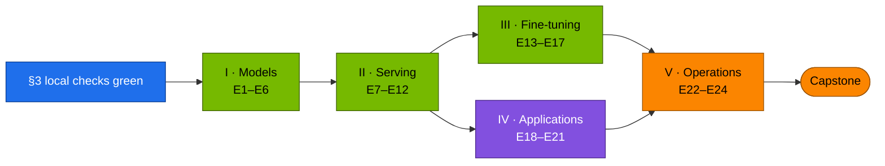

# Chapter 14 · Hands-on Workbook

> **04-Qwen · Part V — Operations · Chapter 14 of 14** · ← [Chapter 13 · Telemetry & troubleshooting](13-telemetry-and-troubleshooting.md) · [All chapters](00-qwen-step-by-step-guide.md)

| | |
|---|---|
| **You will build** | Proof that you can do what this module teaches: 24 exercises with objective pass criteria (a command or a calculation and its expected result), ten of them worked on the CPU with reference solutions, and a capstone that serves a Qwen model through the gateway, improves it with verified synthetic data in a training window, gates the change and survives a provoked fault |
| **Hardware** | dgx-spark-1 (exercises marked **2×** need dgx-spark-2); the CPU exercises run on the MacBook |
| **Time** | 2–4 days part-time; the capstone takes half a day |
| **Risk** | Low. Every exercise is reversible. Training exercises need the training window: vLLM is parked while it is open |
| **Clusters** | `spark-root` (serving, training, apps, telemetry) · `dev-llms` (sandbox for manifests and tiny models) |
| **Lab files** | the whole [`lab/`](lab/README.md): [`tests/run-local-checks.sh`](lab/tests/run-local-checks.sh), [`tests/mock_openai.py`](lab/tests/mock_openai.py), [`models.yaml`](lab/models.yaml), [`scripts/gen_overlays.py`](lab/scripts/gen_overlays.py), [`scripts/serve-model.sh`](lab/scripts/serve-model.sh), [`k8s/jobs/`](lab/k8s/jobs/swift-sft.yaml), [`tools/fc_check.py`](lab/tools/fc_check.py), [`tools/synth_data.py`](lab/tools/synth_data.py), [`tools/qwen_agent_demo.py`](lab/tools/qwen_agent_demo.py); reused from 03: [`tools/rag_demo.py`](../03-DeepSeek/lab/tools/rag_demo.py), [`tools/stream_probe.py`](../03-DeepSeek/lab/tools/stream_probe.py), [`k8s/apps/`](../03-DeepSeek/lab/k8s/apps/kustomization.yaml), [`observability/`](../03-DeepSeek/lab/observability/kustomization.yaml) |

---

## 1. Why this matters on a Spark

The chapters explain GQA, YaRN, LoRA, DPO, parsers and gateways; the exercises make you produce the numbers yourself and check them against the machine. On a Spark every exercise also exercises the platform: the sum of util ≲ 0.72, request = limit on every GPU container, 15 time-slices shared by serving and training, the training window that lends the LLM pool to `batch`, admission policies on the root, secrets from vault01. Passing means you can operate a Qwen stack, not just start one.

Keep a lab notebook (`results/notebook.md`) with every **record yours** value from the chapters; later exercises compare against it.

---

## 2. Architecture — HLD (learning path)



Parts I and the CPU exercises can be done in any order. Part III needs a working Part II (a served model to generate data and to compare against). The capstone uses everything.

---

## 3. LLD — toolchain, grading and the gate

### 3.1 What "green" means

#### What this lab does (script `lab/tests/run-local-checks.sh`)

- **Venv:** creates `.venv` in `04-Qwen/lab` with PyYAML, yamllint and shellcheck; `kubectl` and `kubeconform` come from your PATH.
- **Static checks:** YAML lint, overlays in sync with `models.yaml`, every overlay, sandbox overlay, side render and Job through kustomize + kubeconform (Kubernetes 1.32), the pod rules, Python compile and shellcheck.
- **Guards:** a temporary copy of the catalog with an over-budget set and an undersized pod must be refused.
- **Tools:** `fc_check.py`, `synth_data.py` and `qwen_agent_demo.py` against the good and flaky mocks on ports 18780/18781, stopped on exit. No GPU, no cluster, nothing outside the temp files changes.

#### What to look for

1. **Last line:** `ALL LOCAL CHECKS PASSED`, exit code 0.
2. **On the way**, among the `==` sections: `9 overlays checked, 0 drifted, 0 catalog problems`, `pod rules OK (… objects)`, `swift CLI OK`, `catalog guard OK`, `fc_check: 6/6 cases passed (100%)`, `ms-swift dataset format OK (9 SFT rows, 9 DPO pairs)`, `agent audit OK`, `tool sandboxing OK`.

**If something's off:** the script stops at the first failing section and prints its output. `kubeconform: command not found` → install it. `DRIFT …` → `python3 scripts/gen_overlays.py`. More in §7.

#### Run it

```bash
# ▶ MacBook · 04-Qwen/lab
python3 -m venv .venv && . .venv/bin/activate
pip install pyyaml yamllint shellcheck-py
# kubectl (with kustomize) and kubeconform on the PATH
tests/run-local-checks.sh
```

The local checks lint the YAML, check that the overlays match `models.yaml` (`gen_overlays.py --check`), render every overlay and Job through kustomize and kubeconform, enforce the pod rules (pinned image, memory request = limit, readinessProbe on serving, Kueue labels and priority on Jobs), refuse an over-budget set and an undersized pod, and run `fc_check.py`, `synth_data.py` and `qwen_agent_demo.py` against the good and flaky `mock_openai.py` — no GPU, no cluster. **Pass:** the last line and exit code above.

### 3.2 Rubric

| Grade | Requirement |
|---|---|
| Pass | every exercise's pass criterion met, numbers recorded in the notebook |
| Merit | Pass + the three provoked failures of E22 each diagnosed in under 10 minutes from evidence alone |
| Distinction | Merit + capstone inside the time box, with a one-page operations report a colleague could act on |

### 3.3 The gate for model changes

Every change to what `qwen` or `agent` serves — a new catalog entry, a quantised variant, an adapter from the capstone — is compared against the accepted version on the same probes before the alias moves:

| Probe | Tool | Gate |
|---|---|---|
| function calling | `fc_check.py run --min <accepted rate>` | not below the accepted version (the suite has 6 cases: one failure is 17 points, so the gate is "no new failure") |
| retrieval-grounded answers | `rag_demo.py eval` + 5 spot-checked `ask` answers | hit@5 unchanged (retrieval doesn't depend on the chat model); citations valid |
| task quality | your held-out set from Chapter 09 (pass@1) | not lower |
| latency | `stream_probe.py` time to first answer, p50 of 10 | not worse by more than 20 % |

Write the four numbers for the accepted version into the notebook once; every candidate gets the same four.

### 3.4 The training window

#### What this lab does (02 overlays `training-window`, `10-tenancy`, `20-scheduling`)

- **Open:** pauses the `vllm` ScaledObject at 0 and applies `training-window`: `serving-budget` 2 CPU · 10 Gi, `batch-budget` and `spark-cq` 8 CPU · 80 Gi (3 slices).
- **Close:** re-applies the everyday quotas (`serving-budget` 8 CPU · 90 Gi; `batch` 2 CPU · 12 Gi) and removes the pause.

#### What to look for

1. **Open:** `kubectl --context spark-root -n batch describe quota batch-budget` shows 8 CPU and 80Gi hard; `deploy/vllm` at `0/0`.
2. **Close:** the same command shows 2 CPU and 12Gi; `deploy/vllm` back to `1/1`.

**If something's off:** quotas snap back while open → Argo CD self-heal ([Chapter 07](07-ms-swift-and-sft.md) Task 5.3). `vllm` stays at 0 after closing → the annotation is still set.

#### Run it

```bash
# ▶ MacBook · 02-Kubernetes/lab
# open: park vLLM, lend the LLM pool to batch (spark-cq 8 CPU · 80 Gi · 3 slices)
kubectl --context spark-root -n llm-serving annotate scaledobject vllm autoscaling.keda.sh/paused-replicas=0 --overwrite
kubectl --context spark-root apply -k manifests/root-llms/training-window
# … run the ms-swift Job (≤ 8 CPU · ≤ 80 Gi · 1 slice per pod, request = limit) …
# close: everyday quotas back, vLLM back
kubectl --context spark-root apply -k manifests/root-llms/10-tenancy
kubectl --context spark-root apply -k manifests/root-llms/20-scheduling
kubectl --context spark-root -n llm-serving annotate scaledobject vllm autoscaling.keda.sh/paused-replicas-
```

Park bge-m3 and any second engine too if the Job needs the whole 80 Gi, and silence `VLLMDown` for the window ([Chapter 13](13-telemetry-and-troubleshooting.md)).

---

## 4. Integrations

Nothing here is new infrastructure. The platform comes from [01-Ansible](../01-Ansible/README.md) (dgx-spark-1, sema01, vault01, GPU Operator with 15 time-slices) and [02-Kubernetes](../02-Kubernetes/README.md) (the kubeadm root, quotas, Kueue, KEDA, Traefik, Prometheus); the application stack (LiteLLM, Open WebUI, bge-m3, RAG tooling, dashboards) is 03-DeepSeek's. 02 and 03 have their own workbooks ([02 Chapter 27](../02-Kubernetes/27-hands-on-practice-exercises-workbook.md), [03 Chapter 19](../03-DeepSeek/19-hands-on-workbook.md)); do 02's platform exercises first if anything in §3.4 is unfamiliar.

---

## 5. Lab — the exercises

### Part I — Models (Chapters 01–03)

#### What this lab does (E1–E6)

- **CPU only:** E1, and the arithmetic parts of E2, E3 and E6 (§5.7).
- **On `spark-root`:** E2 reads a served model's startup log; E3 serves a YaRN variant; E4 serves the Coder model; E5 uses a hybrid Qwen3; E6 serves `qwen3-vl-8b`. Each replaces the main `deploy/vllm` through `serve-model.sh`.

#### What to look for

1. **E2:** your KV token capacity within ~10 % of vLLM's `GPU KV cache size`.
2. **E3:** wavelength ratio ≈ 93; a 128K request accepted with YaRN, a 400 without.
3. **E4:** the middle parses and the test passes (`ACCEPT tests passed` in Chapter 02 Task 1).
4. **E6:** 2,040 predicted image tokens for 1920×1080 on Qwen3-VL; `prompt_tokens` minus the text tokens within a few of it.

**If something's off:** see each chapter's lab block and §7 below.

#### Run it

| # | Goal | Do | Pass when |
|---|---|---|---|
| E1 | Mask the loss to assistant tokens | write the ChatML mask function (§5.7) ([Chapter 07](07-ms-swift-and-sft.md)) | mask is 1 exactly on assistant content and its `<|im_end|>` |
| E2 | Size the KV cache from the config | compute KV/token for three Qwen models from `config.json`, then compare with vLLM's startup log "GPU KV cache size" ([Chapter 01](01-qwen-architecture-and-model-family.md)) | your token capacity is within ~10 % of vLLM's |
| E3 | Explain RoPE base and YaRN | compute the slowest RoPE wavelength for θ = 10⁴ and 10⁶ (§5.7); serve one model with YaRN factor 4 in `dev-llms` or on the root alone ([Chapter 01](01-qwen-architecture-and-model-family.md)) | ratio ≈ 93× explained; 128K request accepted with YaRN, rejected without |
| E4 | Use fill-in-the-middle | send a FIM prompt (`<|fim_prefix|>…<|fim_suffix|>…<|fim_middle|>`) to a Coder model via `/v1/completions` ([Chapter 02](02-coder-math-and-reasoning-models.md)) | the completion fits between prefix and suffix and the file parses |
| E5 | Measure the price of thinking | the same 10 maths questions with thinking on and off on a Qwen3 hybrid model ([Chapter 02](02-coder-math-and-reasoning-models.md)) | accuracy and completion tokens recorded for both; a written rule for when to think |
| E6 | Predict image token counts | compute visual tokens for a 1920×1080 image (§5.7), then send it to `qwen3-vl-8b` ([Chapter 03](03-vision-language-models.md)) | `usage.prompt_tokens` minus the text tokens matches your number within a few tokens |

### Part II — Serving (Chapters 04–06)

#### What this lab does (E7–E12)

- **Serve and measure** on `spark-root`: `serve-model.sh`, the 02 benchmark Job and probes (E7, E8), a quantised variant and llama.cpp (E9, E10), a new catalog entry (E11), and three timed restarts (E12).
- **E11 changes your repo:** a new `models.yaml` entry and its generated overlay.

#### What to look for

1. **E7/E8:** `[PASS] answer: 144`; `speed-up from prefix cache` clearly above 1×.
2. **E11:** `tests/run-local-checks.sh` still ends with `ALL LOCAL CHECKS PASSED`; `serve-model.sh <new>` ends with `0 failed`.
3. **E12:** three times, download ≫ NVMe > page cache.

**If something's off:** [Chapter 04 §7](04-serving-qwen-with-vllm-and-sglang.md), [Chapter 06 §7](06-kubernetes-deployment-and-weight-caching.md).

#### Run it

| # | Goal | Do | Pass when |
|---|---|---|---|
| E7 | Serve and benchmark | `serve-model.sh qwen3-8b`; vLLM's benchmark Job or `stream_probe.py` at concurrency 1 and 16 ([Chapter 04](04-serving-qwen-with-vllm-and-sglang.md)) | TTFT, ITL, tokens/s at both concurrencies recorded |
| E8 | Show prefix caching | `python3 ../../02-Kubernetes/lab/scripts/ttft_probe.py --url http://localhost:8000 --model <name>` ([Chapter 04](04-serving-qwen-with-vllm-and-sglang.md)) | median TTFT with shared prefix clearly below unique prefix |
| E9 | Quantisation trade-off | BF16 vs AWQ (or FP8) of the same model — add the quantised variant as a catalog entry (E11): memory, tokens/s, `fc_check.py run` and a quality probe ([Chapter 05](05-quantization-and-local-engines.md)) | four-column table; choice justified |
| E10 | A local engine | the same model as GGUF on llama.cpp ([Chapter 05](05-quantization-and-local-engines.md)) | tokens/s and memory vs vLLM recorded |
| E11 | Add a catalog entry | new `models.yaml` entry with util and memory sized from the memory math, `gen_overlays.py`, server-side dry run, apply in `dev-llms` first if it's small ([Chapter 06](06-kubernetes-deployment-and-weight-caching.md)) | local checks green; `serve-model.sh <new>` smoke test passes on `spark-root` |
| E12 | Cold vs warm start | first load (download), second load (warm `model-cache`), third load (page cache) ([Chapter 06](06-kubernetes-deployment-and-weight-caching.md)) | three times recorded; you can say what dominates each |

### Part III — Fine-tuning (Chapters 07–09), training Jobs in the window

#### What this lab does (E13–E17)

- **Jobs in `batch`** (`swift-sft`, `swift-dpo`, `swift-grpo`), each admitted by Kueue inside the training window (§3.4), one at a time, on PVC `qwen-train`.
- **E17 on the MacBook:** `synth_data.py` against a served model, plus the CPU verifier.

#### What to look for

1. **Each Job:** Workload `ADMITTED True`; the log's `trainable params` line (E14: compare with your 40.4 M for Qwen2.5-7B, or ~33 M for the Qwen3-4B default).
2. **E15:** `rewards/margins` rising; **E16:** format reward rising first.
3. **After every Job:** the window closed (§3.4 close commands).

**If something's off:** Workload not admitted → window not open or vLLM / bge-m3 still holding the pool (§7).

#### Run it

| # | Goal | Do | Pass when |
|---|---|---|---|
| E13 | An SFT that changes behaviour | `k8s/jobs/swift-sft.yaml` on a small dataset with a visible format change ([Chapter 07](07-ms-swift-and-sft.md)) | the adapter follows the format, the base doesn't; window closed afterwards |
| E14 | Size LoRA before training | parameter count for r = 16, all linear layers, Qwen2.5-7B (§5.7) ([Chapter 08](08-peft-and-alignment.md)) | your count matches the trainable-parameter line in the ms-swift log |
| E15 | DPO on your own pairs | `dpo.jsonl` from E17 → `k8s/jobs/swift-dpo.yaml`; compute one loss by hand (§5.7) ([Chapter 08](08-peft-and-alignment.md)) | reward margin rises in the log; hand-computed loss correct |
| E16 | GRPO advantages | compute group advantages by hand (§5.7), then run `k8s/jobs/swift-grpo.yaml` briefly ([Chapter 08](08-peft-and-alignment.md)) | advantages correct; reward curve recorded for the steps you ran |
| E17 | Synthetic data you can trust | `synth_data.py` from your own seeds with `--judge --dpo`; κ between the judge and 30 of your own labels (§5.7); the verifier of Chapter 09 §5.6 on four sampled candidates ([Chapter 09](09-synthetic-data-and-self-play.md)) | funnel and κ recorded; coverage for the verifier task stated |

### Part IV — Applications (Chapters 10–12)

#### What this lab does (E18–E21)

- **Probes** the served models directly and through LiteLLM (`fc_check.py`, `qwen_agent_demo.py`), ingests and evaluates RAG with `rag_demo.py`, and creates one scoped LiteLLM key (E21).
- **E20 writes** a new Qdrant collection behind the alias, only if the gate passes.

#### What to look for

1. **E18:** gateway pass count = direct pass count for every model.
2. **E19:** no state change; `{"error": "unknown model …"}` reported; one audit line per call.
3. **E20:** `gate passed`; hit@1, hit@5, MRR before and after.
4. **E21:** `429` first on `qwen`.

**If something's off:** [Chapter 10 §7](10-qwen-agent-and-function-calling.md), [Chapter 11 §7](11-rag-with-qwen-bge-and-qdrant.md), [Chapter 12 §7](12-open-webui-and-litellm.md).

#### Run it

| # | Goal | Do | Pass when |
|---|---|---|---|
| E18 | Parser matrix | `fc_check.py run` for `qwen3-8b`, `qwen3-4b-instruct` and (set `coding`) `qwen3-coder-30b-fp8` with its `qwen3_coder` parser, direct and via LiteLLM ([Chapter 10](10-qwen-agent-and-function-calling.md)) | table filled; gateway result = direct |
| E19 | An agent that doesn't make things up | `qwen_agent_demo.py` with a destructive request (`--max-steps 2`) and with an unknown catalog name ([Chapter 10](10-qwen-agent-and-function-calling.md)) | no state change; the unknown model is reported, not invented; audit lines for every call |
| E20 | Measured RAG | ingest with `--gate`, `eval`, add five 04-Qwen gold questions, RRF by hand (§5.7) ([Chapter 11](11-rag-with-qwen-bge-and-qdrant.md)) | hit@1, hit@5, MRR recorded before and after; RRF ranking correct |
| E21 | Thinking costs quota | scoped key with `tpm_limit`, `qwen` vs `qwen-fast` (§5.7 token bucket) ([Chapter 12](12-open-webui-and-litellm.md)) | 429 appears first on the thinking alias; ratio recorded |

### Part V — Operations (Chapter 13)

#### What this lab does (E22–E24)

- **Deliberate failures** on the served model (E22), a watched restart with `uma-watch.sh` on dgx-spark-1 (E23), and 03's alert rules (E24). Restore the catalog overlay with `serve-model.sh` after each.

#### What to look for

1. **E22:** the giveaway named for each: `finish_reason: length` with empty content; tool cases failing in `fc_check.py`; `Pending` or CUDA OOM with its event or log line.
2. **E23:** peak `pod.mem.current` below `pod.mem.max`.
3. **E24:** `ReasoningTruncated` (or your Qwen copy of it) shows Firing, then Resolved.

**If something's off:** [Chapter 13 §7](13-telemetry-and-troubleshooting.md).

#### Run it

| # | Goal | Do | Pass when |
|---|---|---|---|
| E22 | Diagnose from evidence | have a colleague (or a coin) pick one of: truncated thinking, missing tool parser, over-the-pool engine ([Chapter 13](13-telemetry-and-troubleshooting.md) §5.5); diagnose without looking at what they changed | correct diagnosis in < 10 min each, with the giveaway signal named |
| E23 | Memory margin | `uma-watch.sh` during a load and a restart ([Chapter 13](13-telemetry-and-troubleshooting.md) §5.4) | peak cgroup memory and pod limit recorded; margin > 0 |
| E24 | Alerts that work | 03's rules applied; make the truncation alert fire with a Qwen model and resolve it ([Chapter 13](13-telemetry-and-troubleshooting.md)) | Firing, then Resolved |

### 5.7 Worked CPU exercises (reference solutions)

#### What this lab does (Python snippets, standard library)

- **Runs on the MacBook CPU.** Each snippet reproduces one exercise's arithmetic; nothing touches the cluster.

#### What to look for

| Exercise | Healthy output |
|---|---|
| E1 | the `assert` passes silently |
| E2 | `56`, `144`, `256` KiB/token, then `128.0 GiB` |
| E3 | ~54,400 and ~5,063,000 tokens (ratio ≈ 93) |
| E6 | `2691` and `2040` |
| E14 | `40370176` |
| E15 | `0.5544…` |
| E16 | `[1.0, -1.0, -1.0, 1.0]` |
| E17 | `0.7…` |
| E20 | B, A, D, C in that order |
| E21 | four `True`, then four `False` |

**If something's off:** a different number usually means a changed constant; compare with the comment next to the `print`.

#### Run it

Try each before reading the solution. Everything below runs with the Python standard library.

**E1 — ChatML loss mask.** Given messages, return token ids and a mask that is 1 only on assistant content and its closing `<|im_end|>`.

```python
def chatml_mask(messages, vocab):
    ids, mask = [], []
    for m in messages:
        head = [vocab[f"<|im_start|>{m['role']}\n"]]
        body = [vocab.get(c, vocab["<unk>"]) for c in m["content"]]
        tail = [vocab["<|im_end|>\n"]]
        ids += head + body + tail
        on = 1 if m["role"] == "assistant" else 0
        mask += [0] + [on] * len(body) + [on]
    return ids, mask

vocab = {"<|im_start|>user\n": 1, "<|im_start|>assistant\n": 2, "<|im_end|>\n": 3, "<unk>": 0, "A": 10, "B": 11}
ids, mask = chatml_mask([{"role": "user", "content": "A"}, {"role": "assistant", "content": "B"}], vocab)
assert mask == [0, 0, 0, 0, 1, 1]
```

The closing `<|im_end|>` is trained (mask 1) so the model learns to stop; the role header is not.

**E2 — KV cache per token.** $2 \times L \times H_{kv} \times d_{head} \times 2$ bytes (BF16).

```python
def kv_bytes_per_token(layers, kv_heads, head_dim, bytes_per=2):
    return 2 * layers * kv_heads * head_dim * bytes_per

for name, cfg in {"Qwen2.5-7B": (28, 4, 128), "Qwen3-8B": (36, 8, 128), "Qwen2.5-32B": (64, 8, 128)}.items():
    kib = kv_bytes_per_token(*cfg) / 1024
    print(f"{name:12} {kib:5.0f} KiB/token")
# 16 sequences × 32K tokens on Qwen2.5-32B:
print(16 * 32768 * kv_bytes_per_token(64, 8, 128) / 2**30, "GiB")   # 128.0 — more than the whole Spark
```

56, 144 and 256 KiB per token. The last line is why long-context concurrency on a 32B model is a two-Spark (or quantised-KV) problem.

**E3 — RoPE wavelengths.** $\lambda_i = 2\pi\,\theta^{2i/d}$; the slowest pair is $i = d/2 - 1$.

```python
import math
d = 128
for theta in (1e4, 1e6):
    print(f"theta={theta:.0e}: slowest wavelength {2 * math.pi * theta ** ((d - 2) / d):,.0f} tokens")
# theta=1e+04: ~54,400   theta=1e+06: ~5,063,000   → ratio ≈ 93
```

With θ = 10⁴ the slow dimensions repeat every ~54K tokens and the model was never trained to tell distant positions apart at that base; a Qwen checkpoint served with the wrong `rope_theta` degrades long before that.

**E6 — image tokens.** The vision encoder cuts the image into square patches and merges 2×2 neighbours into one token, so one visual token covers (2 × patch)² pixels: 28×28 for Qwen2/2.5-VL (14-pixel patches), 32×32 for Qwen3-VL (16-pixel patches — read `patch_size` and `merge_size` in the model's `preprocessor_config.json`). Each side is rounded to a multiple of that unit, within the processor's min/max pixel limits.

```python
def vl_tokens(h, w, unit):
    return round(h / unit) * round(w / unit)
print(vl_tokens(1080, 1920, 28))   # Qwen2.5-VL: 39 × 69 = 2691
print(vl_tokens(1080, 1920, 32))   # Qwen3-VL:   34 × 60 = 2040
```

A full-HD screenshot costs 2–2.7K tokens of context and KV cache, plus a few marker tokens. Lower `max_pixels` in the request or the processor config to cap it.

**E14 — LoRA parameter count.** Each adapted matrix $W \in \mathbb{R}^{d_{out} \times d_{in}}$ adds $r(d_{in} + d_{out})$.

```python
h, inter, kv, layers, r = 3584, 18944, 4 * 128, 28, 16           # Qwen2.5-7B
mats = [(h, h), (h, kv), (h, kv), (h, h), (h, inter), (h, inter), (inter, h)]   # q k v o gate up down
per_layer = sum(r * (a + b) for a, b in mats)
print(per_layer * layers)        # 40,370,176 ≈ 40.4 M, about 0.5 % of 7.6 B
```

**E15 — DPO loss for one pair.** $\mathcal{L} = -\log\sigma\big(\beta[(\log\pi_\theta(y_w) - \log\pi_{ref}(y_w)) - (\log\pi_\theta(y_l) - \log\pi_{ref}(y_l))]\big)$.

```python
import math
beta, chosen_logratio, rejected_logratio = 0.1, 2.0, -1.0
z = beta * (chosen_logratio - rejected_logratio)       # 0.3
print(-math.log(1 / (1 + math.exp(-z))))               # 0.5544
```

At initialisation both log-ratios are 0 and the loss is $\log 2 \approx 0.693$; it falls as the policy separates chosen from rejected.

**E16 — GRPO group advantages.** $A_i = (r_i - \bar r)/\sigma_r$ within the group of samples for one prompt.

```python
import statistics
rewards = [1, 0, 0, 1]
mu, sd = statistics.mean(rewards), statistics.pstdev(rewards)
print([(x - mu) / sd for x in rewards])                # [1.0, -1.0, -1.0, 1.0]
```

A group where every sample gets the same reward has $\sigma = 0$: no signal, which is why prompts the model always or never solves are wasted in GRPO (implementations add a small ε or skip such groups).

**E17 — Cohen's kappa.** Judge vs your labels on 100 pairs: both "A" 40, judge A / you B 10, judge B / you A 5, both "B" 45.

```python
aa, ab, ba, bb = 40, 10, 5, 45
n = aa + ab + ba + bb
p_o = (aa + bb) / n                                          # 0.85
judge_a, you_a = (aa + ab) / n, (aa + ba) / n                # 0.50, 0.45
p_e = judge_a * you_a + (1 - judge_a) * (1 - you_a)          # 0.50
print((p_o - p_e) / (1 - p_e))                               # 0.70 — substantial
```

**E20 — Reciprocal Rank Fusion.**

```python
def rrf(*rankings, k=60):
    score = {}
    for ranking in rankings:
        for rank, doc in enumerate(ranking, start=1):
            score[doc] = score.get(doc, 0) + 1 / (k + rank)
    return sorted(score.items(), key=lambda kv: -kv[1])
print(rrf(["A", "B", "C"], ["B", "D", "A"]))   # B 0.03252, A 0.03227, D 0.01613, C 0.01587
```

**E21 — Token bucket.** `tpm_limit` 6000 → refill $r = 100$ tokens/s, capacity 6000. Back-to-back requests of 1500 tokens:

```python
cap, rate, cost = 6000, 6000 / 60, 1500
balance, last, admitted = cap, 0.0, []
for t in range(8):                       # one request per second
    balance = min(cap, balance + rate * (t - last)); last = t
    ok = balance >= cost
    if ok:
        balance -= cost
    admitted.append(ok)
print(admitted)   # [True, True, True, True, False, False, False, False]
```

Swap `cost` for the completion tokens you measured with thinking on (Chapter 12 §5.4) and the number of admitted requests per minute drops by the same factor.

### Capstone (half a day, time-boxed)

#### What this lab does

- **Uses everything:** the `everyday` set and Chapter 12 aliases, `synth_data.py`, one SFT Job in the training window, a new catalog entry for the adapter or merged model, the four gate probes (§3.3), and one E22 fault.
- **Changes** your catalog (one entry) and, if the gate passes, the alias in `litellm-config`.

#### What to look for

1. **Step 1:** `ALL LOCAL CHECKS PASSED`; LiteLLM, Open WebUI, bge-m3 and Qdrant Ready.
2. **Step 5:** four gate numbers for the candidate next to the baseline; the alias moves only if all four pass.
3. **At the end:** everyday quotas back, util sum ≲ 0.72, `serving-budget` within limits.

**If something's off:** §7.

#### Run it

1. **Platform check.** `tests/run-local-checks.sh` green; `kubectl --context spark-root -n llm-serving get pods` shows LiteLLM, Open WebUI, bge-m3, Qdrant Ready.
2. **Baseline.** Serve the `everyday` set (`qwen3-8b`, then `qwen3-4b-instruct --side`) with the Chapter 12 aliases; record the four gate numbers (§3.3) for `agent`.
3. **Improve.** Generate data for one narrow skill your users need with `synth_data.py` from your own seeds (`--judge --dpo`), check the judge against your labels, decontaminate against the gate's probes.
4. **Train.** Open the window, run `swift-sft.yaml` (LoRA on Qwen3-4B-Instruct-2507, your data via the `qwen-sft-data` ConfigMap), close the window. Everyday quotas back, vLLM back.
5. **Gate.** Serve the adapter or merged model as a new catalog entry, run the four probes, and move the alias only if the gate passes.
6. **Fault.** While you are writing the report, a colleague applies one of the E22 failures; diagnose and fix it.
7. **Report.** One page: what changed, the gate table before/after, the sum of util and the quota at the end, the incident and its evidence, and what you would do next.

---

## 6. Verify

| Check | Expected |
|---|---|
| Local checks | exit code 0 |
| Notebook | every **record yours** value from Chapters 04–13 filled in |
| CPU exercises | your outputs match §5.7 |
| Training window | after every training exercise: everyday quotas re-applied, pause annotation removed, `VLLMDown` silence expired |
| Budget | `kubectl --context spark-root -n llm-serving describe quota serving-budget` within limits; util sum ≲ 0.72 at the end of the capstone |
| Gate | the capstone alias moved only after all four probes passed |

---

## 7. Troubleshooting

| You see | Cause | Fix |
|---|---|---|
| Local checks fail on overlays | `models.yaml` edited, overlays not regenerated | `python3 scripts/gen_overlays.py`, commit both |
| E2 numbers far from vLLM's | wrong `head_dim` or KV heads (read `config.json`, not the model card prose), or vLLM's util budget left little for KV | recompute; vLLM reports what's left after weights and activations |
| E14 count differs from ms-swift | different target modules (`all-linear` vs attention only) or embeddings included | compare the target module list in the log |
| Training Job never admitted | window not open, or vLLM / bge-m3 still holding the pool | §3.4 |
| Gate fails after SFT | catastrophic forgetting on the probes, or format changes | mix general data back in, lower LR or epochs, check the template |
| Capstone runs out of time | serial waits on model loads | prefetch weights into `model-cache` first (Chapter 06) |

---

## 8. Scale-out path

With dgx-spark-2: run E10, E12 and the generator side of E17 on one Spark while training runs on the other; repeat E2 for a 32B model with tensor parallelism across the CX-7 fabric (03-DeepSeek [Chapter 04](../03-DeepSeek/04-scaling-beyond-one-spark.md)) and compare KV capacity; in the capstone, keep `qwen-fast` serving on one Spark while the window is open on the other, so users never lose the service.

---

## 9. Checklist

- [ ] Local checks are green and stay green after my changes.
- [ ] All 24 exercises meet their pass criteria; the notebook holds the numbers.
- [ ] The ten CPU exercises reproduce the reference outputs.
- [ ] Every training run happened inside a window that was closed afterwards.
- [ ] The capstone change passed the gate before the alias moved, and the report fits on one page.
