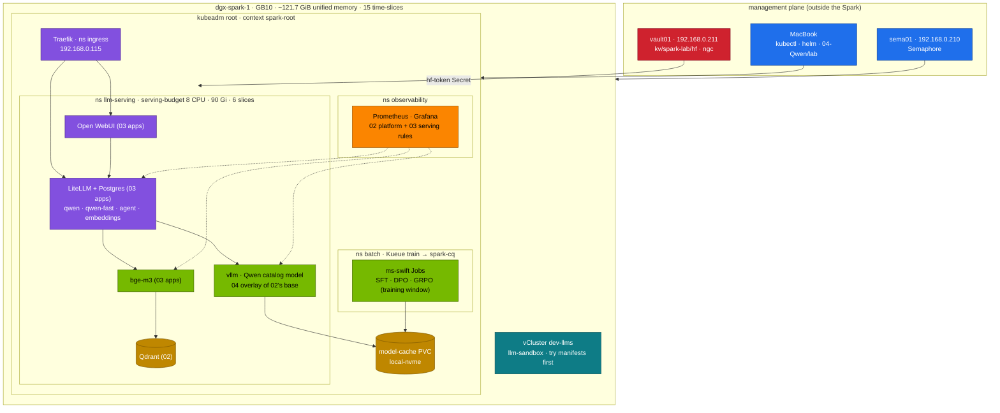

# 04-Qwen · Qwen models on a DGX Spark

This module takes Alibaba's Qwen model family — Qwen2.5 and Qwen3, dense and MoE, the Coder, Math, reasoning (QwQ / thinking mode) and vision-language models — from architecture to a served, fine-tuned and observed service on the lab platform built in [01-Ansible](../01-Ansible/README.md) and [02-Kubernetes](../02-Kubernetes/README.md): one DGX Spark (`dgx-spark-1`, an optional `dgx-spark-2`), a kubeadm root cluster, and the shared LLM memory pool of ~90 GiB.

It is a companion to [03-DeepSeek](../03-DeepSeek/README.md), not a copy of it. The serving base (02's vLLM Deployment), the application stack (LiteLLM, Open WebUI, BGE-M3, the RAG tooling) and the dashboards and alerts are 03's and 02's; this module adds a Qwen model catalog, ms-swift training jobs and three Qwen-specific tools, and says in each chapter how to point the shared pieces at a Qwen model.

**Start here:** [Chapter 00 · Qwen Step-by-Step Guide](00-qwen-step-by-step-guide.md) for the reading order and prerequisites, and [`lab/README.md`](lab/README.md) for the lab files.

---

## Parts and chapters

| Part | Chapter | What you do |
|---|---|---|
| – | [00 · Qwen Step-by-Step Guide](00-qwen-step-by-step-guide.md) | prerequisites, reading order, the path through the lab |
| I · Models | [01 · Qwen architecture & model family](01-qwen-architecture-and-model-family.md) | GQA, RoPE/YaRN, DCA; Qwen2.5 → Qwen3, dense and MoE; memory per model on GB10 |
| | [02 · Coder, Math & reasoning models](02-coder-math-and-reasoning-models.md) | FIM for Coder, tool-integrated reasoning for Math, QwQ and Qwen3 thinking mode |
| | [03 · Vision-language models](03-vision-language-models.md) | Qwen-VL image and video input, multimodal document pipelines |
| II · Serving | [04 · Serving Qwen with vLLM & SGLang](04-serving-qwen-with-vllm-and-sglang.md) | the catalog, `serve-model.sh`, parsers, prefix caching, SGLang |
| | [05 · Quantization & local engines](05-quantization-and-local-engines.md) | AWQ, GPTQ, FP8; TensorRT-LLM; GGUF and llama.cpp |
| | [06 · Kubernetes deployment & weight caching](06-kubernetes-deployment-and-weight-caching.md) | generated overlays of 02's vLLM base, budgets, `model-cache` |
| III · Fine-tuning | [07 · ms-swift & supervised fine-tuning](07-ms-swift-and-sft.md) | ms-swift in `batch`, the training window, SFT |
| | [08 · PEFT & alignment](08-peft-and-alignment.md) | LoRA/QLoRA, DPO, SimPO, GRPO with ms-swift |
| | [09 · Synthetic data & self-play](09-synthetic-data-and-self-play.md) | rejection sampling with verifiers, judges, filtering, iterated RFT |
| IV · Applications | [10 · Qwen-Agent & function calling](10-qwen-agent-and-function-calling.md) | tool-call and reasoning parsers, `fc_check.py`, guarded agents, Qwen-Agent |
| | [11 · RAG with Qwen, BGE & Qdrant](11-rag-with-qwen-bge-and-qdrant.md) | 03's RAG stack with a Qwen chat model; hybrid search, reranking, long context |
| | [12 · Open WebUI & LiteLLM](12-open-webui-and-litellm.md) | Qwen aliases, thinking on/off, limits, Open WebUI presets |
| V · Operations | [13 · Telemetry & troubleshooting](13-telemetry-and-troubleshooting.md) | dashboards and alerts for Qwen, the troubleshooting playbook |
| | [14 · Hands-on workbook](14-hands-on-workbook.md) | 24 exercises, CPU solutions, capstone |

---

## The stack on the current platform

| Layer | What runs | Where it comes from |
|---|---|---|
| Host, drivers, GPU telemetry, secrets | DGX OS (headless), GPU Operator with 15 time-slices, textfile collector, vault01 | [01-Ansible](../01-Ansible/README.md) |
| Cluster, quotas, scheduling, ingress, metrics | kubeadm root, Cilium, MetalLB, Traefik at 192.168.0.115, Kueue, KEDA, KServe, kube-prometheus-stack | [02-Kubernetes](../02-Kubernetes/README.md) |
| Serving base | vLLM Deployment `vllm`, PVC `model-cache`, Qdrant, KEDA ScaledObject | 02's `manifests/root-llms/` |
| Applications | LiteLLM, PostgreSQL, Open WebUI, bge-m3, RAG and streaming tools, serving rules and dashboard | [03-DeepSeek lab](../03-DeepSeek/lab/README.md) |
| Qwen | catalog, generated overlays, ms-swift Jobs, `fc_check.py`, `synth_data.py`, `qwen_agent_demo.py` | [this module's lab](lab/README.md) |

## Rules every chapter follows

- **Memory.** The LLM pool on the root is ~90 GiB, shared by `llm-serving` and `batch`. The sum of vLLM `--gpu-memory-utilization` over all models running at the same time stays ≲ 0.72 (util × ~121.7 GiB; 0.20 ≈ 24 GiB). Every GPU container sets memory request = limit. A 32B BF16 model (util 0.70) runs alone with everything else parked.
- **Training** runs in `batch` through Kueue (`train` → `spark-cq`) inside the training window (02-Kubernetes Chapter 14): vLLM parked, `spark-cq` raised to 8 CPU · 80 Gi · 3 slices; each pod ≤ 8 CPU · ≤ 80 Gi · 1 slice, request = limit.
- **Admission** on the root: pinned image tags (see `lab/versions.env`), a readinessProbe on serving Deployments, no `NVIDIA_VISIBLE_DEVICES` env.
- **Secrets** come from vault01 (`kv/spark-lab/hf` for the Hugging Face token, synced to Secret `hf-token` in `llm-serving`), never from files in the repo.
- **Contexts.** `spark-root` runs the models; `dev-llms` (namespace `llm-sandbox`, 2 CPU · 4 Gi · 2 slices) is where you try a manifest or `qwen3-0.6b` first (`scripts/serve-model.sh qwen3-0.6b --sandbox`).
- **Versions.** Qwen generations, vLLM parsers and image tags change often: the lab pins what it tested in `lab/versions.env` and `lab/models.yaml`; for anything newer, check the current release and the model card.
